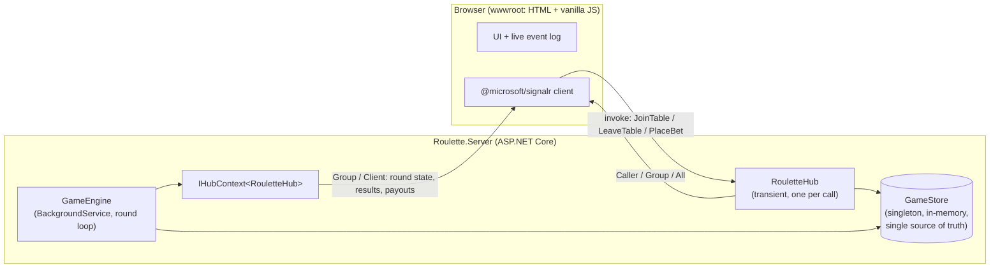

# Realtime Roulette

A tiny "Mini Roulette" game built to learn **real-time push design**, **ASP.NET Core SignalR**, and **scaling with a Redis backplane**, as interview preparation for an online casino / sports betting company.

The game itself doesn't matter. Every feature exists to teach a concept, and the [`docs/`](docs/) folder is the long-term study material.

## The game

- Players open the page, enter a nickname and join `table-1` or `table-2`.
- Everyone starts with **1000 credits**.
- Each table runs its own round loop on the server:
  `BettingOpen (10s) → BettingClosed (2s) → Result (0–36) + Payout (shown 5s) → next round`
- Bets: **Red / Black** pay 2x, a **single number** pays 36x. **0 is green**, so every colour bet loses on 0.
- Everyone at a table sees the round state and countdown, the players, all bets, and the result.
- Each player privately sees their own balance and win/loss.
- A global **jackpot** grows by 1% of every bet and is shown to everyone on every table.

## Architecture (Phase 1: one server, in memory)



| Push target | Used for | Why |
|---|---|---|
| `Clients.Caller` | `Welcome`, `Joined` snapshot, `BetRejected`, `BalanceUpdated` | Only the connection that made the call cares |
| `Clients.Group(tableId)` | `RoundStateChanged`, `BetPlaced`, `RoundResult`, `PlayersChanged` | Everyone at the table, nobody else |
| `Clients.Client(connectionId)` | `PlayerRoundResult` (from the engine) | Private message with no caller (a background service sends it) |
| `Clients.User(userId)` | *(Phase 2)* private messages to every tab of one logged-in player | Needs authentication first |
| `Clients.All` | `JackpotUpdated` | Global information |

## Folder structure

```
Real-Time-Push/
├─ RealtimeRoulette.slnx          (.NET 10 solution, XML format)
├─ README.md
├─ docs/                          study notes, see the learning path below
└─ src/
   └─ Roulette.Server/
      ├─ Program.cs               DI, SignalR, static files, hub route
      ├─ Hubs/RouletteHub.cs      client -> server methods + lifecycle
      ├─ Game/GameEngine.cs       BackgroundService round loop, pushes via IHubContext
      ├─ Game/GameStore.cs        all state + rules, behind one lock
      ├─ Game/BetRules.cs         pure roulette rules (colours, payouts)
      ├─ Game/Models.cs           messages sent to clients (records)
      ├─ Game/TableState.cs       mutable server-side Table / Player
      └─ wwwroot/                 index.html, app.js, app.css
```

Later phases add `Roulette.PubSubDemo`, `Roulette.LoadTest`, `docker-compose.yml` and an nginx load balancer.

## How to run

Requires the .NET 10 SDK (any .NET 8+ SDK works if you change `TargetFramework`).

### Phase 1

```powershell
dotnet run --project src/Roulette.Server
```

Open <http://localhost:5000> in two browser windows (e.g. one normal and one private/incognito), join the same table with different nicknames, and watch the **live event log** on the right.

### Phase 2–4

*Added as each phase is built.*

## Hands-on training

Want to build a SignalR app yourself from scratch? Follow [training/](training/README.md): a step-by-step **LiveChat** course (Part 1: hub, singleton, background service, browser + console clients; Part 2: two servers + Redis backplane).

## Learning path

| # | Doc | Read it when |
|---|---|---|
| 0 | [How to play](docs/00-how-to-play.md) | First: roulette rules, the round cycle, reading the event log |
| 1 | [Real-time push fundamentals](docs/01-realtime-push-fundamentals.md) | Before Phase 1: polling, SSE, WebSockets |
| 1b | [Short and long polling](docs/01b-short-and-long-polling.md) | How long polling works, real captures, build-it-yourself |
| 1a | [WebSockets explained](docs/01a-websockets-explained.md) | Handshake, frames, heartbeats, hands-on raw socket |
| 2a | [How SignalR works (plain language)](docs/02a-signalr-how-it-works.md) | Negotiation and fallback, RPC in both directions, DI lifetimes |
| 2 | [SignalR concepts](docs/02-signalr-concepts.md) | During Phase 1 and 2 (reference) |
| 3 | [Casino real-time patterns](docs/03-casino-realtime-patterns.md) | Phase 1 (timing, validation), Phase 2 (reliability) |
| 4 | [Scaling and Redis](docs/04-scaling-and-redis.md) | Phase 3, the most important one |
| 5 | [Diagnostics under load](docs/05-diagnostics-under-load.md) | Phase 4 |
| 6 | [Interview questions](docs/06-interview-questions.md) | After each phase |
| 7 | [Cheatsheet](docs/07-cheatsheet.md) | The night before the interview |
| + | [Extra topics](docs/extra/README.md) | Background not specific to this project: HTTP essentials, C10k, `Thread.Sleep` vs `Task.Delay` |

## Phase status

- [x] Phase 1: basic SignalR (single server, in memory)
- [ ] Phase 2: reliability patterns (typed hub, seq numbers, resync, idempotency, auth, throttling)
- [ ] Phase 3: scale out with a Redis backplane, shared state, leader election, load balancer
- [ ] Phase 4: load testing and diagnostics
