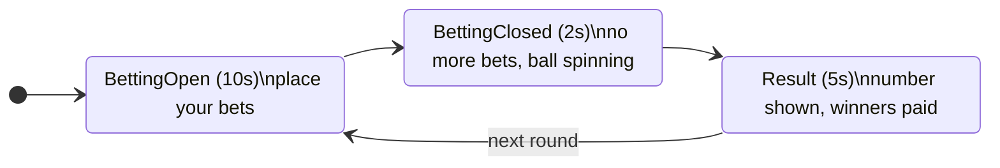

# 00: How to play Mini Roulette

You don't need to know casino games to use this project. This page explains roulette from zero, then how to play it in our web page and what every message in the event log means.

## Roulette in 30 seconds

A roulette wheel has **37 pockets** numbered **0 to 36**:

- **18 Red** numbers: 1, 3, 5, 7, 9, 12, 14, 16, 18, 19, 21, 23, 25, 27, 30, 32, 34, 36
- **18 Black** numbers: all the other numbers from 1 to 36
- **0 is Green**: the only green pocket

The croupier (the casino employee) spins the wheel and a ball lands in one pocket. Before the spin, players **bet** on where it will land. Guess right and you win; guess wrong and you lose what you bet.

## Glossary

| Term | Meaning |
|---|---|
| **Credits** | Play money. Everyone starts with **1000**. |
| **Balance** | How many credits you have right now. |
| **Bet** (or **stake**) | Credits you put on a guess. They leave your balance **immediately**. |
| **Target** | What you bet on: **Red**, **Black**, or **one number** (0–36). |
| **Round** | One cycle of "bet → spin → pay". Rounds repeat forever, each with a number (`round #12`). |
| **Result** | The number the ball lands on. The **server** picks it at random. |
| **Payout** | What you get back when you win, **including your original bet**. |
| **Table** | An independent game with its own wheel and rounds. `table-1` and `table-2` don't affect each other. |
| **Jackpot** | A shared counter that grows by **1% of every bet on every table**. In this project it only grows and is never won. It exists to teach "send to everybody" (`Clients.All`). |
| **House edge** | The casino's built-in advantage: the green 0 makes every bet slightly more likely to lose than win. |

## Winning and losing

| You bet on | You win when | You get back | Chance |
|---|---|---|---|
| **Red** | the result is a red number | **2×** your bet | 18 / 37 ≈ 49% |
| **Black** | the result is a black number | **2×** your bet | 18 / 37 ≈ 49% |
| **One number** (e.g. 17) | the result is exactly that number | **36×** your bet | 1 / 37 ≈ 2.7% |

> When **0** comes up, **every Red and Black bet loses**. That's the house edge.

### Worked examples (starting balance 1000)

**100 on Red.** Your balance becomes **900** right away.
- Result **14 (Red)** → you get **200** back → balance **1100**, you **won 100**.
- Result **15 (Black)** or **0 (Green)** → you get **0** → balance stays **900**, you **lost 100**.

**10 on number 17.** Your balance becomes **990**.
- Result **17** → you get **360** back → balance **1350**, you **won 350**.
- Anything else → balance stays **990**, you **lost 10**.

You can place **several bets in one round**, e.g. 50 on Red **and** 10 on number 7.

## The round cycle

Every table runs this loop forever, driven by the server:



| Phase | Countdown | What you can do |
|---|---|---|
| **BettingOpen** | 10 → 0 | Place bets. This is the **only** phase where bets are accepted. |
| **BettingClosed** | 2 → 0 | Nothing. In a real casino the ball is spinning now. |
| **Result** | 5 → 0 | Look at the winning number and your private result. Payouts have already been added. |

So if you see a countdown from **5** to 0, you're looking at the **Result** phase. The label next to the countdown tells you which phase you're in.

## How to play on the page

1. Start the server (`dotnet run --project src/Roulette.Server`) and open <http://localhost:5000>.
2. Type a nickname, choose **table-1**, and click **Join**. Nothing much happens until you join a table: most messages are only sent to players **at** a table.
3. Wait for the label to say **BettingOpen**.
4. In **Your bet**, enter an amount (e.g. `50`), choose a target (`Red`, `Black` or `Number 0`–`Number 36`), and click **Place bet**.
   - Your **Balance** drops by the amount.
   - Your bet appears in **Bets this round**.
5. About 12 seconds later the **Round** box shows the winning number and its colour.
6. The gold **Private to you** box says something like *"Round 12: you bet 50, got back 100, so you won 50."*
7. Repeat. To see multiplayer, open a **second window** (e.g. an incognito window), join the **same table** with another nickname, and watch both players' bets appear in both windows.

### Small experiments

| Try | Expected | Concept |
|---|---|---|
| Bet more than your balance | `BetRejected: Insufficient balance` | The server validates every bet |
| Tick *Keep the bet button enabled* and bet during BettingClosed | `BetRejected: Betting is closed` | The server owns the clock |
| Move one window to table-2 | It stops seeing table-1's bets but still sees the jackpot change | Group vs All |
| Refresh the page | You're a new player with 1000 credits | Phase 1 identifies you by connection only (fixed in Phase 2) |

## Reading the live event log

- **⬆** = your browser **sent** this to the server (a hub method call).
- **⬇** = the server **pushed** this to your browser.
- **⚠** = an error.

| Message | Direction | Who receives it | Meaning |
|---|---|---|---|
| `Welcome` | ⬇ | only you | You're connected. Contains your connection id and the current jackpot. |
| `JoinTable` | ⬆ | | You asked to sit at a table. |
| `Joined` | ⬇ | only you | The table's full current state: round, players, bets, your balance. |
| `PlayersChanged` | ⬇ | everyone at the table | Someone joined or left. |
| `RoundStateChanged` | ⬇ | everyone at the table | New phase. `endsAtUtc` = when this phase ends. |
| `PlaceBet` | ⬆ | | You placed a bet. |
| `BetPlaced` | ⬇ | everyone at the table | Someone at your table (maybe you) placed a bet. |
| `BalanceUpdated` | ⬇ | only you | Your bet was accepted. Here's your new balance. |
| `BetRejected` | ⬇ | only you | Your bet was refused, with the reason. |
| `RoundResult` | ⬇ | everyone at the table | The winning number and its colour. |
| `PlayerRoundResult` | ⬇ | only you | How the round went for you: bet, payout, net, new balance. |
| `JackpotUpdated` | ⬇ | **everyone, all tables** | The jackpot grew. |
| `LeaveTable` / `Left` | ⬆ / ⬇ | only you | You left the table. |

One round at a table looks like this in the log (newest at the top of the page; shown here oldest first):

```
⬇ RoundStateChanged   {"phase":"BettingOpen","endsAtUtc":"...:10.000",...}
⬆ PlaceBet            [50,"Red"]
⬇ BetPlaced           {"bet":{"nickname":"alice","amount":50,"target":"Red"}}
⬇ BalanceUpdated      {"balance":950}
⬇ JackpotUpdated      {"amount":0.5}
⬇ RoundStateChanged   {"phase":"BettingClosed",...}
⬇ RoundStateChanged   {"phase":"Result",...}
⬇ RoundResult         {"number":14,"color":"Red"}
⬇ PlayerRoundResult   {"totalBet":50,"totalPayout":100,"net":50,"balance":1050}
```

To understand *how* these messages travel, read [01a: WebSockets explained](01a-websockets-explained.md) and [02a: How SignalR works](02a-signalr-how-it-works.md).
