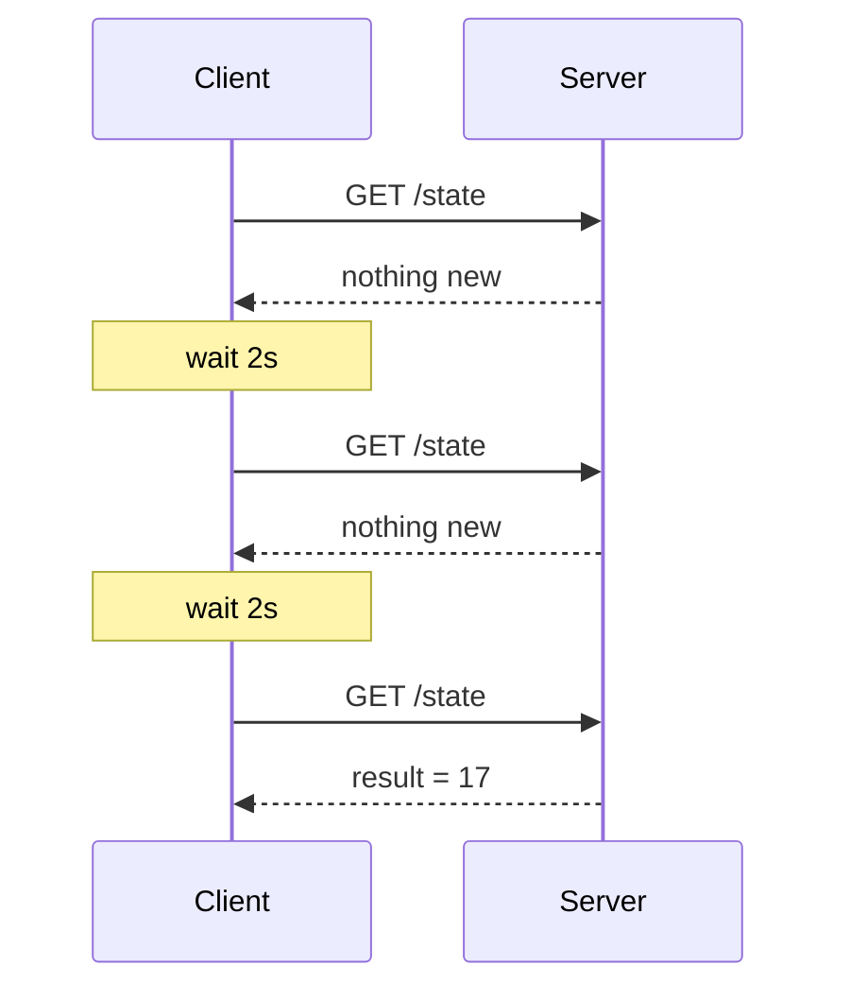
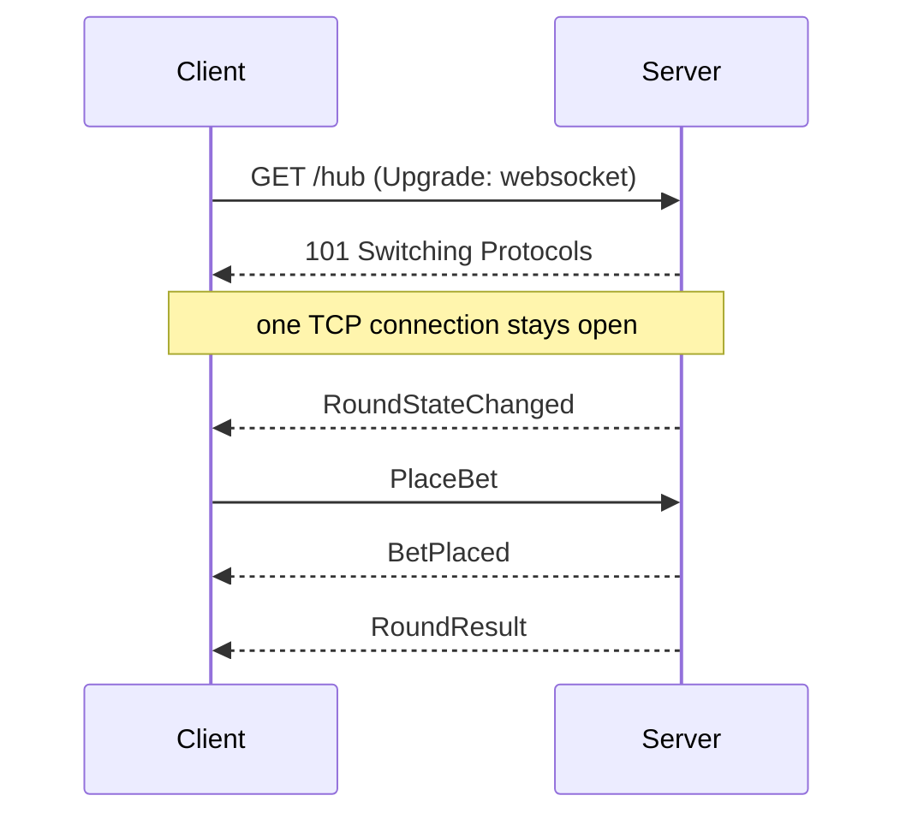

# 01: Real-time push fundamentals

HTTP was designed as **request → response**. The client asks, the server answers, done. "Real-time" means the **server** needs to tell the client something *when it happens*: a roulette result, a price change, a goal scored. There are four classic ways to do that.

## 1. Short polling

The client asks every N seconds: "anything new?"

- ✅ Dead simple, works everywhere, stateless, cacheable.
- ❌ Latency is up to N seconds. Most requests are wasted. With 50k players polling every second that's 50k requests/second for mostly "nothing new".
- Use it for dashboards that refresh every 30 s, or as a fallback.

## 2. Long polling

The client asks, and the server **holds the request open** until there is news (or a timeout). Then the client immediately asks again.

- ✅ Near-real-time, works through any proxy (it's plain HTTP).
- ❌ One request per message, plus headers each time. Message ordering is awkward. Each held request still costs a connection.
- SignalR uses it as its **last-resort fallback transport**.
- Deep dive with real captures and a working implementation: [01b: Short and long polling](01b-short-and-long-polling.md).

## 3. Server-Sent Events (SSE)

One long-lived HTTP response where the server writes `data: ...\n\n` lines whenever it wants (`text/event-stream`, the browser `EventSource` API).

- ✅ Real push, plain HTTP, the browser reconnects automatically (with `Last-Event-ID`!), easy through proxies.
- ❌ **One direction only** (server → client). Client → server needs separate HTTP calls. Text only. Under HTTP/1.1 browsers allow only ~6 connections per domain (not an issue with HTTP/2).
- Great fit for read-only feeds: odds tickers, notifications. SignalR's **second** transport choice.

## 4. WebSockets

An HTTP request that **upgrades** (`Upgrade: websocket`, status `101 Switching Protocols`) into a persistent, **full-duplex** TCP channel with tiny frame overhead (2–14 bytes).

- ✅ Lowest latency and overhead, both directions, binary or text.
- ❌ **Stateful**: every client holds an open connection to a *specific* server, which makes load balancing and scaling harder (→ [doc 04](04-scaling-and-redis.md)). Some corporate proxies break it. You must handle reconnects, heartbeats and message ordering yourself, unless a library like SignalR does it.
- SignalR's **first** transport choice.
- Deep dive with real captures and a hands-on exercise: [01a: WebSockets explained](01a-websockets-explained.md).

## Comparison

| | Short polling | Long polling | SSE | WebSockets |
|---|---|---|---|---|
| Direction | client pulls | client pulls (server delays) | server → client | both |
| Latency | up to interval | low | low | lowest |
| Overhead per message | full HTTP request | full HTTP request | small | tiny frame |
| Connection | short-lived | held, re-opened | persistent | persistent |
| Proxy friendliness | best | good | good | sometimes blocked |
| Auto-reconnect built in | n/a | n/a | yes (browser) | no (DIY / library) |

## Persistent connections: what changes for the server

Once connections are persistent, the server is no longer "stateless request handling":

- **Memory per connection**: buffers, a connection object, group memberships. 50k connections × a few KB adds up fast.
- **OS limits**: file descriptors and ephemeral ports. Tune `ulimit` on Linux.
- **Load balancing**: a connection is stuck on one server, so you cannot rebalance it without disconnecting it.
- **Deployments**: restarting a server drops every connection on it, so clients must reconnect *and resync* (→ Phase 2).
- **Fan-out**: one event (a roulette result) might need to reach 10,000 connections spread across 10 servers (→ backplane, Phase 3).
- **Liveness**: a dead TCP connection can look alive for minutes, so you need application heartbeats (SignalR keep-alive pings).

## Trade-offs: which to choose?

- Need **two-way, low latency, high frequency** (betting, chat, games)? **WebSockets** (via SignalR).
- Only **server → client** and want simplicity? **SSE**.
- Updates are rare or freshness doesn't matter? **Polling**.
- Don't want to choose per client? **SignalR**: it negotiates the best transport available and falls back automatically.

## In this project

Phase 1 runs on WebSockets by default. Open DevTools → Network → **WS** and click the `roulette?id=...` row → **Messages** to see the raw frames. Each frame ends with the `0x1E` record separator character used by the SignalR JSON protocol.
