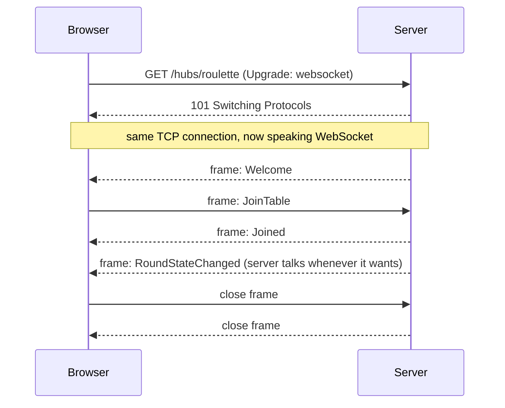

# 01a: WebSockets explained

WebSockets is the technology you'll hear about most in real-time systems. This page explains it in plain language first, then in detail, and ends with a hands-on exercise against our own server.

## The problem WebSockets solves

Normal HTTP works like **sending letters**:

> You write a letter (request), post it, and wait for a reply (response). The post office never brings you a letter you didn't ask for.

For a roulette game that's a problem. The **server** knows when the ball lands, but it can't tell you, because you didn't ask. You'd have to keep asking "did it land yet?" (polling, see [doc 01](01-realtime-push-fundamentals.md)).

WebSockets turns this into a **phone call**:

> You call once, the line stays open, and **either side can talk at any moment** until someone hangs up.

| | HTTP (letters) | WebSocket (phone call) |
|---|---|---|
| Who starts a message | only the client | **both** sides, any time |
| Connection | usually opened per request (or reused, but still request→response) | **one** connection stays open for minutes or hours |
| Overhead per message | headers, often hundreds of bytes | **2–14 bytes** of framing |
| State | stateless | **stateful**: the server knows who is on the line |

## Step 1: the handshake (the call starts as HTTP)

A WebSocket connection **starts as a normal HTTP request** asking the server to switch protocols. That's why it works on ports 80/443 and passes through most HTTP infrastructure.

Captured from our own server (`curl` against `/hubs/roulette`):

```http
GET /hubs/roulette?id=6S1HmbrGdZ3DvMjg-RtTUg HTTP/1.1
Host: localhost:5000
Connection: Upgrade
Upgrade: websocket
Sec-WebSocket-Version: 13
Sec-WebSocket-Key: dGhlIHNhbXBsZSBub25jZQ==
```

```http
HTTP/1.1 101 Switching Protocols
Connection: Upgrade
Upgrade: websocket
Sec-WebSocket-Accept: s3pPLMBiTxaQ9kYGzzhZRbK+xOo=
Server: Kestrel
```

- **`Upgrade: websocket`**: "let's stop speaking HTTP on this connection".
- **`101 Switching Protocols`**: the server agrees. From now on the **same TCP connection** carries WebSocket frames, not HTTP.
- **`Sec-WebSocket-Key` / `Sec-WebSocket-Accept`**: a random value from the client. The server answers with `base64(SHA1(key + "258EAFA5-E914-47DA-95CA-C5AB0DC85B11"))`. It proves the server really understands WebSockets (and isn't an old cache replaying a response). **It is not security**: anyone can compute it.
- **`ws://`** = plain, **`wss://`** = over TLS (like `https`). Always use `wss://` in production. Many proxies only let WebSockets through when they're encrypted.



## What an HTTP message looks like vs a WebSocket frame

Both travel over the **same kind of TCP connection**, and TCP just carries bytes. The difference is **how those bytes are arranged**. All captures below were taken from our own server with a raw TCP socket (`\r\n` = the two bytes "carriage return, line feed").

### An HTTP/1.1 message: human-readable text

HTTP/1.1 doesn't really have "frames". A message is **plain text lines**, a **blank line**, then an optional body.

Request we sent:

```
GET /app.css HTTP/1.1\r\n          ← start line: METHOD  PATH  VERSION
Host: localhost:5000\r\n           ← headers, one "Name: value" per line
Accept: text/css\r\n
Connection: close\r\n
\r\n                               ← blank line = end of headers (no body for GET)
```

Response we got back:

```
HTTP/1.1 200 OK\r\n                ← status line: VERSION  CODE  REASON
Content-Length: 3030\r\n           ← how many body bytes follow
Connection: close\r\n
Content-Type: text/css\r\n
Date: Fri, 23 Oct 2026 08:51:07 GMT\r\n
Server: Kestrel\r\n
Accept-Ranges: bytes\r\n
ETag: "1dd60a2a3cbeed6"\r\n
Last-Modified: Tue, 20 Oct 2026 14:52:34 GMT\r\n
\r\n                               ← end of headers
:root {\n  --bg: #0f1a14; ...      ← body: exactly 3030 bytes
```

- The receiver reads **line by line** until the blank line, then reads `Content-Length` bytes of body. (Or it reads the body in chunks if the response uses `Transfer-Encoding: chunked`.)
- About **230 bytes of headers** to deliver this file, and **every request and every response** repeats a block like this.
- It's strictly **request → response**. The server can only *answer*; it can never start a message.

### A WebSocket frame: a tiny binary header + payload

After `101 Switching Protocols`, the same connection stops using text lines and starts using **binary frames**. Here's the first message our server sent back, the SignalR handshake reply `{}␞`, **the whole frame, all 5 bytes**:

```
81 03 7b 7d 1e
│  │  └──┬───┘
│  │     └─ payload: '{' '}' 0x1E  (3 bytes of UTF-8 text)
│  └─ 0x03 = 0000 0011 → MASK = 0 (server→client is not masked), payload length = 3
└─ 0x81 = 1000 0001 → FIN = 1 (complete message), opcode = 1 (text)
```

The browser→server frame we sent (`{"protocol":"json","version":1}␞`, 32 bytes) took **38 bytes**:

```
81 a0 | 37 fa 21 3d | 4c d8 51 4f 58 8e 4e 5e ...
│  │    └─ 4-byte masking key (random per frame)
│  └─ 0xa0 = 1010 0000 → MASK = 1 (client→server MUST be masked), length = 32
└─ FIN = 1, opcode = 1 (text)
   payload = each byte XOR'd with the mask key; the server un-XORs it back to the JSON text
```

A larger message, our 129-byte `Welcome`, uses the **extended length** form:

```
81 7e 00 81 | {"type":1,"target":"Welcome",...
      └─┬─┘
        └─ length byte 0x7e (=126) means "the real length is in the next 2 bytes": 0x0081 = 129
```

Length encoding: **0–125** fits in the 7-bit field; **126** → the next 2 bytes hold the length (up to 64 KB); **127** → the next 8 bytes hold it.

### Side by side

| | HTTP/1.1 message | WebSocket frame |
|---|---|---|
| Format | text lines + blank line + body | binary header + payload |
| Overhead | usually 200–800+ bytes of headers | **2–14 bytes** |
| How the receiver finds the end | blank line, then `Content-Length` or chunked encoding | length field in the header |
| Who can send | client asks, server answers | **either side, any time** |
| Metadata | rich: method, path, status, headers, cookies, caching… | almost none: FIN, opcode, mask, length |
| Meaning of the content | defined by method, path and headers | **none**: the app decides (SignalR: JSON with `type`/`target`) |

**HTTP/2 and HTTP/3 do use binary frames**, but they're a different kind: frames there carry headers and body pieces of many parallel request/response pairs. See [extra/http-protocol.md](extra/http-protocol.md).

## Step 2: frames (how messages travel)

After the handshake, data moves in **frames**. Each frame has a tiny header:

| Field | Meaning |
|---|---|
| **FIN** bit | "this is the last piece of the message" (big messages can be split into several frames) |
| **Opcode** | what kind of frame (see below) |
| **Mask** bit + 4-byte key | frames **from the browser** are always XOR-masked. This stops a malicious page from tricking a naive proxy into caching fake data. Server→client frames are not masked. |
| **Payload length** | 7 bits, or 16 or 64 bits for larger payloads |

| Opcode | Frame type | Used for |
|---|---|---|
| `0x1` | **Text** | UTF-8 text, e.g. SignalR's JSON messages |
| `0x2` | **Binary** | raw bytes, e.g. SignalR's MessagePack protocol |
| `0x8` | **Close** | "I'm hanging up", with a close code |
| `0x9` / `0xA` | **Ping / Pong** | "are you still there?" / "yes" |

WebSocket itself only says "here is a text message" or "here is a binary message". **It has no idea what the message means.** There are no method names, no request ids, no "reply to message #3". Any meaning is up to the application, and that's where SignalR comes in (see [02a](02a-signalr-how-it-works.md)).

## Step 3: staying alive and hanging up

### Why heartbeats are needed
A TCP connection can **die silently**: a Wi-Fi switch, a laptop going to sleep, or a NAT router forgetting the connection. Neither side gets a notification. Without traffic, the server may think a player is still connected for many minutes.

- WebSocket has **ping/pong** control frames for this, but **browser JavaScript cannot send them**. Only browsers and servers do, internally.
- Proxies and load balancers often close connections that are **idle for 60 s** or so.
- So libraries send **application-level heartbeats**. SignalR sends `{"type":6}` every 15 s in both directions. You can see them in DevTools.

### Close codes

| Code | Meaning |
|---|---|
| `1000` | Normal closure |
| `1001` | Going away (tab closed, server shutting down) |
| `1006` | **Abnormal**: the connection dropped without a close frame (network loss). It's never actually sent; the browser reports it locally. |
| `1008` | Policy violation (e.g. auth failed) |
| `1009` | Message too big |
| `1011` | Server error |

## The browser API

The browser's built-in WebSocket API is small:

```js
const ws = new WebSocket("wss://example.com/socket");
ws.onopen    = () => ws.send("hello");                  // connected
ws.onmessage = (e) => console.log("got", e.data);       // text or binary
ws.onclose   = (e) => console.log("closed", e.code);    // 1000, 1006, ...
ws.onerror   = () => console.log("error");               // details are hidden on purpose
// ws.readyState: 0 CONNECTING, 1 OPEN, 2 CLOSING, 3 CLOSED
// ws.bufferedAmount: bytes queued but not yet sent (a sign of backpressure)
```

**Note:** `new WebSocket(url)` has **no way to set custom headers** such as `Authorization: Bearer ...`. That's why tokens are usually passed in the **query string** (`?access_token=...`). We'll do exactly this in Phase 2.

## What raw WebSockets do NOT give you

| You need… | Raw WebSocket | SignalR adds |
|---|---|---|
| Reconnect after a drop | ❌ you write it | ✅ `withAutomaticReconnect()` |
| "Call function X with arguments Y" | ❌ just text/bytes | ✅ hub methods and client handlers (RPC) |
| Match a reply to a request | ❌ | ✅ `invocationId` + `invoke()` promise |
| Send to a table / a user / everyone | ❌ you track every socket | ✅ `Groups`, `Clients.User`, `Clients.All` |
| Heartbeats through proxies | ❌ | ✅ keep-alive pings + timeouts |
| A fallback when WebSockets are blocked | ❌ the connection just fails | ✅ SSE / long polling |
| Several servers | ❌ | ✅ backplane (Phase 3) |
| **Guaranteed delivery** | ❌ | ❌ **neither!** You design it (Phase 2) |

## Raw WebSockets in ASP.NET Core (for comparison)

This is what you'd write **without** SignalR: one loop per connection, and you manage everything else yourself.

```csharp
app.UseWebSockets();
app.Map("/raw", async context =>
{
    if (!context.WebSockets.IsWebSocketRequest) { context.Response.StatusCode = 400; return; }

    using var socket = await context.WebSockets.AcceptWebSocketAsync(); // sends the 101
    var buffer = new byte[4096];

    while (socket.State == WebSocketState.Open)
    {
        var result = await socket.ReceiveAsync(buffer, CancellationToken.None);
        if (result.MessageType == WebSocketMessageType.Close) break;

        // Echo it back. Groups, users, reconnects and scaling are all up to you.
        await socket.SendAsync(buffer.AsMemory(0, result.Count), WebSocketMessageType.Text, true, CancellationToken.None);
    }
});
```

## Infrastructure gotchas (interview favourites)

- **Load balancers / reverse proxies** must forward the `Upgrade` and `Connection` headers (nginx needs `proxy_set_header Upgrade $http_upgrade; proxy_set_header Connection "upgrade";`). We'll configure this in Phase 3.
- **Idle timeouts** (nginx's default `proxy_read_timeout` is 60 s, Azure LB is about 4 min) silently kill quiet connections unless heartbeats are more frequent.
- **Stateful connections**: a client is pinned to one server for the life of the connection. Rolling deployments disconnect clients, so plan for reconnect storms.
- **Security**: use `wss://`. **Check the `Origin` header** (otherwise another website can open a socket with your user's cookies: *Cross-Site WebSocket Hijacking*). Limit the message size. Authenticate during the handshake.
- **HTTP/2 and HTTP/3** can also carry WebSockets (RFC 8441 / 9220), several on one TCP connection. Kestrel supports this.

## Hands-on: speak to our hub with a raw WebSocket

Run the server, open <http://localhost:5000>, press **F12** → **Console**, and paste:

```js
const RS = "\x1e"; // SignalR ends every JSON message with this "record separator" character
const raw = new WebSocket("ws://localhost:5000/hubs/roulette");
raw.onmessage = (e) => console.log("⬇", e.data);
raw.onopen = () => {
  raw.send('{"protocol":"json","version":1}' + RS);   // SignalR handshake
  setTimeout(() => raw.send(
    '{"type":1,"invocationId":"0","target":"JoinTable","arguments":["table-1","raw-ws"]}' + RS), 200);
};
```

You'll see `{}` (handshake OK), then `Welcome`, `Joined`, a `{"type":3,...}` completion, and then `RoundStateChanged` every few seconds. **You are using SignalR without the SignalR library.** It's just JSON text inside WebSocket frames. Your other browser windows at table-1 will show a player called `raw-ws`. Close it with `raw.close()`.

(Tested against this project: it works because SignalR lets WebSocket clients skip the negotiate step.)

## Key takeaways

1. A WebSocket starts as an **HTTP request** and is **upgraded** (`101`) to a persistent, two-way connection.
2. It carries **text or binary frames** with tiny overhead. It knows nothing about what the messages mean.
3. Connections can **die silently**, so heartbeats are required.
4. Browsers **can't set headers**, so tokens go in the query string.
5. It is **stateful**, which makes load balancing, deployments and scaling harder.
6. SignalR = WebSockets + a message format + RPC + groups + reconnect + fallback + scale-out.
