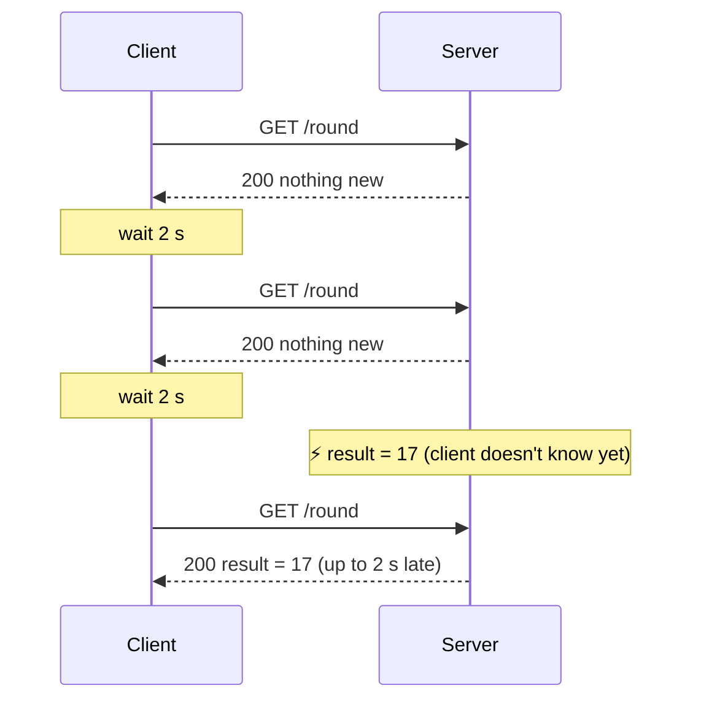
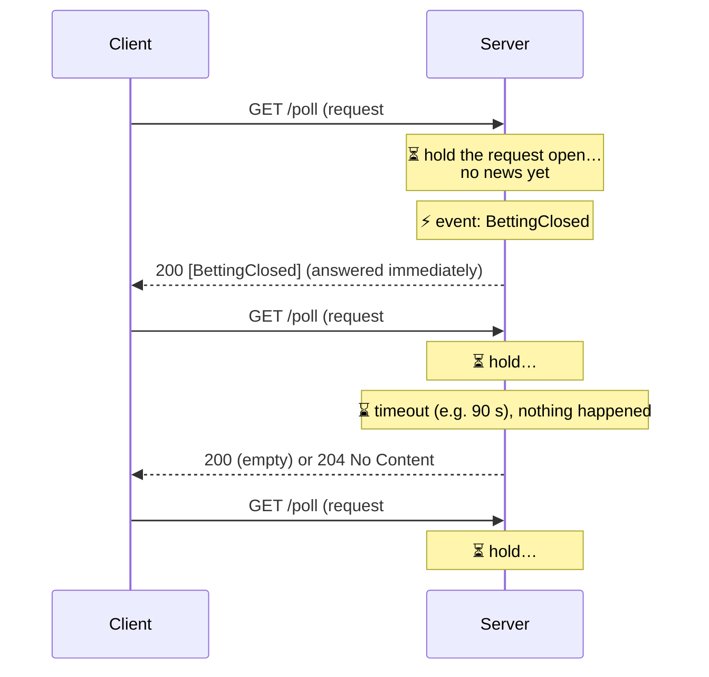
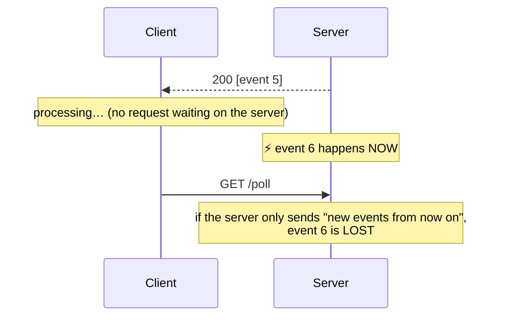

# 01b: Short polling and long polling

Both techniques solve the same problem with plain HTTP: **"the server has news, but HTTP only lets the client ask."** This page covers short polling briefly and **long polling in depth**, with real captures from this project and a small do-it-yourself implementation you can run.

Related: [01: fundamentals](01-realtime-push-fundamentals.md) · [01a: WebSockets](01a-websockets-explained.md) · [02a: How SignalR works](02a-signalr-how-it-works.md)

## A restaurant analogy

You've ordered food and want to know when it's ready.

- **Short polling**: you walk to the kitchen every 2 minutes and ask "is it ready?" Usually the answer is "no". You waste trips, and if the food is ready right after you asked, it goes cold for up to 2 minutes.
- **Long polling**: you walk to the kitchen and say "**I'll wait here until it's ready**". The chef answers the moment it's done. If nothing happens for a long time, the chef eventually says "still not ready, ask again", and you immediately start waiting again.
- **WebSocket**: you're given a buzzer. The kitchen buzzes you whenever there's news, and you can talk back through it.

---

## Part 1: Short polling (recap)

The client asks on a fixed timer, and the server answers **immediately**, whether or not there's news.



```js
setInterval(async () => {
  const res = await fetch("/api/round");
  render(await res.json());
}, 2000);
```

### The numbers

| | Value |
|---|---|
| **Average delay** | interval / 2 (1 s for a 2 s interval), worst case = the full interval |
| **Requests per client** | 1 / interval, *whether or not anything changed* |
| **50,000 players, 1 s interval** | **50,000 requests/s**, nearly all answered "nothing new" |

Lowering the interval reduces delay but multiplies the load. Raising it does the reverse. **You can't have both.** That trade-off is the whole problem.

### Making short polling cheaper
- **Conditional requests**: send `If-None-Match: "<etag>"`. The server answers **`304 Not Modified`** with no body when nothing changed.
- **Adaptive interval**: poll faster when something is about to happen (betting about to close), and slower when idle or the tab is hidden (`document.visibilityState`).
- **Jitter**: add a random ±10% to the interval so 50k clients don't all hit the server in the same millisecond after a deploy.
- **CDN caching**: if every user sees the same data (e.g. a public scoreboard), a CDN can answer most polls.

### When short polling is the right choice
Data changes rarely, a few seconds of delay is fine, and you want **maximum simplicity**: dashboards, a job status page, "check for new version". It's stateless, cacheable, and works through any proxy.

---

## Part 2: Long polling

### The idea in one sentence
The client sends a request, and the server **does not answer until it has something to say** (or a timeout passes). As soon as the client gets an answer, it **immediately sends the next request**.

So there is (almost) **always one request waiting on the server**, ready to be answered the moment news arrives. The delay drops from "up to one interval" to roughly one network round trip, using only plain HTTP.

### The loop



Each request ends in one of two ways:

| Outcome | Server answers | Client does |
|---|---|---|
| **News arrives** | immediately, with the message(s) | handle them, then poll again right away |
| **Timeout** (nothing happened) | an empty `200` or `204 No Content` | poll again right away |

### Why a timeout at all?
Why not hold the request forever?
- **Proxies, load balancers and browsers kill HTTP requests that are idle too long**, often after 60–120 s. A deliberate, shorter timeout ends the request cleanly before something in between kills it with an error.
- It works as a **heartbeat**: if the client doesn't come back for its next poll, the server knows it's gone.
- SignalR's server uses **90 seconds**. You'll see exactly that in the capture below.

### Real capture from this project

SignalR's long-polling transport, driven by hand with `curl` against our roulette server:

| Step | Request | What happened |
|---|---|---|
| 1 | `POST /hubs/roulette/negotiate` | got a connection token |
| 2 | `GET /hubs/roulette?id=…` | opened the long-polling connection (returns at once) |
| 3 | `POST /hubs/roulette?id=…` with `{"protocol":"json","version":1}␞` | handshake, **sent as a separate POST** |
| 4 | `GET` poll #1 | **0.02 s**: `{}` (handshake OK) **and** `Welcome`, **two messages in one response** |
| 5 | `GET` poll #2 | **held for 90.02 s**, then returned empty: the timeout (we weren't at a table, so nothing was sent to us) |
| 6 | `GET` poll #3 | **held for 90.00 s**, empty again |
| 7 | `POST` `JoinTable("table-2", …)` | client→server message, again a separate POST |
| 8 | `GET` poll #4 | **0.002 s**: `Joined` was already waiting in the buffer |
| 9 | `GET` poll #5 | **0.93 s**: returned **the moment** the round switched to `BettingClosed` |
| 10 | `GET` poll #6 | **1.94 s**: returned when the round switched to `Result`, carrying **both** `RoundStateChanged` and `RoundResult` |
| 11 | `DELETE /hubs/roulette?id=…` | closed the connection (`202`) |

This shows three key properties:
1. **No news → the server waits** (90 s here) instead of answering "nothing".
2. **News → an instant answer**: 0.93 s and 1.94 s are just "time until the next game event".
3. **Messages that pile up between polls are delivered together** in the next response (steps 4 and 10).

### The gap problem (and why you need a cursor)

There's always a short moment **between** one response and the next request:



There are two common fixes, and good systems use both:
- **The server buffers per client.** SignalR keeps a buffer per connection and sends everything queued since the last poll. That's why poll #6 above got two messages.
- **The client sends a cursor**: "give me everything **after id 5**" (`GET /poll?since=5`). The server can answer instantly if anything newer exists. This also makes retries safe: re-sending the same `since` just returns the same messages again.

The cursor is the same idea as **sequence numbers** in Phase 2 ([doc 03](03-casino-realtime-patterns.md#sequence-numbers)) and SSE's `Last-Event-ID`.

### Client → server
Long polling is **one-directional**: the waiting GET only carries server → client data. To send something (`PlaceBet`), the client makes a **separate normal HTTP request**. SignalR uses a `POST` to the same URL (steps 3 and 7 above). So each user has up to **two** HTTP requests in flight at once.

### What it costs the server
- **A waiting request is not a waiting thread**, as long as the server is asynchronous. In ASP.NET Core, `await` releases the thread while the request waits, so 10,000 held requests cost memory (a few KB each), not 10,000 threads. On old thread-per-request servers, long polling was far more expensive. (That was the famous "C10k problem". See [extra/c10k-problem.md](extra/c10k-problem.md).)
- **Per-client state**: the message buffer and the "is this client still coming back?" timer.
- **Re-request overhead**: each message costs a full HTTP response plus a new request with headers, cookies and auth. Under a high message rate, long polling turns into rapid short polling.

### Long polling and load balancers
Every poll is a **new HTTP request**. Behind a load balancer, poll #2 might go to a different server from poll #1. But the client's message buffer lives on **one** server. So long polling (and SignalR's negotiate step) needs **sticky sessions**: the load balancer must send all of one client's requests to the same server. WebSockets avoid this because they stay on one connection. More in Phase 3 ([doc 04](04-scaling-and-redis.md)).

### Other gotchas
- **Browser connection limit**: with HTTP/1.1, a browser allows about **6 connections per domain**. One long poll per tab × several tabs can starve other requests. HTTP/2 multiplexing removes this.
- **Duplicates**: if a response is lost in transit and the client retries, it may receive the same messages again, so it needs ids (the cursor) to ignore duplicates.
- **Ordering**: keep **one** poll in flight per client. Two parallel polls can deliver messages out of order.
- **Errors**: on a network error, **back off** (wait 1 s, 2 s, 4 s… with jitter) before polling again, otherwise thousands of clients hammer a server that is already struggling.

---

## Long polling vs a normal API endpoint

**Long polling is a normal HTTP API.** It uses the same GET, the same `fetch`/`HttpClient`, the same controller or minimal API, JSON, status codes and auth. Two things change:

| | Normal endpoint | Long-polling endpoint |
|---|---|---|
| Backend | reads the data and **returns immediately** | **awaits** until there's news or a timeout, then returns |
| Client | calls it when it needs the data | calls it **in a loop**, again right after each response |
| "Nothing new" | 200 with the current state | **204 No Content** (or empty 200) after the timeout |
| Parameters | the resource id | usually a **cursor** (`?since=42`): "what happened after what I've already seen?" |

Side by side, as controller actions:

```csharp
// Normal: answer now with the current state.
[HttpGet("api/round")]
public RoundDto GetRound() => _store.CurrentRound();

// Long polling: same kind of action, but it may wait up to 30 s before answering.
[HttpGet("api/round/changes")]
public async Task<IActionResult> WaitForChanges(long since, CancellationToken ct)
{
    var news = await _feed.WaitForNewerThanAsync(since, TimeSpan.FromSeconds(30), ct);
    return news.Count > 0 ? Ok(news) : NoContent();
}
```

`_feed` is a **singleton** (like our `GameStore`) that holds recent messages and a "doorbell" that wakes up waiting requests. The full version is in the build-it-yourself section below.

### What the backend needs that a normal endpoint doesn't

1. **Something to wait on**, like a doorbell: a `TaskCompletionSource`, a `Channel<T>` or a `SemaphoreSlim`. The request `await`s it, so **no thread is blocked** while it waits.
2. **Something that rings the doorbell**: another request (`POST /publish`), a background service (our `GameEngine`), or a message from another server (Redis pub/sub, Phase 3).
3. **A timeout** that is **shorter than any proxy's idle limit** (nginx defaults to 60 s).
4. **A cursor or buffer**, so messages created between two polls are not lost.
5. **The `CancellationToken`**, so a client that closes the tab frees its waiting request.

### A simpler (but weaker) backend: poll the database on the server

If the news lives in a database and you have no "doorbell", you can loop on the server:

```csharp
var deadline = DateTime.UtcNow.AddSeconds(30);
while (DateTime.UtcNow < deadline)
{
    var news = await db.Events.Where(e => e.Id > since).ToListAsync(ct);
    if (news.Count > 0) return Ok(news);
    await Task.Delay(500, ct);   // NOT Thread.Sleep: that would block a thread per waiting client (see extra/thread-sleep-vs-task-delay.md)
}
return NoContent();
```

It works, and the client still gets long-polling behaviour. But you've only **moved the polling from the browser to the server**: 10,000 waiting clients means 20,000 database queries per second. The doorbell version does no work at all until something actually happens.

### Practical gotchas when calling it

- **Client timeouts**: .NET `HttpClient.Timeout` defaults to **100 s**. If the server holds for 120 s, the client throws. Rule: **proxy idle timeout > server hold time**, and **client timeout > server hold time**.
- **No caching**: make sure no proxy or CDN caches the response (`Cache-Control: no-store`).
- **It's not really REST**: the URL is more "give me changes since X" than "give me resource X". That's fine, just name it accordingly (`/changes`, `/events`, `/updates`).

## Build it yourself: minimal long polling in ASP.NET Core

A tiny message board. `POST /lp/publish?text=...` adds a message. `GET /lp/poll?since=N` waits until a message with id > N exists, or returns **204** after 30 s. (Tested: a poll waited 3.08 s and returned the moment a message was published, and an idle poll returned 204 after 30.01 s.)

```csharp
var builder = WebApplication.CreateBuilder(args);
var app = builder.Build();

var gate = new object();
var messages = new List<(long Id, string Text)>();

// A "doorbell" that every waiting poll listens to. Each new message rings it once,
// then a fresh one is installed for the next message.
var newMessage = new TaskCompletionSource(TaskCreationOptions.RunContinuationsAsynchronously);

app.MapPost("/lp/publish", (string text) =>
{
    TaskCompletionSource toWake;
    long id;
    lock (gate)
    {
        id = messages.Count + 1;
        messages.Add((id, text));
        toWake = newMessage;
        newMessage = new TaskCompletionSource(TaskCreationOptions.RunContinuationsAsynchronously);
    }
    toWake.SetResult(); // wake up every poll that is waiting
    return Results.Ok(new { id });
});

app.MapGet("/lp/poll", async (long since, CancellationToken ct) =>
{
    var deadline = DateTime.UtcNow.AddSeconds(30);
    while (true)
    {
        Task waitForNews;
        lock (gate)
        {
            // Anything the client hasn't seen yet? Answer immediately (this closes the gap).
            var news = messages.Where(m => m.Id > since).Select(m => new { m.Id, m.Text }).ToList();
            if (news.Count > 0)
                return Results.Ok(news);
            waitForNews = newMessage.Task;
        }

        var remaining = deadline - DateTime.UtcNow;
        if (remaining <= TimeSpan.Zero)
            return Results.NoContent();

        // HOLD the request: no thread is blocked here, the await just parks it.
        // ct fires if the client disconnects.
        try { await waitForNews.WaitAsync(remaining, ct); }
        catch (TimeoutException) { return Results.NoContent(); } // 204: nothing new, ask again
    }
});

app.Run();
```

The matching browser loop:

```js
let since = 0;

async function pollForever() {
  while (true) {
    try {
      const res = await fetch(`/lp/poll?since=${since}`);
      if (res.status === 200) {
        for (const msg of await res.json()) {
          console.log("news:", msg.text);
          since = msg.id;                 // move the cursor forward
        }
      }
      // 204 = timeout, nothing new. Just loop and ask again right away.
    } catch {
      await new Promise((r) => setTimeout(r, 2000)); // network error: back off before retrying
    }
  }
}
pollForever();
```

Try it with `curl` (Git Bash). Start a poll in one terminal and publish from another:

```bash
curl -w "\n%{http_code} after %{time_total}s\n" "http://localhost:5099/lp/poll?since=0"   # waits…
curl -X POST "http://localhost:5099/lp/publish?text=hello"                              # …poll returns now
```

Things to notice in the code:
- the **cursor** (`since`), so nothing is lost between polls;
- the **timeout** → `204`;
- **async waiting** (`WaitAsync`), so held requests don't block threads;
- the **cancellation token**, so a client that leaves frees its request.

SignalR does all of this for you, plus per-connection buffers, client→server POSTs, and automatic fallback.

## Hands-on with our roulette server (optional)

Force the real app onto long polling and watch it in DevTools. In [app.js](../src/Roulette.Server/wwwroot/app.js), temporarily change:

```js
.withUrl("/hubs/roulette")
// to
.withUrl("/hubs/roulette", { transport: signalR.HttpTransportType.LongPolling })
```

Reload, join a table, and open **DevTools → Network → Fetch/XHR**. You'll see `GET roulette?id=…` requests that stay **pending** until a round event happens, then complete, followed immediately by a new pending one. Your bets show up as separate `POST` requests. The game and the event log work exactly the same. Change it back afterwards.

---

## Comparison

| | Short polling | **Long polling** | SSE | WebSockets |
|---|---|---|---|---|
| Server answers | immediately, even "nothing" | **only when there's news or on timeout** | streams events on one response | any time, on one connection |
| Delay | up to the interval | ~one round trip | ~one-way latency | ~one-way latency |
| Wasted requests | many | **few** (only timeouts) | none | none |
| HTTP requests per message | 1+ | **1** | 0 | 0 |
| Client → server | normal requests | **separate normal requests** | separate normal requests | same connection |
| Works through any proxy | ✅ | ✅ | ✅ mostly | ⚠️ sometimes blocked |
| Needs sticky sessions when scaled | no | **yes** (per-client buffer) | yes | yes for negotiate, then the connection itself stays put |
| Good for | rare updates, simplicity | **fallback, firewalls, moderate rates** | one-way feeds | high-frequency, two-way |

## Where long polling is used in the real world
- **SignalR** and **Socket.IO** use it as a fallback (Socket.IO even *starts* with polling and then upgrades to WebSockets).
- **Telegram Bot API** `getUpdates?timeout=30&offset=N`: long polling with a cursor (`offset`), exactly like our `since`.
- **AWS SQS** `ReceiveMessage` with `WaitTimeSeconds` (up to 20 s): long polling to avoid empty, billed receives.
- **Consul** blocking queries and the **Kubernetes** API `watch`: wait until something changes after version N.

## Interview-ready summary
1. **Short polling**: ask on a timer, and the server answers immediately. Simple and cacheable, but delay and load trade off against each other.
2. **Long polling**: the server **holds** the request until there's news or a **timeout**, and the client **re-polls immediately**. Near-real-time over plain HTTP.
3. Needs a **timeout** (proxies kill idle requests), a **cursor / per-client buffer** (the gap between polls), and **async I/O** on the server (held requests must not block threads).
4. Client → server goes over **separate requests**. Scaling needs **sticky sessions**.
5. Today it's mainly a **fallback** (SignalR, Socket.IO) and a pattern for **APIs and queues** (Telegram, SQS, Kubernetes watch). Prefer WebSockets or SSE when they're available.
