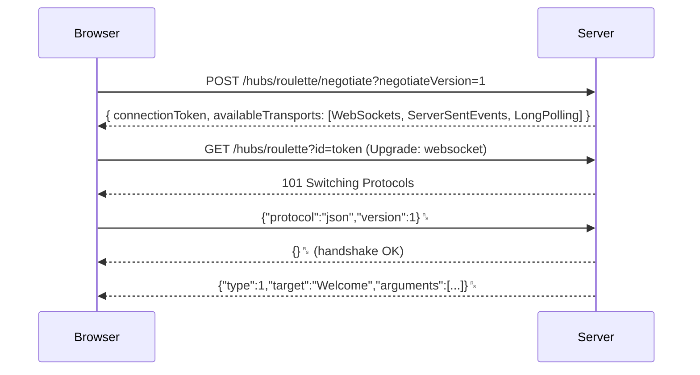
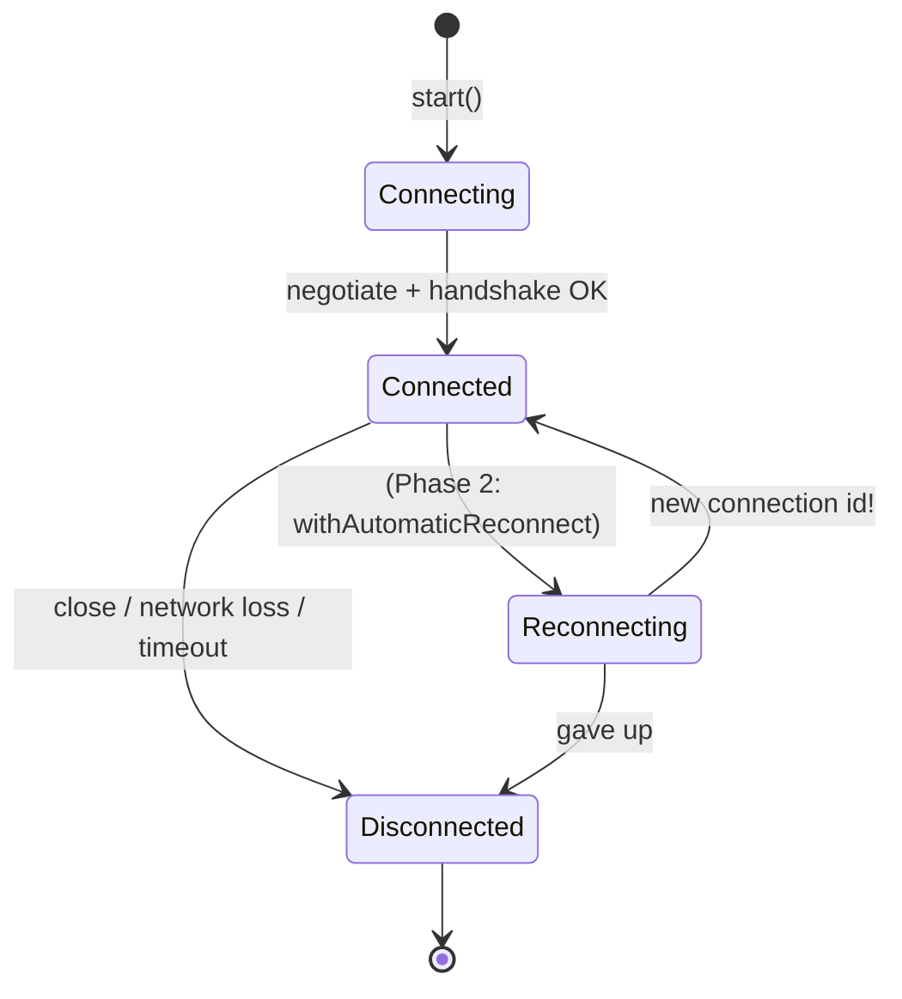

# 02: SignalR concepts

> New to this? Read [02a: How SignalR works, in plain language](02a-signalr-how-it-works.md) first. This page is the denser reference.

ASP.NET Core SignalR is a library that gives you **RPC in both directions** over a persistent connection. The client calls server methods, and the server calls client handlers. It also picks the transport, frames messages, sends heartbeats, and manages groups.

## Hubs

A **Hub** is a class whose public methods clients can call:

```csharp
public sealed class RouletteHub(GameStore store) : Hub
{
    public async Task PlaceBet(int amount, string target) { ... }
}
```
```js
await connection.invoke("PlaceBet", 100, "Red");
```

Key facts:
- **Hubs are transient.** A new instance is created **for every call** and disposed afterwards. Never store state in hub fields. Put it in a singleton (our `GameStore`), a database or Redis.
- Don't start background work from a hub method with fire-and-forget. The hub (and its `Context`) is gone when the method returns.
- Calls from **one connection** run **one at a time** by default (`MaximumParallelInvocationsPerClient = 1`). Calls from different connections run in parallel, so shared state still needs a lock or atomic operations.
- The hub is mapped to a URL: `app.MapHub<RouletteHub>("/hubs/roulette")`.

## Connections, users and groups

| Concept | What it is | Lifetime |
|---|---|---|
| **Connection** | One open transport from one browser tab. `Context.ConnectionId`. | Until the tab closes or the network drops. **A reconnect gets a NEW id.** |
| **User** | Identity from authentication (`IUserIdProvider`, default = `NameIdentifier` claim). One user can have **many connections** (tabs, phone + laptop). | As long as the login |
| **Group** | A named set of connections, e.g. `"table-1"`. | Created implicitly, **not persisted**. A connection must re-join its groups after reconnecting. |

### Groups

```csharp
await Groups.AddToGroupAsync(Context.ConnectionId, "table-1");
await Clients.Group("table-1").SendAsync("BetPlaced", evt);
```

- Groups contain **connections**, not users.
- SignalR removes a connection from all its groups when the connection closes.
- There is **no API to list group members** or check whether a group exists. If you need that (we need the player list), track it in your own state.
- Groups are cheap. Use one per table, per match, per market, and so on.

## Sending to clients

| API | Who receives it | In this project |
|---|---|---|
| `Clients.Caller` | Only the connection that made this hub call | `Welcome`, `Joined`, `BetRejected`, `BalanceUpdated` |
| `Clients.Others` | Everyone except the caller | not used |
| `Clients.Client(id)` / `Clients.Clients(ids)` | Specific connection(s) | `PlayerRoundResult` from the engine (no caller there) |
| `Clients.User(userId)` | **All connections of one user** | Phase 2: private messages to every tab |
| `Clients.Group(name)` | All connections in the group | table events |
| `Clients.OthersInGroup(name)` | The group minus the caller | not used |
| `Clients.All` | Every connection on the hub | `JackpotUpdated` |

Choosing well is about **privacy and cost**. A balance sent to `Group` leaks private data. A table event sent to `All` wastes bandwidth on every other table.

`SendAsync` completes when the message is **written to the server's outgoing buffer**, not when the client receives it. SignalR has **no delivery acknowledgement**. That's why Phase 2 adds sequence numbers and resync.

## IHubContext

Code **outside** a hub (a `BackgroundService`, a controller, a message consumer) cannot use a hub instance, because:
1. hubs are created by SignalR per incoming call, and you can't get one by DI;
2. there is no caller, so `Context` and `Clients.Caller` don't make sense.

Inject `IHubContext<THub>` instead. It's a singleton with the same `Clients` and `Groups` APIs, minus `Caller`/`Others`:

```csharp
public sealed class GameEngine(IHubContext<RouletteHub> hub) : BackgroundService
{
    // ...
    await hub.Clients.Group(tableId).SendAsync("RoundStateChanged", state, ct);
}
```

This is how most **server-initiated** pushes work: game loops, odds updates, notifications from a message bus.

## Transports and negotiation



1. **Negotiate**: an HTTP POST that returns a connection token and the transports the server supports.
2. The client tries **WebSockets → Server-Sent Events → Long Polling**, in that order.
3. **Handshake**: the client picks a protocol (**JSON** or **MessagePack**, which is binary and smaller and faster).
4. Messages flow. `type: 1` = invocation, `3` = completion, `6` = ping, `7` = close.

The negotiate step and the following requests must reach the **same server**. This matters when scaling out (sticky sessions, see [doc 04](04-scaling-and-redis.md)). You can skip negotiation by forcing WebSockets (`skipNegotiation: true, transport: WebSockets`).

## Strongly-typed hubs

*(Implemented in Phase 2.)* `Hub<IRouletteClient>` replaces `SendAsync("BetPlaced", ...)` magic strings with `Clients.Group(id).BetPlaced(evt)`, so typos become compile errors.

## Connection lifecycle



- `OnConnectedAsync()`: per-connection setup. We send a `Welcome`.
- `OnDisconnectedAsync(Exception? ex)`: clean up your own state. `ex` is `null` for a clean close and non-null for errors and timeouts. **It is not guaranteed to run** if the server process crashes, so don't rely on it for critical state (use expiries/TTLs).
- **Heartbeats**: the server pings every `KeepAliveInterval` (15 s). The client considers the server dead after `serverTimeoutInMilliseconds` (30 s). The server considers the client dead after `ClientTimeoutInterval` (30 s). Rule: **client timeout ≥ 2 × the other side's keep-alive**.

## Errors

Two ways to report a problem to the client:

| | `throw new HubException("...")` | Push a message (`BetRejected`) |
|---|---|---|
| Client sees | `invoke()` promise **rejects** | a normal event handler runs |
| Use for | invalid calls (unknown table, bad nickname) | expected business outcomes (bet refused) |
| Message text | always sent for `HubException` | whatever you send |

Any **other** exception type only reaches the client as a generic message, unless `EnableDetailedErrors = true` (dev only).

## Authentication

*(Implemented in Phase 2.)* Notes so far:
- The hub supports `[Authorize]`, and `Context.User` comes from normal ASP.NET Core authentication.
- Browsers **cannot set custom headers on a WebSocket request**, so the JS client sends the bearer token as the `access_token` **query string** parameter (via `accessTokenFactory`). The server must be told to read it from there.

## Configuration settings

| Setting | Default | Meaning |
|---|---|---|
| `EnableDetailedErrors` | false | Send exception messages to clients (dev only) |
| `KeepAliveInterval` | 15 s | Server ping interval |
| `ClientTimeoutInterval` | 30 s | Close a client that sent nothing for this long |
| `HandshakeTimeout` | 15 s | Max time for the protocol handshake |
| `MaximumReceiveMessageSize` | 32 KB | Largest client → server message |
| `MaximumParallelInvocationsPerClient` | 1 | Concurrent hub calls per connection |
| `StreamBufferCapacity` | 10 | Items buffered for client upload streams |

Phase 4 revisits these under load (backpressure, slow clients).

## Pitfalls learned in this project

- **A client handler that returns a value** is treated as a *client result* (the server→client "invoke with result" feature, .NET 7+). If the server didn't ask for a result, the JS client logs `Result given for 'x' method but server is not expecting a result`. Write handlers so they return nothing: `conn.on("X", p => { list.push(p); })`, **not** `p => list.push(p)`.
- Method names are matched **case-insensitively**, and payload properties arrive **camelCase** in JS.
- Enums serialize as numbers unless you add `JsonStringEnumConverter` to the hub's JSON protocol.
