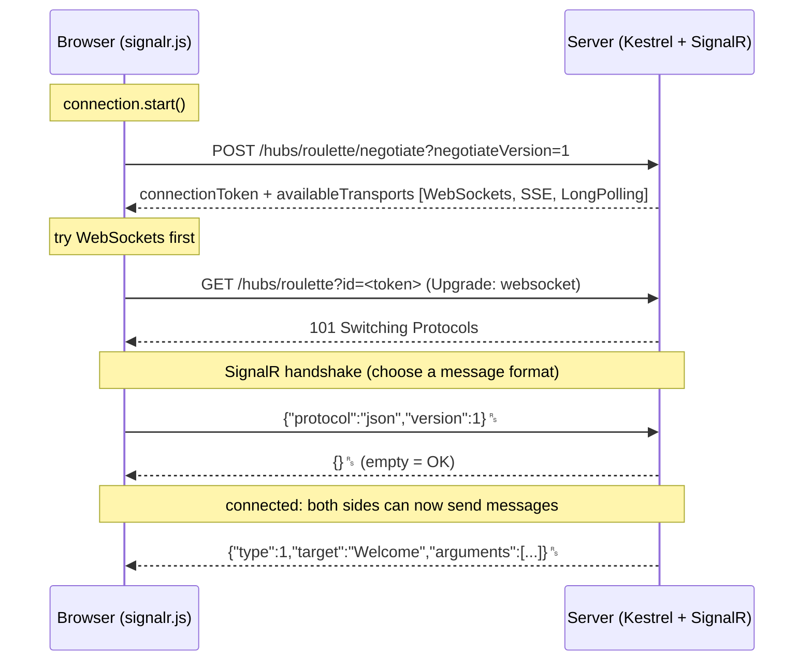
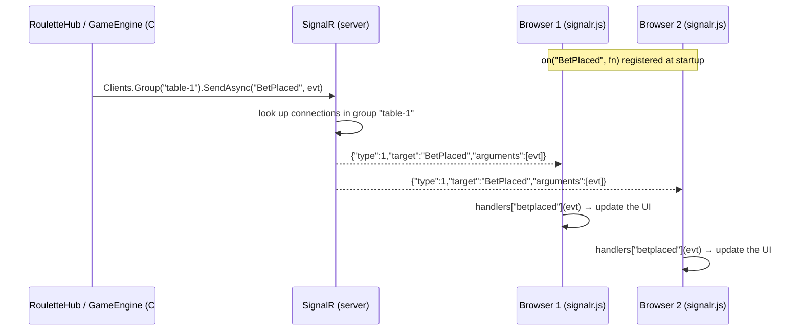
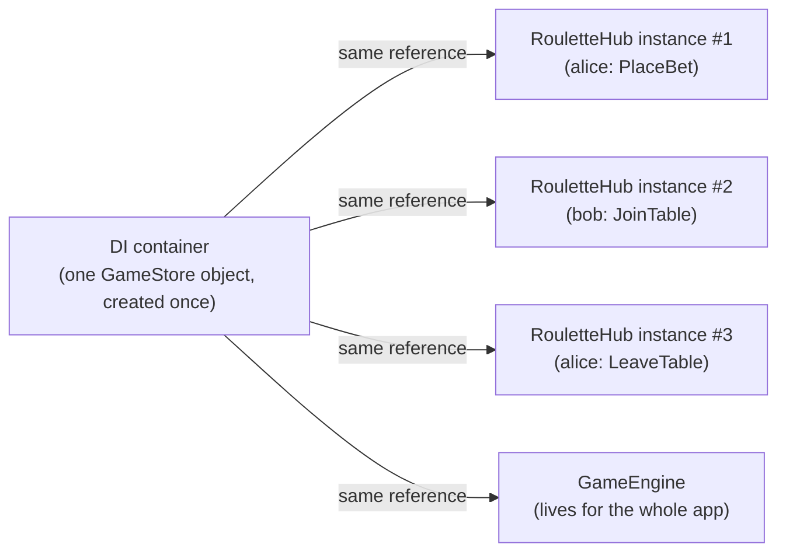

# 02a: How SignalR works, in plain language

This page answers the beginner questions you should be able to answer confidently before going deeper into [02: SignalR concepts](02-signalr-concepts.md):

1. How does the connection get set up, and how does SignalR choose between WebSockets and long polling?
2. What does `connection.invoke("PlaceBet", ...)` really do? Is it RPC?
3. How does the **server** call the **client** (`connection.on(...)`)?
4. How can there be only one `GameStore` for the whole app if the class isn't a "singleton"?

Every message shown below was **captured from this project** with the SignalR client's trace logging.

---

## 1. Setting up the connection

### Plain-language version
Before talking, the browser and the server agree on **how** to talk. The browser asks: "which ways of talking do you support?" The server lists them, and the browser tries the best one first. If that doesn't work, it tries the next.

### Step by step



**Real negotiate response from our server:**

```json
{
  "negotiateVersion": 1,
  "connectionId": "ZPq8vrURNHAi4lRpQmDzAQ",
  "connectionToken": "6S1HmbrGdZ3DvMjg-RtTUg",
  "availableTransports": [
    { "transport": "WebSockets",       "transferFormats": ["Text", "Binary"] },
    { "transport": "ServerSentEvents", "transferFormats": ["Text"] },
    { "transport": "LongPolling",      "transferFormats": ["Text", "Binary"] }
  ]
}
```

**Real client trace (shortened):**

```
Debug: Sending negotiation request: http://localhost:5000/hubs/roulette/negotiate?negotiateVersion=1.
Debug: Selecting transport 'WebSockets'.
Trace: (WebSockets transport) Connecting.
Debug: The HttpConnection connected successfully.
Trace: (WebSockets transport) sending data. Content: '{"protocol":"json","version":1}'.
Trace: (WebSockets transport) data received. Content: '{}'.
Debug: HubConnection connected successfully.
```

### Your question: "Does it check whether WebSocket works, and fall back if not?"

**Yes, exactly.** The client goes through the server's list **in order of preference**:

1. **WebSockets.** Skipped if the browser has no WebSocket support, the server disabled it, or you asked for something else. If it's tried and the connection **fails** (e.g. a corporate proxy blocks the upgrade), the client logs the error, **negotiates again** for a fresh connection id, and moves on to…
2. **Server-Sent Events.** Server→client goes over one long HTTP response, and client→server uses normal HTTP POSTs.
3. **Long polling.** The client keeps a "wait for news" request open, and the server answers as soon as there's a message.
4. If all three fail: `Error: Unable to connect to the server with any of the available transports.`

For comparison, here's the **same session forced onto long polling** (captured from our server). Every message from the server is a separate HTTP response, followed by a new poll:

```
Debug: Selecting transport 'LongPolling'.
Trace: (LongPolling transport) polling: http://localhost:5000/hubs/roulette?id=yZ0A...&_=1792576514428.
Trace: (LongPolling transport) sending data. Content: '{"protocol":"json","version":1}'.
Trace: (LongPolling transport) request complete. Response status: 200.
Trace: (LongPolling transport) data received. Content: '{}{"type":1,"target":"Welcome",...}'.
Trace: (LongPolling transport) polling: http://localhost:5000/hubs/roulette?id=yZ0A...&_=1792576514441.
Trace: (LongPolling transport) sending data. Content: '{"arguments":["table-1","alice"],"invocationId":"0","target":"JoinTable","type":1}'.
Trace: (LongPolling transport) request complete. Response status: 200.
Trace: (LongPolling transport) polling: ...
```

**Your hub code and your JavaScript don't change at all** whichever transport is chosen. That's SignalR's biggest selling point.

### "So SignalR is really powerful?" Yes, but know its limits

| SignalR does for you | SignalR does **not** do for you |
|---|---|
| Transport choice and fallback | **Guaranteed delivery.** A message sent while you're disconnected is gone. |
| Message format (JSON / MessagePack) | **Ordering across reconnects** or detecting gaps |
| RPC in both directions | **Persistence.** Nothing is stored. |
| Groups, users, broadcast | **Business state.** Your balance, bets etc. are your job. |
| Heartbeats and timeouts | **Scale-out by itself.** It needs a backplane or Azure SignalR (Phase 3). |
| Automatic reconnect (opt-in) | Re-joining groups after a reconnect. **You** must do it. |

Fallback **only happens when starting** the connection. If WebSockets work at first and break later, the connection drops, and the next connection attempt goes through the whole process again.

The fallback is also why **sticky sessions** come up in scaling: negotiate and the long-polling requests are *separate HTTP requests* that must reach the same server (Phase 3).

---

## 2. Client → server: `invoke` is RPC

### What is RPC?
**Remote Procedure Call**: calling a function that runs **on another machine** as if it were a local function. You write `invoke("PlaceBet", 50, "Red")`, and the method `PlaceBet(int amount, string target)` in `RouletteHub` runs on the server.

### What actually happens

```js
// app.js
await connection.invoke("PlaceBet", 50, "Red");
```

1. The client turns the call into a message and writes it to the WebSocket:
   ```json
   {"type":1,"invocationId":"1","target":"PlaceBet","arguments":[50,"Red"]}␞
   ```
   - `type: 1` = **Invocation** ("please run a method")
   - `target` = the method **name** (matched case-insensitively)
   - `arguments` = parameters, **by position**
   - `invocationId` = a ticket number so the reply can be matched to this call
2. On the server, SignalR reads the frame, finds the public method named `PlaceBet` on `RouletteHub`, converts `50` to `int` and `"Red"` to `string`, **creates a new `RouletteHub` instance**, and calls the method.
3. When the method finishes, the server sends a **Completion** with the same ticket number:
   ```json
   {"type":3,"invocationId":"1","result":null}␞
   ```
   (`result` holds the return value; `null` because `PlaceBet` returns `Task`. If the method throws a `HubException`, there's an `error` field instead.)
4. The client finds the pending promise for ticket `"1"` and resolves it, or rejects it on `error`. That's when `await connection.invoke(...)` continues.

**Real capture of one `PlaceBet` call** (during BettingClosed, so it was rejected):

```
⬆ {"arguments":[50,"Red"],"invocationId":"1","target":"PlaceBet","type":1}
⬇ {"type":1,"target":"BetRejected","arguments":[{"amount":50,"target":"Red","reason":"Betting is closed for this round."}]}
⬇ {"type":3,"invocationId":"1","result":null}
```

Note the order: the server **pushed** `BetRejected` (a normal message) *and then* completed the call. Two independent things happen on the same connection.

### `invoke` vs `send`

| | `connection.invoke(...)` | `connection.send(...)` |
|---|---|---|
| Has `invocationId` | yes | **no** |
| Server sends a completion | yes | no |
| Returns | a promise that waits for the server's completion (result or error) | a promise that resolves once the message is **sent** |
| Use when | you need to know it worked, or need a return value | fire-and-forget, e.g. "typing…" indicators |

---

## 3. Server → client: how `connection.on(...)` works

### Plain-language version
The client gives SignalR a **list of named functions it's willing to have called**: "if the server says `BetPlaced`, run this function". The server doesn't call JavaScript directly. It sends a message saying *"run `BetPlaced` with these arguments"*, and the client looks the name up in its list and runs the function.

Think of it like `addEventListener("click", fn)` in the browser, except the *server* fires the event.

### Step by step

**① The client registers handlers** before starting (in `app.js`):

```js
connection.on("BetPlaced", (msg) => {
  state.bets.push(msg.bet);
  renderBets();
});
```

Internally this is just a dictionary: `handlers["betplaced"] = [yourFunction]`. Nothing goes over the network yet.

**② The server sends** (in `RouletteHub.PlaceBet`):

```csharp
await Clients.Group(outcome.TableId).SendAsync("BetPlaced", outcome.Placed);
```

SignalR works out **which connections** are in that group, serializes the object to JSON (camelCase), and writes one frame to **each** of those connections:

```json
{"type":1,"target":"BetPlaced","arguments":[{"tableId":"table-1","roundId":472,"bet":{"nickname":"alice","amount":50,"target":"Red"}}]}␞
```

It's the **same message type (`1` = Invocation)** as client→server. RPC works in both directions. But this one has **no `invocationId`**, so it's fire-and-forget: the server doesn't wait for an answer.

**③ The client receives** the frame, reads `target: "BetPlaced"`, looks up `handlers["betplaced"]`, and calls each function with the `arguments`. In our app, the `on()` wrapper also writes the message to the event log.



### Things worth knowing
- **The server never knows** whether the client has a handler. If it doesn't, the client logs a warning (`No client method with the name 'betplaced' found`) and the message is ignored.
- `await SendAsync(...)` on the server finishes when the message is **queued for sending**, **not** when the browser has processed it. There's no acknowledgement. (That's why Phase 2 adds sequence numbers and resync.)
- **Names are just strings** that must match on both sides. A typo (`"BetPlacd"`) is silently ignored. Phase 2 uses a strongly-typed hub (`Hub<IRouletteClient>`) so the C# side is checked by the compiler.
- **A handler should not return a value** unless the server explicitly asked for one (the "client results" feature). We hit this in testing: a handler written as `p => list.push(p)` returns a number, and the client logs `Result given for 'x' method but server is not expecting a result`.
- Handlers are called **in the order messages arrive**. An `async` handler is not awaited, so the next message doesn't wait for it to finish.

### All message types in the SignalR protocol

| `type` | Name | Direction | Example in this project |
|---|---|---|---|
| 1 | Invocation | both | `JoinTable` (client→server), `BetPlaced` (server→client) |
| 2 | StreamItem | both | streaming, not used here |
| 3 | Completion | both | `{"type":3,"invocationId":"0","result":null}` |
| 4 | StreamInvocation | client→server | not used |
| 5 | CancelInvocation | client→server | not used |
| 6 | Ping | both | `{"type":6}` every 15 s (the heartbeat) |
| 7 | Close | both | `{"type":7}` when you call `connection.stop()` |

Each JSON message ends with the **record separator** character `␞` (`0x1E`), so several messages can be packed into one frame or one long-polling response. You can see that in the long-polling trace above: `{}{"type":1,...}` arrived in one response.

### A complete real session

```
⬆ {"protocol":"json","version":1}                                            handshake request
⬇ {}                                                                          handshake OK
⬆ {"type":6}                                                                  ping
⬆ {"arguments":["table-1","alice"],"invocationId":"0","target":"JoinTable","type":1}
⬇ {"type":1,"target":"Welcome","arguments":[{"connectionId":"xAlY...","tables":["table-1","table-2"],"jackpot":42.49}]}
⬇ {"type":1,"target":"Joined","arguments":[{"tableId":"table-1","nickname":"alice","balance":1000,...}]}
⬇ {"type":3,"invocationId":"0","result":null}                                 JoinTable finished
⬆ {"arguments":[50,"Red"],"invocationId":"1","target":"PlaceBet","type":1}
⬇ {"type":1,"target":"BetRejected","arguments":[{"amount":50,"target":"Red","reason":"Betting is closed for this round."}]}
⬇ {"type":3,"invocationId":"1","result":null}                                 PlaceBet finished
⬆ {"type":7}                                                                  close
```

---

## 4. Why there's only one `GameStore`: dependency injection lifetimes

### The confusion
`GameStore` is an ordinary class:

```csharp
public sealed class GameStore { ... }   // no static Instance, no private constructor
```

So how can every hub call see **the same** balances and bets?

### The answer: the DI container makes it a singleton

Look at [Program.cs](../src/Roulette.Server/Program.cs):

```csharp
builder.Services.AddSingleton<GameStore>();
```

This line says to ASP.NET Core's **dependency injection (DI) container**: *"create **one** `GameStore` the first time anyone asks for it, keep it, and hand out **that same object** every time after that, until the app stops."*

"Singleton" here is a **lifetime chosen at registration**, not something written into the class.



When a client calls `PlaceBet`, SignalR asks the container for a new `RouletteHub`. The hub's constructor wants a `GameStore`:

```csharp
public sealed class RouletteHub(GameStore store, ILogger<RouletteHub> logger) : Hub
```

The container sees the hub needs a `GameStore`, finds it registered as a singleton, and passes **the existing object**. The hub instance is thrown away after the call, but the `GameStore` stays. `GameEngine` gets the same object too.

### The three DI lifetimes

| Lifetime | Registration | One instance per… | Example |
|---|---|---|---|
| **Singleton** | `AddSingleton<T>()` | **application** (until the process stops) | `GameStore`, `IHubContext<T>`, a Redis connection |
| **Scoped** | `AddScoped<T>()` | **request**; in SignalR, per **hub method call** | an EF Core `DbContext` |
| **Transient** | `AddTransient<T>()` | **every time it's requested** | small stateless helpers |

**Hubs** are created by SignalR for **each call**, which behaves like transient. That's why state in a hub field would disappear after every call, and why we keep state in the singleton.

### DI singleton vs the classic "Singleton pattern"

```csharp
// Classic Singleton pattern: the class enforces it itself
public sealed class GameStore
{
    public static GameStore Instance { get; } = new();
    private GameStore() { }
}
```

Both give you one instance. The DI version is preferred in ASP.NET Core because:
- the class stays **normal and testable** (a test can just `new GameStore()`);
- the **container** decides the lifetime, and you can change it in one line;
- dependencies (loggers, config) can be injected into it.

### What "one instance" really means, and its consequences
- **One per process.** If you run **two servers** (Phase 3), each has **its own** `GameStore`, with different balances. That's exactly the problem Phase 3 solves by moving state to Redis.
- **Shared by many threads at once.** Hub calls from different players run in parallel, so a singleton with changing data **must be thread-safe**. That's why every `GameStore` method uses `lock (_gate)`.
- **A singleton must not depend on a scoped service** (e.g. a `DbContext`). It would keep one request's object forever (the *captive dependency* bug). ASP.NET Core catches this at startup in Development.

### Try it yourself
Add one line to `PlaceBet` in `RouletteHub`:

```csharp
logger.LogInformation("hub #{Hub} uses store #{Store}", GetHashCode(), store.GetHashCode());
```

Place a few bets. The **hub** number changes every time (a new instance per call), and the **store** number stays the same (one singleton).

---

## Summary in 6 lines
1. `start()` → **negotiate** → try **WebSockets → SSE → long polling** → **handshake** → connected.
2. Everything after that is small **JSON messages** (`type`, `target`, `arguments`) inside the transport.
3. `invoke("X", args)` = **RPC** to hub method `X`. The `invocationId` links the server's **completion** back to your promise.
4. `SendAsync("Y", data)` on the server = an **invocation message without an id** → the client runs the handler registered with `on("Y", fn)`.
5. Hubs are **new per call**. Shared state lives in a **DI singleton** (`AddSingleton<GameStore>()`), which must be **thread-safe**.
6. SignalR handles transport, RPC, groups and heartbeats. **Delivery guarantees, state and scale-out are your job** (Phases 2–3).
