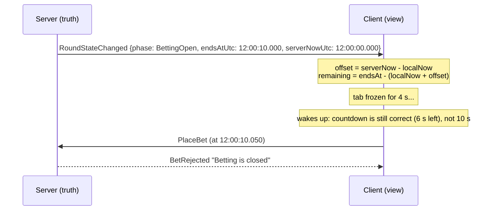

# 03: Casino real-time patterns

In a casino or sportsbook, real-time isn't about "showing things fast". It's about **money moving correctly while thousands of people watch the same event**. The patterns below are what interviewers in this domain want to hear.

## Server-authoritative state and timing

**Rule: the server owns the truth: the clock, the round state, the result, and the balance.** The client is a *view*.

What this means in practice:

1. **The server runs the round loop** (`GameEngine`), not the browser. Every table has exactly one timeline.
2. **The server decides when betting closes.** `PlaceBet` checks `Phase == BettingOpen && now < EndsAtUtc`, *at the moment the bet arrives*. A bet one millisecond late is rejected even if the user's button was still enabled.
3. **Send absolute end times, not durations.** Each `RoundStateChanged` carries `endsAtUtc` and `serverNowUtc`:



   - "10 seconds left" goes wrong when the message is delayed or the tab is throttled. An **end time** stays correct.
   - The client computes `offset = serverNow - localNow`, so a wrong local clock (a PC 2 minutes off) doesn't matter.
   - Remaining error = one-way network latency (tens of ms). That's fine for **display**, because the server enforces the real deadline.
4. **Check phase AND clock.** Timers fire late (thread pool busy, GC pause). Between the deadline and the engine actually flipping the phase, the phase still says "open". The deadline check closes that gap.
5. **Wait until absolute times** (`DelayUntil(endsAt)`), not `Delay(10s)` in a loop, or small delays add up over many rounds.

## Never trust the client

The UI shows only valid options, but anyone can open DevTools and run:

```js
connection.invoke("PlaceBet", -500, "Red")      // negative amount = free money?
connection.invoke("PlaceBet", 999999, "17")     // more than the balance
connection.invoke("PlaceBet", 10, "Purple")     // nonsense target
```

`GameStore.PlaceBet` validates **everything**: the player is at a table, the amount is > 0, the target is valid, betting is open (phase + clock), and the balance is sufficient. And it does it **atomically** (inside one lock), so two simultaneous bets can't both pass the balance check ("double spend"). In Phase 3 the lock becomes a Redis Lua script.

Other things you never take from the client: the result, the payout amount, the timestamp of the bet, the player id (comes from the auth token in Phase 2), the odds.

## Push is a notification, not the source of truth

*(Expanded in Phase 2.)* SignalR does not guarantee delivery. Messages are lost on disconnect, and `SendAsync` completing only means "buffered". So:
- The **balance lives on the server** (database). The push is a hint: "your balance changed, here's the new value".
- The client can always **re-fetch** via a normal REST API (`GET /api/players/{id}/balance`).
- Money must never depend on whether a WebSocket frame arrived.

## Snapshot + deltas

*(Implemented in Phase 2.)* Phase 1 already uses the idea in a simple form: `JoinTable` returns a **snapshot** (`Joined`: round, players, bets, balance), and after that the client applies **deltas** (`BetPlaced`, `RoundStateChanged`...). Phase 2 adds resync after reconnect.

## Sequence numbers

*(Implemented in Phase 2.)* Phase 1 has a visible race: the join snapshot and a table event can arrive in either order. Sequence numbers let the client detect gaps and duplicates.

## Idempotency

*(Implemented in Phase 2.)* Each bet gets a client-generated `betId`, so a retry can't place the same bet twice.

## Message criticality

Not all messages are equal:

| Message | If lost... | Strategy |
|---|---|---|
| `PlayerRoundResult`, `BalanceUpdated` | user sees the wrong balance, support ticket | must be recoverable: source of truth + resync |
| `RoundStateChanged`, `RoundResult` | UI stuck | recoverable via snapshot |
| `JackpotUpdated` | nothing: the next update overwrites it | can drop or coalesce; **throttle** (Phase 2) |
| `BetPlaced` (others' bets) | cosmetic | best effort |

Phase 1 sends `JackpotUpdated` to **everyone on every bet**. With 50k players and 1000 bets/s that's 50 million messages/s. Phase 2 throttles it to once per second (the latest value wins).

## Fairness and audit logging

- The result comes from a **cryptographic RNG on the server** (`RandomNumberGenerator.GetInt32(0, 37)`), not `new Random()` (predictable), and never from the client. Real casinos use certified RNGs, audited by regulators.
- **Log every money event** with round id, player, amount, target, result and timestamps (`GameEngine` logs each round's result). In production this is an append-only audit store: regulators and dispute resolution need to replay "what exactly happened in round 1234".
- Bets are **accepted or rejected with a reason**, never silently dropped.
- Close betting **before** generating the result (`BettingClosed` phase), so nobody can bet after the outcome is known.

## Phase 1 limitations (fixed later)

| Limitation | Fixed in |
|---|---|
| Player = connection id; refreshing the page = new player with 1000 credits | Phase 2 (auth, user id) |
| Disconnect mid-round → the bet is lost (player removed before payout) | Phase 2 |
| No reconnect | Phase 2 |
| Jackpot broadcast on every bet | Phase 2 |
| Everything in one process's memory | Phase 3 |
