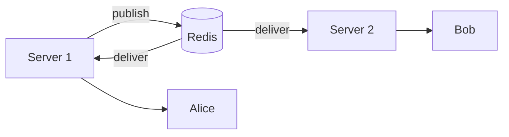
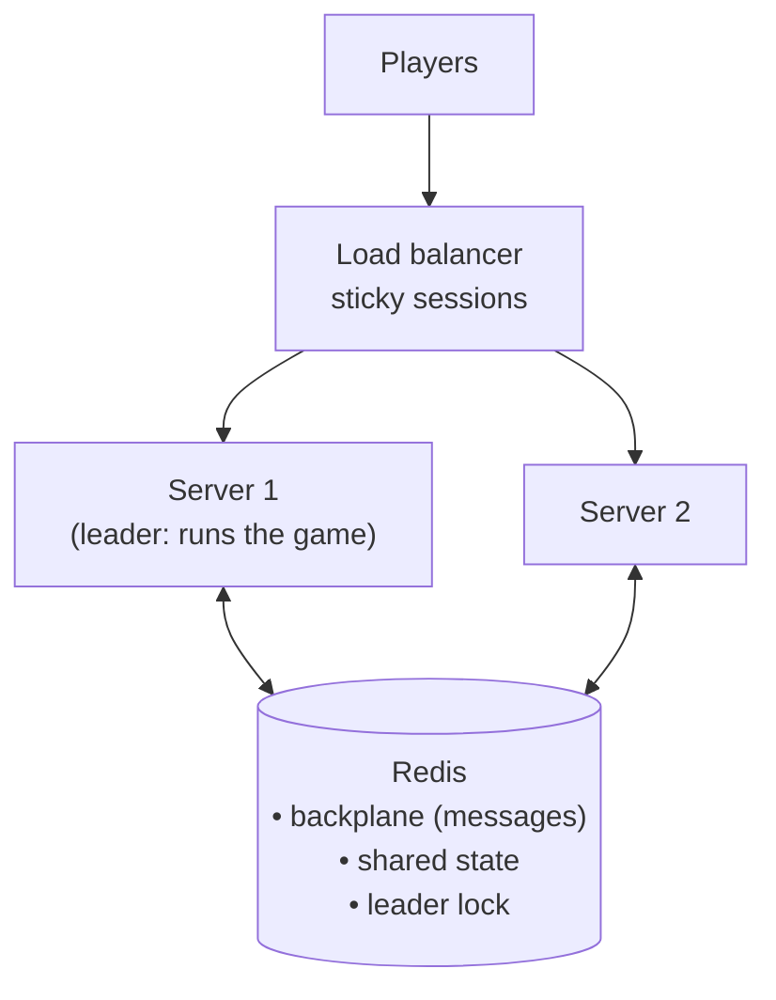

# 04: Scaling a real-time app (the simple version)

> This is all you need for an interview. The details and measurements are in [extra/scaling-deep-dive.md](extra/scaling-deep-dive.md), which is optional.
> New terms like **backplane** and **sticky sessions** are explained in [extra/glossary.md](extra/glossary.md).

## The 30-second answer

> "With one server everything works, because all connections and all game state are in one place. When you add a second server, you get three problems: players on different servers **don't see each other's messages**, **each server runs its own game**, and the **same balance can be spent twice**. The fixes: a **backplane** (usually Redis pub/sub) so messages reach every server; **shared state in Redis or a database** with **atomic** updates; and **one leader** server that runs the game loop. Also, the load balancer needs **sticky sessions** (or you use a managed service like **Azure SignalR Service**)."

If you can say that and explain each part in simple words, you're fine.

---

## The story

### One server: everything works

All players are connected to the same server. It knows every player, every table and every balance, and it runs the round timer.

### Many players → we add a second server

A load balancer splits players between **Server 1** and **Server 2**. Now three things break.

Think of it as **a casino that opened a second room**:

| | Problem | Casino analogy | Fix |
|---|---|---|---|
| **1** | Players on Server 1 don't receive messages sent by Server 2 | Each room has its own speaker system; room 2 can't hear room 1's announcements | **Backplane**: one shared speaker system both rooms are wired to |
| **2** | Each server runs its own round and spins its own number | Each room has its own dealer spinning their own wheel | **One leader**: only one dealer spins; the other room just watches |
| **3** | Each server has its own copy of balances, so a player can spend the same money on both | Each room has its own cash desk with its own copy of your wallet | **One shared cash desk**: state in Redis/DB, changed **atomically** |

### Problem 1 → the backplane

Each server only knows **its own** connections. When Server 1 says "send to everyone at table-1", players on Server 2 don't get it.

**Fix:** every server connects to a shared message bus, usually **Redis pub/sub**. A server **publishes** the message once, every server **receives** it and delivers it to its own players.

In SignalR it's **one line** of setup (`AddStackExchangeRedis(...)`), with no other code changes.

The catch: the backplane only moves **messages**. It does **not** share game state. That's problems 2 and 3.

### Problem 2 → one leader runs the game

Each server has its own round timer, so players receive **two rounds with two different results**.

**Fix:** only **one** server runs the game loop (the **leader**).
- Every server tries to grab a lock in Redis. The first one wins and becomes leader.
- The lock **expires automatically** after a few seconds unless the leader keeps renewing it.
- If the leader crashes, the lock expires and **another server takes over** (in our test: about 3 seconds).

### Problem 3 → shared state, changed atomically

If balances live in each server's memory, they differ per server.

**Fix:** keep the state (balances, bets, round state) in **one shared place**: Redis or a database.

But that alone isn't enough. "**Check** the balance, **then** subtract" is two steps. Two servers can both check before either subtracts, so both bets go through: **double spending**. In our test, 50 simultaneous bets of 100 on a balance of 1,000 were **all accepted**.

**Fix:** make check-and-subtract **one atomic operation**. Nothing can happen in between. In Redis that's a small **Lua script**; in SQL it's `UPDATE ... SET balance = balance - 100 WHERE balance >= 100`. With the atomic version, exactly **10** bets were accepted.

### Plus: sticky sessions

A SignalR connection starts with a small "negotiate" request, and the next request must reach **the same server**. Otherwise it fails ("No Connection with that ID"). So the load balancer is configured with **sticky sessions**: the same client always goes to the same server.

### The easy way out: a managed service

**Azure SignalR Service** holds all the client connections for you. No backplane and no sticky sessions to manage.
But it still **doesn't** solve problems 2 and 3. Game state and money are always your job.

---

## The final picture

---

## Likely follow-up questions (short answers)

**"What is a backplane?"**
A shared message bus (like Redis pub/sub) that all servers are connected to, so a message sent by one server reaches players on every server.

**"Is the backplane enough to scale?"**
No. It shares **messages**, not **state**. You still need shared state, atomic updates and a single game loop.

**"What happens if Redis goes down?"**
Players stay connected, but messages sent during that time are lost. So Redis must be highly available, and clients should **re-fetch the current state** after problems. And money must never depend on a push message arriving: the balance is always stored in the database or state, and the push is just a notification.

**"How do you stop double spending?"**
Do "check balance + subtract" as **one atomic step**: a Redis Lua script, or a conditional SQL update. Also give every bet a unique id so a retry isn't charged twice (**idempotency**).

**"How do you make sure only one server runs the round timer?"**
**Leader election** with a Redis lock that has an expiry time. The leader keeps renewing it. If the leader dies, the lock expires and another server takes over.

**"Why sticky sessions?"**
The connection setup (negotiate) is stored on the server that handled it, so the follow-up request must go to the same server. Not needed with WebSockets-only + `skipNegotiation`, or with Azure SignalR Service.

**"Redis pub/sub vs Kafka?"**
Redis pub/sub is fast but **forgets** messages (if nobody listens, they're gone). That's fine for live updates. Kafka **stores** messages so they can be replayed. That's what you want for important events like bets and payouts (audit).

---

## Words to know

| Word | Simple meaning |
|---|---|
| **Scale out** (horizontal) | add more servers |
| **Scale up** (vertical) | use a bigger server |
| **Backplane** | shared message bus between servers |
| **Pub/sub** | publish a message to a channel, and everyone subscribed receives it |
| **Shared state** | data stored in one place all servers use (Redis/DB) |
| **Atomic** | happens as one step; nothing can sneak in between |
| **Double spending** | the same money used twice because of a race |
| **Idempotent** | doing it twice has the same effect as once |
| **Leader election** | picking one server to do a job only one should do |
| **Sticky session** | the load balancer always sends a client to the same server |
| **Azure SignalR Service** | a managed service that holds the connections for you |
