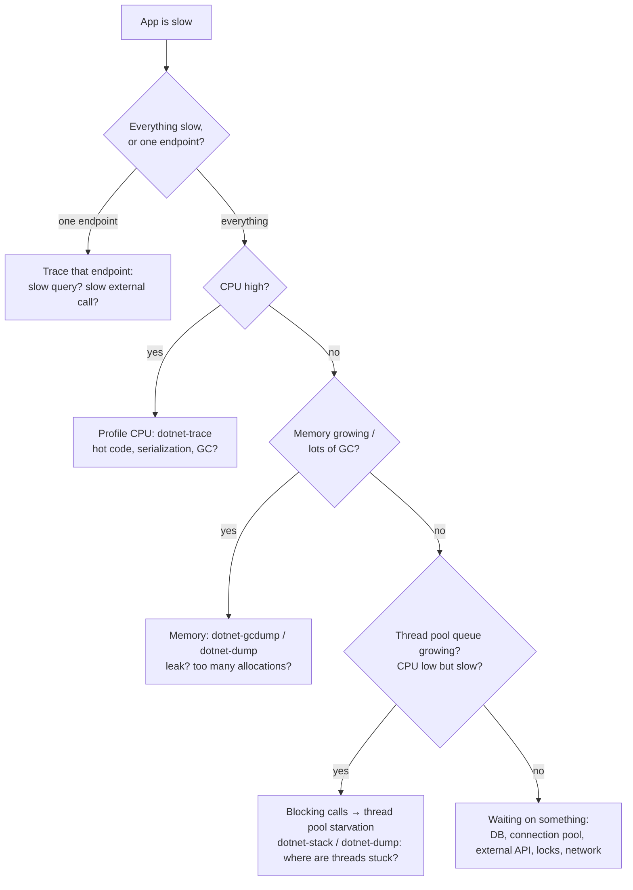

# 05: Diagnostics under load

> General knowledge for **any** app (web APIs, real-time apps, background workers), not just games. Interview level: simple and practical.

## The 30-second answer

> "When an app gets slow under load, I **mitigate first**: roll back, scale out, or throttle, so users are OK again. Then I **look at metrics**: for the service, rate, errors and duration (**RED**); for resources, utilization, saturation and errors (**USE**), always using **percentiles** like p95/p99, not averages. That tells me whether the problem is **CPU**, **memory/GC**, **threads that are blocked**, or **waiting on something else** like the database or an external API. Then I narrow it down with tools: in .NET, **dotnet-counters** for live numbers, **dotnet-trace** to see where time goes, **dotnet-dump** for a memory or thread snapshot. I fix the root cause, add an alert for it, and **load test** to prove the fix."

---

## 1. Mitigate first, then diagnose

When production is slow, **users come first, root cause second**.

| Step | What | Examples |
|---|---|---|
| 1. **Mitigate** | make users OK again, fast | roll back the last deploy, scale out, restart a stuck instance, turn off a feature flag, rate-limit a noisy client |
| 2. **Diagnose** | find the real cause | metrics → narrow down → tools (below) |
| 3. **Fix** | fix the root cause | code fix, index, config change |
| 4. **Prevent** | make sure you'll notice next time, or it can't happen | an alert, a dashboard, a load test in CI, a post-mortem |

> 💡 Before restarting a broken instance, **take a dump** (`dotnet-dump collect`) if you can. Restarting destroys the evidence.

---

## 2. Observability: the three signals

You can't diagnose what you can't see. Modern apps produce three kinds of signals:

| Signal | What it is | Answers | Example |
|---|---|---|---|
| **Metrics** | numbers over time | "Is something wrong? How bad?" | requests/sec, p99 latency, CPU %, error rate |
| **Logs** | text events | "What exactly happened?" | `Bet rejected: insufficient balance, player 42` |
| **Traces** | the path of **one request** through all services, with timings | "**Where** did the time go?" | API 20 ms → DB query 950 ms → cache 2 ms |

- **Correlation id / trace id**: one id attached to a request everywhere (logs, traces, downstream calls), so you can follow it across services.
- **OpenTelemetry**: the standard way to produce all three, sending them to tools like Application Insights, Grafana/Prometheus, Datadog or Jaeger.
- **Structured logging**: log fields, not just text (`{PlayerId}`), so logs can be searched and filtered.

---

## 3. What to measure: RED and USE

Two simple checklists so you don't forget anything.

### RED: for **services** (each API, endpoint or hub)
| Letter | Meaning | Example |
|---|---|---|
| **R**ate | requests per second | 1,200 req/s |
| **E**rrors | failed requests per second (or %) | 0.5% 5xx |
| **D**uration | how long requests take (**as percentiles**) | p50 40 ms, p99 900 ms |

### USE: for **resources** (CPU, memory, disk, network, thread pool, DB connection pool)
| Letter | Meaning | Example |
|---|---|---|
| **U**tilization | how busy it is | CPU 85% |
| **S**aturation | how much work is **waiting** for it | thread pool queue = 277, DB pool waiters |
| **E**rrors | errors from that resource | connection timeouts, OutOfMemory |

> 💡 **Saturation is the most telling one.** A resource at 100% with nothing waiting is fine. A **queue** that keeps growing is the problem.

---

## 4. Percentiles: why averages lie

**p95 = 95% of requests were faster than this.** p99 = 99% were faster.

Example, 100 requests: 98 take 50 ms, 2 take 5 seconds.
- **Average** ≈ 150 ms → "looks fine".
- **p99** = 5 s → "1 in 100 users waits 5 seconds".

Those slow 1–2% are often your **most active users** (they make the most requests), and in a microservice call chain one slow call makes the whole page slow. **Always report p50, p95 and p99**, never just the average.

Related ideas:
- **Throughput vs latency**: how many requests per second vs how long each one takes. Under load, latency rises **sharply** once a resource is saturated.
- **The "knee"**: in a load test, the point where latency suddenly shoots up. That's your real capacity.

---

## 5. A simple way to find the problem

---

## 6. The most common bottlenecks (any app)

| Problem | Symptoms | How to see it | Fix |
|---|---|---|---|
| **Thread pool starvation** (blocking calls: `.Result`, `.Wait()`, `Thread.Sleep`, sync I/O) | slow everywhere, **CPU low**, even trivial endpoints slow, timeouts | thread pool **queue length** grows; thread count creeps up; stacks show threads stuck in `Wait`/`Sleep` | use `async`/`await` all the way. Never block on async code. |
| **Slow database** | specific endpoints slow; DB CPU high | traces show long DB spans; query plans | indexes, fix **N+1 queries**, fetch less data, caching |
| **Connection pool exhaustion** | timeouts "waiting for a connection"; works at low load | pool usage at max; many waiters | release connections quickly (`using`), shorter queries, right pool size. For HTTP use **`IHttpClientFactory`** (a `new HttpClient()` per request exhausts sockets). |
| **Memory leak** | memory only goes up; eventually OutOfMemory or restarts | working set/heap grows over hours; a heap snapshot shows what's held | unbounded caches/static lists, event handlers never removed. Add limits and expiry. |
| **GC pressure** (too many allocations) | CPU high, spiky latency | high GC count, % time in GC, allocation rate | allocate less: reuse buffers, avoid big strings and LINQ in hot paths, use streaming |
| **Lock contention** | throughput stops growing with more load; CPU not maxed | lock contention counter; stacks waiting on `Monitor.Enter` | smaller/shorter locks, never do I/O inside a lock, concurrent collections |
| **Slow external dependency** | slow or failing when the other service is slow | traces; dependency latency metrics | **timeouts**, retries with backoff, **circuit breaker** (e.g. Polly), caching, async/queue the work |
| **Too much work per request** | CPU high on simple calls | CPU profile | cache results, move work to background jobs, reduce logging in hot paths |

> 💡 **"CPU is low but the app is slow"** almost always means **waiting**: blocked threads, a DB/connection pool, an external call, or a lock. **"CPU is high"** means **computing**: hot code or GC.

---

## 7. The .NET tools (what each is for)

| Tool | Use it for | Simple example |
|---|---|---|
| **dotnet-counters** | **live numbers**: CPU, GC, thread pool queue, exceptions, requests/s | `dotnet-counters monitor -n MyApp` |
| **dotnet-trace** | **where time goes** (CPU profile, events); open in Visual Studio or PerfView | `dotnet-trace collect -n MyApp` |
| **dotnet-stack** | **what every thread is doing right now** | `dotnet-stack report -n MyApp` |
| **dotnet-dump** | a **full snapshot** of memory and threads, to analyze later (hangs, leaks, crashes) | `dotnet-dump collect -n MyApp`, then `dotnet-dump analyze` |
| **dotnet-gcdump** | a lighter **heap snapshot**: which objects use memory | `dotnet-gcdump collect -n MyApp` |
| **Visual Studio profiler** | the same things, with a UI, during development | Debug → Performance Profiler |
| **APM** (Application Insights, Datadog, Grafana + OpenTelemetry) | production dashboards, traces, alerts | always-on monitoring |

Install a tool: `dotnet tool install -g dotnet-counters`.

### A real example (measured on this machine)

A test endpoint with `Thread.Sleep(1000)`, hit by 300 requests at once:

| What | Result |
|---|---|
| Time for all 300 requests | **13.1 s** (the same 300 with `await Task.Delay(1000)`: **1.25 s**) |
| `dotnet-counters`: thread pool queue | jumped to **~277 waiting** work items |
| `dotnet-counters`: CPU | **under 1%** |
| `dotnet-stack`: threads | **25 of 31 threads** stuck in `Thread.Sleep`, and the stack showed exactly which endpoint |

That's the classic picture of **thread pool starvation**: a big queue, idle CPU, and threads all blocked in the same place. The fix is `await` instead of blocking. More in [extra/thread-sleep-vs-task-delay.md](extra/thread-sleep-vs-task-delay.md).

---

## 8. Load testing basics

| Type | Question it answers |
|---|---|
| **Load test** | Does it handle the **expected** traffic? |
| **Stress test** | Where does it **break**, and how does it fail? |
| **Spike test** | What happens with a **sudden** jump (a big match starts, a sale opens)? |
| **Soak test** | Does it stay healthy for **hours** (leaks, slow degradation)? |

- Tools: **k6**, **JMeter**, **NBomber** (.NET), **Azure Load Testing**, Locust.
- Measure **RED** (p95/p99, not average) while increasing load, and watch **USE** on servers and the DB. Find the **knee**.
- Tips: run the load generator on a **different machine**; use realistic data and user behaviour; warm up first; change one thing at a time; compare before and after.

---

## 9. Extra things for real-time apps (SignalR, WebSockets)

| Watch | Why |
|---|---|
| **Connected clients** | memory and file handles grow with connections |
| **Messages sent per second** | fan-out cost: 1 message × 10,000 users = 10,000 sends |
| **Slow clients** (backpressure) | a client that can't keep up makes the server **buffer** messages for it, which costs memory. Set limits, and drop or disconnect slow clients. |
| **Reconnect storms** | after a deploy or network blip, everyone reconnects at once. Use **backoff with random jitter** on the client. |
| **Backplane (Redis) health** | if Redis is slow, every server's messages are slow |
| **Message size / rate** | throttle or merge frequent updates (e.g. send a jackpot value at most once per second) |

Useful SignalR settings: `MaximumReceiveMessageSize`, `KeepAliveInterval`, `ClientTimeoutInterval`, and the buffer sizes. Defaults are fine to start with. Change them only when measurements say so.

---

## Interview questions

**1. Users say the app is slow. What do you do?**
Mitigate first (rollback, scale out, throttle) if it's serious. Then check dashboards: is it everything or one endpoint, since when (a deploy?), errors, and p95/p99. Check resources: CPU, memory/GC, thread pool, DB. Narrow down with traces and tools, fix the root cause, add an alert, and verify with a load test.

**2. What are RED and USE?**
RED for services: Rate, Errors, Duration. USE for resources: Utilization, Saturation, Errors. RED tells you users are affected; USE tells you which resource is the cause.

**3. Why use percentiles instead of averages?**
Averages hide the slow tail. 98 fast requests and 2 very slow ones still give a "fine" average. p95/p99 show what your slowest users actually experience, and in call chains the tail adds up.

**4. CPU is low but requests are slow. What could it be?**
The app is **waiting**, not computing: thread pool starvation from blocking calls, a slow DB or exhausted connection pool, a slow external API, or lock contention. Check the thread pool queue, dependency latency in traces, and thread stacks.

**5. What is thread pool starvation and how do you detect it?**
All thread pool threads are blocked (e.g. `.Result`, `.Wait()`, `Thread.Sleep`, sync I/O), so new work waits in a queue, and the pool only adds threads slowly. Symptoms: the queue length grows, CPU is low, and everything is slow. Detect it with `dotnet-counters` (queue length, thread count) and `dotnet-stack` or a dump (threads stuck in waits). Fix: async all the way.

**6. How do you find a memory leak in .NET?**
Watch memory over time (it only grows). Take two heap snapshots (`dotnet-gcdump` or `dotnet-dump`) some time apart and compare which object types grow and what holds on to them. Usual suspects: static collections, unbounded caches, event handlers not unsubscribed, long-lived objects keeping short-lived ones alive.

**7. What's the difference between dotnet-counters, dotnet-trace and dotnet-dump?**
Counters = live numbers (is something wrong?). Trace = recording over time of where CPU and time go (why is it slow?). Dump = a full snapshot of memory and threads at one moment (what's stuck, what holds memory?).

**8. What is GC pressure and how do you reduce it?**
Allocating so many objects that the garbage collector runs very often, using CPU and causing pauses. Reduce it by allocating less in hot paths: reuse buffers (`ArrayPool`), avoid unnecessary strings and LINQ, use `Span<T>`, and stream large data instead of loading it all.

**9. What is connection pool exhaustion?**
All connections in the pool (e.g. DB connections, 100 by default in SqlClient) are in use, so new requests wait and time out. Causes: slow queries, connections not disposed, too much parallelism. For HTTP, creating a new `HttpClient` per request exhausts sockets, so use `IHttpClientFactory`.

**10. How do you protect your app from a slow dependency?**
Timeouts on every call, retries with backoff (only for safe operations), a circuit breaker to stop calling a failing service, bulkheads (limit concurrent calls), caching, and fallbacks. In .NET: Polly / `Microsoft.Extensions.Http.Resilience`.

**11. Which load tests would you run before a big launch?**
A load test at expected traffic, a stress test to find the breaking point, a spike test for sudden traffic, and a soak test for leaks. Watch p95/p99 and resource saturation, and run from a separate machine with realistic scenarios.

**12. What do logs, metrics and traces each give you?**
Metrics: is something wrong and how much (cheap, aggregated). Logs: what exactly happened (detailed events). Traces: where the time went for one request across services. Link them with a correlation/trace id. OpenTelemetry produces all three.

**13. What's special about diagnosing real-time (WebSocket/SignalR) apps?**
Long-lived connections: watch connection count and memory per connection, messages per second and fan-out, slow clients (server-side buffering), reconnect storms after deploys (use jittered backoff), and the backplane's health. Request-based metrics alone don't tell the full story.

**14. What does "mitigate first" mean?**
In an incident, restoring service beats finding the root cause. Roll back, scale out, disable a feature or throttle traffic first. If possible, capture evidence (dump, logs, metrics) before restarting. Then investigate calmly and write a post-mortem.

**15. After fixing a performance problem, how do you make sure it doesn't come back?**
Add an alert on the signal that showed it (e.g. thread pool queue length or p99), add a dashboard panel, keep a load test or performance test in CI, and write a short post-mortem with the lesson.

---

## Words to know

| Word | Simple meaning |
|---|---|
| **Latency** | how long one request takes |
| **Throughput** | how many requests per second the system handles |
| **p95 / p99** | 95% / 99% of requests were faster than this |
| **Saturation** | work is queuing up, waiting for a resource |
| **Thread pool starvation** | all worker threads are blocked, so new work waits |
| **GC (garbage collector)** | .NET's automatic memory cleanup; too much of it costs CPU and causes pauses |
| **Memory leak** | memory that's never released, so usage only grows |
| **Connection pool** | a reusable set of open connections (DB, HTTP) |
| **Backpressure** | a slow receiver forcing the sender to buffer, slow down or drop messages |
| **Circuit breaker** | stop calling a failing service for a while instead of waiting on it every time |
| **Observability** | being able to understand the system from its metrics, logs and traces |
| **APM** | Application Performance Monitoring tools (App Insights, Datadog…) |
