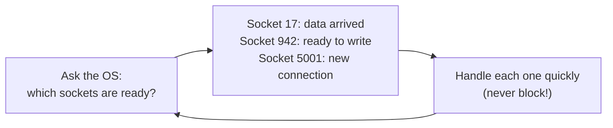

# The C10k problem

> **C10k** = "**C**oncurrent **10,000** connections". How do you build one server that handles 10,000 clients **at the same time**?

The question was made famous by **Dan Kegel** in 1999. Hardware could already handle it (enough CPU, RAM and bandwidth), but the **way servers were programmed** couldn't. The answers to it (event loops, `epoll`, IOCP, non-blocking I/O, and eventually `async`/`await`) are the reason a modern server can hold **hundreds of thousands** of WebSocket connections. It's background knowledge for anything real-time.

## 1. The old model: one thread (or process) per connection

The natural way to write a server:

```csharp
// Simplified "classic" server
var listener = new TcpListener(IPAddress.Any, 8080);
listener.Start();
while (true)
{
    var client = listener.AcceptTcpClient();   // wait for a new connection
    new Thread(() => Handle(client)).Start();  // one thread per client
}

void Handle(TcpClient client)
{
    var stream = client.GetStream();
    var buffer = new byte[4096];
    while (true)
    {
        int n = stream.Read(buffer);           // BLOCKS this thread until data arrives
        if (n == 0) break;
        stream.Write(buffer, 0, n);            // BLOCKS until the data is sent
    }
}
```

It's easy to read: each client gets its own thread that runs top to bottom. Apache's classic `prefork` model (one **process** per connection) worked like this.

### Why it breaks at around 10,000 connections

Most of these threads are **doing nothing**. They're blocked in `Read`, waiting for a client who is thinking, typing, or watching a roulette wheel. But each idle thread still costs:

| Cost | Per thread | × 10,000 |
|---|---|---|
| **Stack memory** | usually 1–8 MB reserved (part of it committed) | gigabytes of address space and real RAM |
| **Kernel bookkeeping** | a thread structure, scheduler entry | the OS scheduler juggles 10,000 threads |
| **Context switches** | ~1–5 µs each, **plus** wiped CPU caches | when data arrives for many clients, the CPU spends its time switching instead of working |
| **Creation / teardown** | tens of µs | short connections → constant thread churn |

Result: memory runs out or the CPU drowns in scheduling, while doing very little useful work. **The bottleneck was the model, not the hardware.**

## 2. The fix: don't wait on a thread, wait on the OS

The key insight: **a waiting connection shouldn't need a thread**. Instead:

1. Make sockets **non-blocking**: `read` returns "no data yet" immediately instead of waiting.
2. Ask the OS a single question: **"Which of my 10,000 sockets are ready right now?"**
3. Handle **only** those, with a **small number of threads** (often one per CPU core).
4. Repeat.

That loop is called an **event loop**:



10,000 idle connections now cost **only memory for their state** (a few KB each), not 10,000 threads.

### How you ask the OS "which sockets are ready?"

The mechanism matters. The early APIs didn't scale either:

| API | OS | How it works | Scales? |
|---|---|---|---|
| `select()` | all (1983) | pass the **whole list** of sockets on every call; the kernel scans all of them | ❌ O(n) per call, usually capped at **1024** sockets (`FD_SETSIZE`) |
| `poll()` | Unix | same idea without the 1024 cap | ❌ still O(n) per call |
| **`kqueue`** | FreeBSD / macOS (2000) | register sockets **once**; the kernel returns **only the ready ones** | ✅ |
| **`epoll`** | Linux (2002, kernel 2.6) | same idea as kqueue | ✅ cost ∝ number of **ready** sockets, not total |
| **IOCP** (I/O Completion Ports) | Windows NT (1990s) | a different style: you **start** an operation and the OS tells you when it's **finished** | ✅ |
| **`io_uring`** | Linux (2019) | shared ring buffers between app and kernel, batching, fewer system calls | ✅✅ the modern high end |

Two styles worth naming in an interview:
- **Reactor** (`epoll`, `kqueue`): the OS says "socket X is **ready**", and you then do the read yourself.
- **Proactor** (IOCP, `io_uring`): you say "read into this buffer", and the OS says "**done**, here's the data".

## 3. Who solved it, and how

| Server / runtime | Approach |
|---|---|
| **nginx** (2004) | a few worker processes, each running an `epoll`/`kqueue` event loop. Holds tens of thousands of connections with little memory. This is a big reason nginx replaced Apache as the front-end proxy. |
| **Node.js** (2009) | **one** JavaScript thread + an event loop (`libuv`, on top of epoll/kqueue/IOCP). Callbacks and promises instead of blocking calls. |
| **Erlang / Elixir** | millions of very lightweight processes scheduled by the VM on an event-driven I/O layer. WhatsApp famously ran **2 million+ connections on one server** (~2012). |
| **Go** | goroutines (tiny, growable stacks) that *look* blocking, but the runtime parks them on an epoll-based "netpoller". |
| **Java** | NIO / Netty event loops. Since Java 21, **virtual threads** (blocking-style code, cheap like goroutines). |
| **.NET** | `async`/`await` + the thread pool on top of **IOCP** (Windows), **epoll** (Linux), **kqueue** (macOS). **Kestrel** (ASP.NET Core's web server) and therefore **SignalR** are built on this. |

## 4. How .NET hides all of this: `async`/`await`

Writing event-loop code by hand ("callback hell") is painful. `async`/`await` lets you write code that **looks** like the simple thread-per-connection version but **behaves** like an event loop:

```csharp
async Task HandleAsync(Socket socket)
{
    var buffer = new byte[4096];
    while (true)
    {
        int n = await socket.ReceiveAsync(buffer);   // NO thread waits here
        if (n == 0) break;
        await socket.SendAsync(buffer.AsMemory(0, n));
    }
}
```

What happens at `await socket.ReceiveAsync(...)`:
1. .NET registers the socket with **epoll/IOCP** and **returns the thread to the pool**.
2. The connection now exists only as a small object in memory (plus kernel buffers).
3. When data arrives, the OS notifies .NET's I/O layer, and the rest of the method continues on **any free pool thread**.

So 10,000 (or 100,000) connected SignalR clients waiting for the next roulette round use **zero threads while idle**. A handful of pool threads (roughly one per CPU) does all the actual work.

**The catch:** this only works if you **never block**. One `Thread.Sleep`, `.Result` or synchronous I/O call in a hot path puts you right back in the thread-per-connection world, and the small thread pool starves. See [thread-sleep-vs-task-delay.md](thread-sleep-vs-task-delay.md) (measured: a trivial request went from 9 ms to 7.9 s).

## 5. The limits that remain after C10k

Once threads aren't the problem, these become the limits:

| Limit | What it is | Typical fix |
|---|---|---|
| **File descriptors** | every socket is a file descriptor; Linux often defaults to **1024 per process** (`ulimit -n`) | raise it (e.g. `ulimit -n 1000000`, `LimitNOFILE` in systemd) |
| **Memory per connection** | app state + kernel send/receive buffers + TLS state (~tens of KB) | smaller buffers, MessagePack, less per-connection state |
| **Ephemeral ports** | a **client** machine (or a proxy talking to backends) has ~28k–64k source ports **per destination IP:port** | more IPs on the proxy, connection reuse. Note: **a server's single listening port is not limited to 64k connections**, because each connection is identified by the full (client IP, client port, server IP, server port) tuple |
| **CPU for fan-out** | sending one message to 100k connections = 100k serializations and writes | serialize once, batch, throttle (our jackpot), scale out |
| **Load balancer / proxy** | the proxy holds every connection too, twice (client side + backend side) | tune it, or use a managed service (Azure SignalR Service) |

## 6. C10M and beyond

Around 2013 the bar moved to **C10M** (10 million connections per server). At that point even the kernel's network stack becomes the bottleneck. Solutions bypass or reduce kernel work: **DPDK**, **kernel-bypass networking**, **`io_uring`**, careful NUMA and CPU-core pinning. You won't need this for a casino front end, but it's good to know the term exists.

## 7. Why this matters for this project

- **SignalR's whole model** (thousands of mostly idle WebSocket connections per server) is only possible because of the C10k solutions.
- A SignalR server's capacity is limited by **memory per connection, CPU for fan-out, and file descriptors**, not threads. If you see threads being the limit, someone is **blocking**.
- Phase 4's "bad mode" recreates the C10k failure mode in miniature: blocking calls → thread pool starvation → latency explodes at low CPU.

## Interview questions

**1. What is the C10k problem?**
The challenge (named by Dan Kegel in 1999) of handling 10,000 concurrent connections on one server. The hardware could do it, but the thread-per-connection programming model couldn't, because of thread memory, scheduling and context-switch overhead.

**2. Why does one thread per connection not scale?**
Most connections are idle, but each thread still reserves stack memory (often 1 MB+), takes kernel resources, and adds context-switch cost and cache pollution. At tens of thousands of threads, memory and scheduling overhead dominate before any real work is done.

**3. What is an event loop?**
A loop that asks the OS which sockets are ready (epoll, kqueue, IOCP), handles just those with non-blocking operations, and repeats. A few threads can serve many thousands of connections. nginx, Node.js and the .NET socket layer all use it.

**4. `select`/`poll` vs `epoll`: what's the difference?**
`select`/`poll` pass and scan the entire socket list on every call, which is O(n). `select` is usually capped at 1024 descriptors. `epoll` registers sockets once and returns only the ready ones, so its cost depends on activity, not on the total number of connections.

**5. Reactor vs proactor?**
Reactor (epoll/kqueue): the OS signals readiness and the app performs the I/O. Proactor (IOCP, io_uring): the app submits the I/O and the OS signals completion with the data. .NET uses IOCP on Windows and an epoll-based engine on Linux, and hides both behind the same `async` APIs.

**6. How does `async`/`await` in .NET relate to C10k?**
It lets you write sequential-looking code while the runtime uses event-driven I/O underneath. At an `await` on I/O, the thread goes back to the pool and the connection waits as a small object, not a blocked thread. That's how Kestrel and SignalR hold huge numbers of idle connections with a few threads.

**7. What happens if you call `.Result` or `Thread.Sleep` inside a SignalR hub under load?**
You block a pool thread. With many concurrent calls, every thread gets blocked, queued work can't run, and latency explodes while the CPU stays low (thread pool starvation). You're back to the thread-per-connection problem, but with a small pool.

**8. A server only has 65,535 ports. Is that the maximum number of connections?**
No, that's a common misconception. A TCP connection is identified by (source IP, source port, destination IP, destination port). A server listening on port 443 can accept far more than 65k connections from different clients. Port exhaustion is a **client-side or proxy-side** problem (many outgoing connections to the same destination).

**9. After solving the thread problem, what limits connections per server?**
File descriptor limits (`ulimit -n`), memory per connection (app state, kernel buffers, TLS), CPU for broadcasting (fan-out), and the load balancer's own limits. Then you scale out horizontally, which for SignalR means a backplane or Azure SignalR Service.

**10. How did nginx beat Apache at high concurrency?**
Apache's classic prefork/worker models used a process or thread per connection. nginx uses a few worker processes, each running a non-blocking event loop over epoll/kqueue, so idle connections cost only a little memory.

**11. What are green threads / virtual threads / goroutines, and how do they relate?**
Very lightweight threads managed by the runtime, not the OS (tiny stacks, cheap to create). Code can *look* blocking, but the runtime parks the lightweight thread and uses an event-driven poller underneath. They achieve the C10k solution with a simpler programming model. Examples: Go goroutines, Java 21 virtual threads, Erlang processes.

**12. What is C10M?**
The follow-up challenge of 10 million concurrent connections per server (around 2013). There the kernel's networking stack itself becomes the bottleneck, so the solutions involve kernel bypass (DPDK), io_uring, and careful CPU/memory layout.

**13. How would you estimate how many SignalR connections one server can hold?**
Measure memory per idle connection (load-test N connections and check the working set), and multiply against available RAM with headroom. Then check CPU at the expected **message rate × fan-out**, and the OS limits (file descriptors). The realistic limit is usually message throughput, not idle connections. Phase 4's load test does exactly this.
