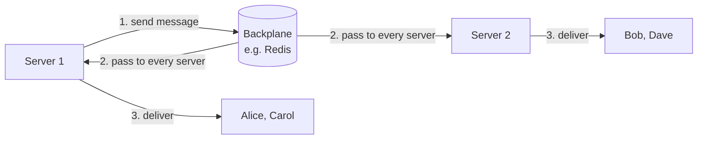
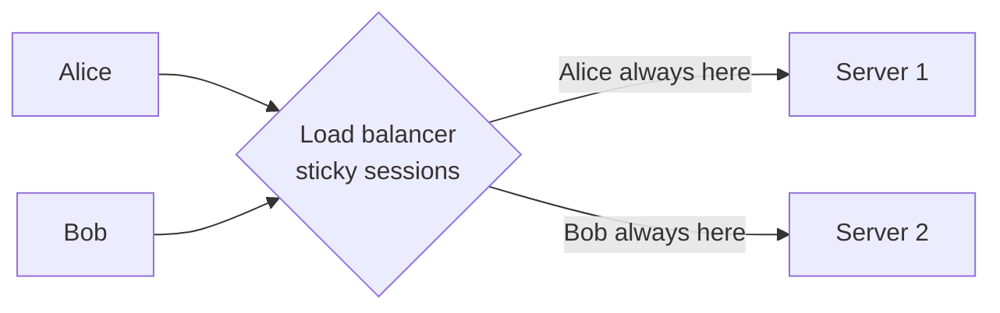

# Glossary: new terms explained simply

Each term has a one-line definition, a simple explanation, an analogy, and how you'd say it in an interview.

---

## Backplane

**One line:** a shared message channel that connects all your servers, so a message sent on one server reaches users connected to any server.

### The problem it solves
With real-time apps (SignalR, WebSockets), each user stays connected to **one specific server**. A server can only push messages to **its own** connected users.

```
Server 1: Alice, Carol        Server 2: Bob, Dave
```

If Server 1 wants to tell "everyone at table-1" that a bet was placed, it can only reach Alice and Carol. Bob and Dave, on Server 2, never hear it.

### How a backplane fixes it
All servers connect to one shared service, usually **Redis**:

1. Server 1 sends the message **to the backplane** instead of only to its own users.
2. The backplane passes it to **every server**.
3. Each server delivers it to **its own** connected users.



### Analogy
A building with two rooms, each with its own speakers. An announcement in room 1 isn't heard in room 2. A backplane is **one central PA system** wired into both rooms: anything announced goes to every room.

### Why it's called "backplane"
The name comes from hardware: a **backplane** is the board at the back of a computer rack that all the cards plug into, so they can talk to each other. Here, all the servers "plug into" the same message channel.

### Good to know
- It shares **messages only**, not data. Balances and game state still need to be stored in a shared place (Redis or a database).
- Common choices: **Redis** (most common with SignalR), a database-based one, or a managed service like **Azure SignalR Service**, which does the job for you.
- In SignalR: one line, `builder.Services.AddSignalR().AddStackExchangeRedis("<redis connection>")`.

### Interview sentence
> "With several servers, each one only knows its own connections, so I add a backplane, usually Redis pub/sub. Every server publishes messages to it and receives them from it, so a message reaches users on all servers."

---

## Sticky sessions

*(also called **session affinity**)*

**One line:** a load balancer setting that always sends the same user to the same server.

### What a load balancer normally does
A **load balancer** sits in front of your servers and spreads incoming requests across them, so no single server gets overloaded. Normally, each request can go to **any** server:

```
request 1 → Server 1
request 2 → Server 2     (same user, different server)
request 3 → Server 1
```

For a normal stateless REST API that's fine, because any server can answer any request.

### The problem
Some things are remembered by **one** server only. With SignalR, connecting takes **two steps**:

1. **"Negotiate"**: the user asks a server "how can I connect?", and that server creates a connection id and **remembers it in its memory**.
2. **"Connect"**: the user opens the real connection using that id.

If step 1 goes to Server 1 and step 2 goes to Server 2, Server 2 has never heard of that id and the connection **fails** (we tested this: `404 No Connection with that ID`).

### How sticky sessions fix it
The load balancer **remembers which server a user was sent to** and keeps sending that user there:

```
user Alice → always Server 1
user Bob   → always Server 2
```

It recognises the user by:
- their **IP address**, or
- a **cookie** the load balancer adds to the first response (more reliable).



### Analogy
A bank with several counters. Normally you go to whichever counter is free. But if you started filling in a form with one clerk, you need to **go back to the same clerk** to finish it, because the others don't have your form. Sticky sessions = "always go back to the same clerk".

### When you need it with SignalR
- **Yes**: by default (because of the negotiate step), and always with the fallback transports (long polling, Server-Sent Events), which send many separate requests.
- **No**: if you use **WebSockets only** and skip the negotiate step (`skipNegotiation: true`). There's then only one request, and it stays on one connection.
- **No**: with **Azure SignalR Service**, which handles connections for you.

### Downsides
- Load can become **uneven**: if you add a new server, existing users stay on the old servers.
- If a server dies, its users must **reconnect** to another server. That only works smoothly if data is stored in a **shared** place, not in that server's memory.
- Sticky sessions do **not** share data between servers. They just keep a user on one server.

### Interview sentence
> "SignalR's connection setup is stored in the memory of the server that handled it, so the load balancer needs sticky sessions to route the follow-up requests to the same server. You can avoid that with WebSockets-only and skipNegotiation, or by using Azure SignalR Service."

---

## Backplane vs sticky sessions: don't mix them up

| | Backplane | Sticky sessions |
|---|---|---|
| Question it answers | "How does a message reach users on **other** servers?" | "How does one user keep talking to the **same** server?" |
| Where it lives | between the servers (e.g. Redis) | in the load balancer |
| Shares data? | messages only | nothing |
| Needed for | sending to groups/users/everyone across servers | SignalR's negotiate step and the non-WebSocket transports |

You usually need **both** when you run SignalR on several servers.
