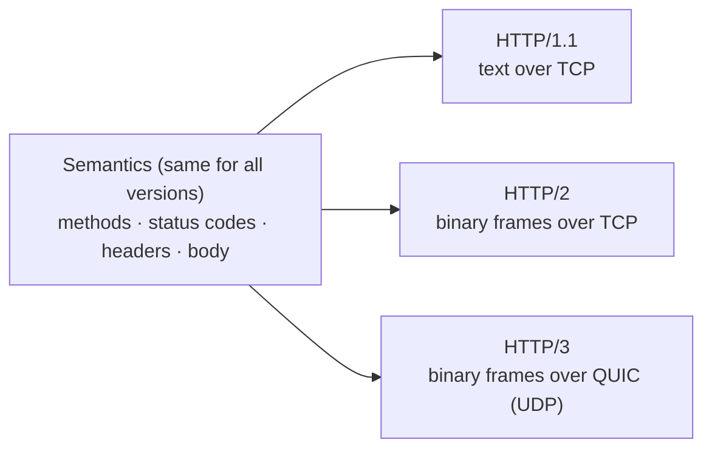

# HTTP: the essentials

HTTP is the protocol behind almost everything you build: REST APIs, web pages, SignalR's negotiate step, long polling, SSE, and the start of every WebSocket. This page covers what you need for day-to-day work and interviews, with real bytes captured from this project.

Related: [01a: WebSockets](../01a-websockets-explained.md) (HTTP message vs WebSocket frame) · [01b: polling](../01b-short-and-long-polling.md) · [C10k](c10k-problem.md)

## 1. What HTTP is

- An **application-level, request → response protocol**: the client sends a request, and the server sends exactly one response.
- **Stateless**: each request stands alone, and the server doesn't remember the previous one. State is added on top (cookies, tokens, databases).
- **Text semantics, many transports**: HTTP/1.1 runs over TCP as text. HTTP/2 runs over TCP as binary frames. HTTP/3 runs over QUIC (UDP). The **meaning** (methods, status codes, headers) is the same in all three.



## 2. Anatomy of a message (real capture from our server)

```
GET /app.css HTTP/1.1                ← request line: method, path, version
Host: localhost:5000                 ← headers
Accept: text/css
                                     ← blank line (end of headers)
```
```
HTTP/1.1 200 OK                      ← status line
Content-Type: text/css
Content-Length: 3030
ETag: "1dd60a2a3cbeed6"
Last-Modified: Tue, 20 Oct 2026 14:52:34 GMT
Server: Kestrel
                                     ← blank line
:root { --bg: #0f1a14; ...           ← body (3030 bytes)
```

Every line ends with `\r\n`. In HTTP/1.1 the body length comes from `Content-Length`, or from `Transfer-Encoding: chunked`, which sends `size\r\ndata\r\n` blocks ending with `0\r\n\r\n`. Chunked encoding is how a server streams a response whose size it doesn't know yet.

## 3. Methods

| Method | Purpose | Safe¹ | Idempotent² | Has body |
|---|---|---|---|---|
| `GET` | read a resource | ✅ | ✅ | no |
| `HEAD` | like GET, headers only | ✅ | ✅ | no |
| `OPTIONS` | what's allowed? (CORS preflight) | ✅ | ✅ | rarely |
| `POST` | create / run an action | ❌ | ❌ | yes |
| `PUT` | replace a resource completely | ❌ | ✅ | yes |
| `PATCH` | partially modify a resource | ❌ | ❌ (not guaranteed) | yes |
| `DELETE` | delete a resource | ❌ | ✅ | rarely |

¹ **Safe** = doesn't change server state.
² **Idempotent** = sending it **once or ten times** has the same effect. This matters for **retries**: clients, proxies and libraries may automatically retry idempotent requests after a network error, but must not blindly retry a `POST`. That's why payment and betting APIs add an **idempotency key** to POSTs (our Phase 2 `betId`).

## 4. Status codes

| Class | Meaning | The ones to know |
|---|---|---|
| **1xx** | informational | `101 Switching Protocols` (WebSocket upgrade) |
| **2xx** | success | `200 OK`, `201 Created` (+ `Location` header), `202 Accepted` (queued for later), `204 No Content` (our long-poll timeout) |
| **3xx** | redirect / use cache | `301`/`308` permanent, `302`/`307` temporary (`307`/`308` keep the method and body), `304 Not Modified` |
| **4xx** | **client** error | `400 Bad Request`, `401 Unauthorized` (= **not authenticated**), `403 Forbidden` (= authenticated but **not allowed**), `404 Not Found`, `409 Conflict`, `422 Unprocessable Content` (validation), `429 Too Many Requests` (+ `Retry-After`) |
| **5xx** | **server** error | `500 Internal Server Error`, `502 Bad Gateway` (proxy got a bad answer from the backend), `503 Service Unavailable` (overloaded or in maintenance, + `Retry-After`), `504 Gateway Timeout` (proxy waited too long for the backend) |

Rule of thumb: **4xx = "fix your request"** (retrying the same thing won't help). **5xx = "our problem"** (a retry later may work).

## 5. Headers you'll actually use

| Area | Headers |
|---|---|
| Content | `Content-Type`, `Content-Length`, `Content-Encoding: gzip/br`, `Accept`, `Accept-Encoding` |
| Auth | `Authorization: Bearer <token>`, `WWW-Authenticate` |
| State | `Cookie`, `Set-Cookie` (attributes: `HttpOnly`, `Secure`, `SameSite`, `Max-Age`) |
| Caching | `Cache-Control`, `ETag`, `If-None-Match`, `Last-Modified`, `If-Modified-Since`, `Vary` |
| Connection | `Host` (required in 1.1), `Connection`, `Upgrade`, `Keep-Alive` |
| Cross-origin | `Origin`, `Access-Control-Allow-Origin`, `Access-Control-Allow-Credentials` |
| Proxies | `X-Forwarded-For`, `X-Forwarded-Proto` (or the standard `Forwarded`) |
| Tracing | `traceparent` (W3C trace context), `X-Request-Id` / correlation ids |
| Rate limits | `Retry-After`, `RateLimit-*` |

## 6. Statelessness, and how we add state anyway

HTTP itself remembers nothing between requests. Common ways to add state:

- **Cookies**: the server sends `Set-Cookie: session=abc; HttpOnly; Secure; SameSite=Lax`, and the browser automatically sends `Cookie: session=abc` on later requests to that site.
  - `HttpOnly`: JavaScript can't read the cookie (limits damage from XSS).
  - `Secure`: only sent over HTTPS.
  - `SameSite`: limits sending from other sites (helps against CSRF).
- **Tokens**: the client stores a token (e.g. a JWT) and sends `Authorization: Bearer <token>` itself. Common for APIs and SPAs. For WebSockets the token goes in the **query string**, because browsers can't set headers there (Phase 2).
- Statelessness is what makes plain HTTP APIs **easy to scale**: any server can answer any request. Persistent connections (WebSockets) give that up, which is why scaling real-time is harder ([doc 04](../04-scaling-and-redis.md)).

## 7. Connections: HTTP/1.0 → 1.1 → 2 → 3

### HTTP/1.0 (1996)
A **new TCP connection per request** (TCP handshake, plus TLS handshake for HTTPS, every time). Slow.

### HTTP/1.1 (1997, still everywhere)
- **Keep-alive by default**: one TCP connection is reused for many requests, **one after another**.
- **Head-of-line (HOL) blocking**: on one connection, request #2 waits until response #1 is completely done. Pipelining was meant to fix this but was broken by buggy proxies and is basically unused.
- So browsers open **~6 parallel connections per host**. That's why long polling with many tabs can starve a page, and why developers used to bundle files and split domains ("domain sharding").

### HTTP/2 (2015)
Same semantics, **new binary wire format**:
- **Binary frames** with a 9-byte header: `length (24 bit) | type (8) | flags (8) | stream id (31)`. Frame types include `HEADERS`, `DATA`, `SETTINGS`, `PING`, `RST_STREAM` (cancel one request), `GOAWAY` (server is closing), and `WINDOW_UPDATE` (flow control).
- **Multiplexing**: many requests ("streams") run **at the same time over one TCP connection**, with their frames interleaved. No more 6-connection limit, and no app-level HOL blocking.
- **HPACK header compression**: repeated headers (cookies, user-agent) are sent as small references instead of full text.
- Server push existed but was **removed from browsers** (Chrome dropped it in 2022) because it rarely helped.
- **Remaining problem: TCP HOL blocking.** One lost TCP packet stalls **all** streams on the connection until it's retransmitted, because TCP delivers bytes strictly in order.
- Browsers only use HTTP/2 over **TLS**, negotiated during the TLS handshake via **ALPN**.

### HTTP/3 (2022)
- Runs on **QUIC**, a transport protocol over **UDP** with its own reliability, streams and congestion control.
- **Streams are independent at the transport level**: a lost packet only stalls **its own** stream, so TCP HOL blocking is gone.
- **TLS 1.3 is built in**: connection + encryption setup in **1 round trip** (0-RTT on resumption).
- **Connection migration**: a connection is identified by a connection ID, not IP:port, so switching from Wi-Fi to 4G doesn't drop it. Great for mobile.
- **QPACK** header compression (HPACK adapted for out-of-order delivery).
- Browsers discover it through the `Alt-Svc` response header, then try QUIC on later connections.

| | HTTP/1.1 | HTTP/2 | HTTP/3 |
|---|---|---|---|
| Wire format | text | binary frames | binary frames |
| Transport | TCP | TCP | **QUIC over UDP** |
| Parallel requests | ~6 connections | many streams on 1 connection | many streams on 1 connection |
| HOL blocking | per connection | at the TCP level | **none** across streams |
| Header compression | none | HPACK | QPACK |
| Encryption | optional | required in browsers | **always** (built in) |

## 8. HTTPS and TLS in a nutshell
- **TLS** gives **encryption** (no eavesdropping), **integrity** (no tampering) and **authentication** (the certificate proves you're talking to the real `example.com`).
- **TLS 1.3**: 1 round trip to set up (vs 2 for TLS 1.2). The optional **0-RTT** resumption can be **replayed** by an attacker, so it's only safe for idempotent requests.
- **SNI** (Server Name Indication) tells the server which hostname you want, so one IP can host many HTTPS sites.
- **TLS termination**: often the load balancer handles TLS and forwards plain HTTP inside the network. The backend then reads `X-Forwarded-Proto` to know the original request was HTTPS.

## 9. Caching
- **`Cache-Control: max-age=60`**: reuse for 60 s without asking the server.
- **`no-cache`**: you *may* store it, but **must check with the server** before using it. **`no-store`**: **don't store it at all** (use for balances and other private, live data). These two are often confused.
- **`private`** = only the browser may cache it. **`public`** = shared caches (CDN, proxy) may too.
- **Conditional requests**: our server sent `ETag: "1dd60a2a3cbeed6"`. Next time the browser sends `If-None-Match: "1dd60a2a3cbeed6"`, and if the file hasn't changed the server answers **`304 Not Modified`** with **no body**.
- **`Vary: Accept-Encoding`** (or `Authorization`) tells caches that the response depends on that request header.

## 10. CORS in one paragraph
Browsers block a page on `https://a.com` from reading responses from `https://b.com` unless `b.com` allows it. For "non-simple" requests (custom headers, JSON `Content-Type`, `PUT`/`DELETE`) the browser first sends a **preflight** `OPTIONS` request with `Origin` and `Access-Control-Request-Method`. The server must answer with `Access-Control-Allow-Origin` (and friends). **CORS is enforced by the browser, not the server.** `curl` ignores it completely. For SignalR from another origin you need specific allowed origins plus `AllowCredentials()`. `*` isn't allowed together with credentials.

## 11. HTTP and real-time

| Technique | How it uses HTTP |
|---|---|
| Short polling | ordinary requests on a timer |
| Long polling | ordinary requests that the server **holds** ([01b](../01b-short-and-long-polling.md)) |
| SSE | one response that **never ends** (`Content-Type: text/event-stream`). Works great over HTTP/2. |
| WebSocket | starts as an HTTP/1.1 `GET` with `Upgrade: websocket` → `101`, then **leaves HTTP**. Over HTTP/2 and HTTP/3 it's a stream opened with **extended CONNECT** (RFC 8441 / 9220) instead. |
| SignalR negotiate | an ordinary `POST /hub/negotiate` that returns JSON |

## 12. HTTP vs REST
**HTTP** is the protocol. **REST** is an architectural *style* that uses HTTP well: resources identified by URLs (`/api/players/42/balance`), standard methods with their real meaning, status codes, statelessness, and cacheability. Many "REST APIs" are really just "JSON over HTTP", which is fine. Just know the difference when asked.

## Interview questions

**1. What happens when you type a URL and press Enter?** *(the classic)*
DNS lookup → TCP connection (3-way handshake), or QUIC for HTTP/3 → TLS handshake (certificate check, ALPN chooses h2 or http/1.1) → HTTP request (method, path, headers) → server (often via load balancer/CDN → app) produces a response → browser parses the HTML, fetches CSS/JS/images (reusing connections or HTTP/2 streams) → renders. Mention caching (browser cache, CDN, `304`) at each step for bonus points.

**2. What does "HTTP is stateless" mean, and how do we keep users logged in?**
The server keeps no memory of earlier requests on the protocol level. Login state is added with cookies (a session id or token) or an `Authorization: Bearer` header sent on every request. Statelessness is what makes HTTP servers easy to scale horizontally.

**3. Difference between PUT, POST and PATCH? What does idempotent mean?**
POST creates or triggers an action and isn't idempotent. PUT replaces a whole resource and is idempotent. PATCH changes part of it and isn't guaranteed to be idempotent. Idempotent = repeating the request has the same effect as sending it once, which is what makes automatic retries safe. For non-idempotent operations (payments, bets), use an idempotency key.

**4. 401 vs 403?**
401 = "I don't know who you are" (missing or invalid credentials, so log in). 403 = "I know who you are, and you're not allowed" (logging in again won't help).

**5. 502 vs 503 vs 504?**
All three typically come from a proxy or load balancer. 502 = the backend returned an invalid response or closed the connection. 503 = the service is overloaded, in maintenance, or has no healthy backends. 504 = the backend didn't answer in time.

**6. What changed from HTTP/1.1 to HTTP/2?**
Same semantics, but a binary framing layer; multiplexing many streams over one TCP connection (no 6-connection limit, no app-level HOL blocking); HPACK header compression; stream priorities and flow control. TCP-level HOL blocking remains.

**7. Why HTTP/3, and why UDP?**
To get rid of TCP head-of-line blocking and handshake latency. QUIC implements reliable, independent streams on top of UDP (a lost packet stalls only its own stream), builds TLS 1.3 into the handshake (1-RTT, 0-RTT resumption), and supports connection migration between networks. UDP is used because new transport protocols can't realistically be deployed in OS kernels and middleboxes. QUIC runs in user space on top of UDP.

**8. What is head-of-line blocking?**
When one slow or lost item holds up everything queued behind it. In HTTP/1.1: request #2 waits for response #1 on the same connection. In HTTP/2: one lost TCP packet stalls all streams. HTTP/3/QUIC removes it across streams.

**9. How does HTTP caching work? `no-cache` vs `no-store`?**
`Cache-Control` sets freshness (`max-age`) and who may cache (`private`/`public`). `ETag`/`Last-Modified` let clients revalidate with `If-None-Match`/`If-Modified-Since` and get a cheap `304 Not Modified`. `no-cache` = store but always revalidate. `no-store` = never store, for sensitive or live data like balances.

**10. What is CORS and who enforces it?**
A browser security mechanism that stops pages from reading cross-origin responses unless the target server allows it via `Access-Control-Allow-*` headers. Non-simple requests trigger an `OPTIONS` preflight. It's enforced by the **browser**: server-to-server calls and `curl` aren't affected. It isn't an API security mechanism by itself.

**11. How does a WebSocket relate to HTTP?**
It starts as an HTTP/1.1 GET with `Upgrade: websocket` and `Sec-WebSocket-Key`. The server replies `101 Switching Protocols`, and the same TCP connection then carries WebSocket frames, no longer HTTP. Over HTTP/2 and HTTP/3, WebSockets use extended CONNECT on a single stream instead.

**12. What is chunked transfer encoding and when is it used?**
In HTTP/1.1, when the server doesn't know the body size up front, it sends the body as `size + data` chunks, ending with a zero-size chunk. It's used for streaming responses (and in practice for SSE and long-lived responses). HTTP/2 and HTTP/3 don't need it because their DATA frames already carry lengths.

**13. What is keep-alive and why does it matter?**
Reusing one TCP (and TLS) connection for multiple requests instead of reconnecting each time. It saves handshake round trips and CPU. It's the default in HTTP/1.1. Be aware of idle timeouts on servers and load balancers, which matter for long polling and WebSockets.

**14. HTTP vs REST?**
HTTP is the transfer protocol. REST is an architectural style built on it: resources as URLs, uniform methods with proper semantics, meaningful status codes, stateless interactions, cacheable responses. An API can use HTTP without being RESTful (e.g. RPC-style `POST /doThing`).

**15. Where does TLS terminate in a typical production setup, and what do you have to watch out for?**
Usually at the load balancer, ingress or CDN, which forwards plain HTTP (or re-encrypts) to the backends. The app must trust and read `X-Forwarded-For` / `X-Forwarded-Proto` (ASP.NET Core: `UseForwardedHeaders`) to know the real client IP and scheme. Otherwise redirects, cookie `Secure` flags and generated links break.
