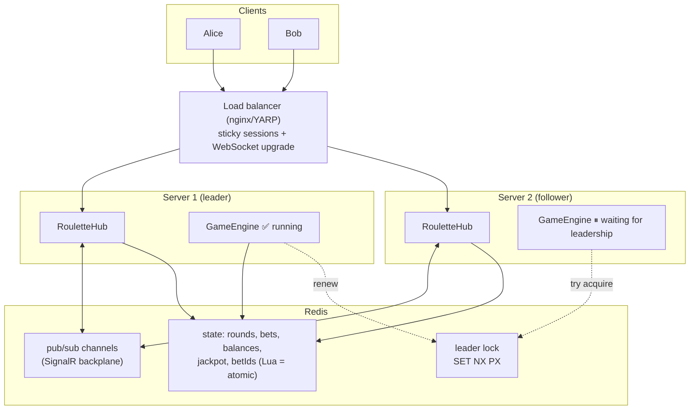
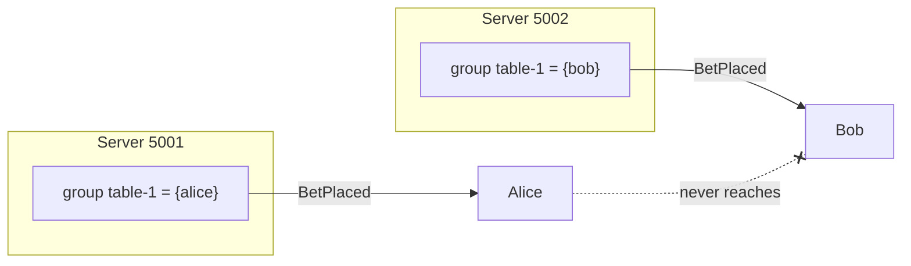
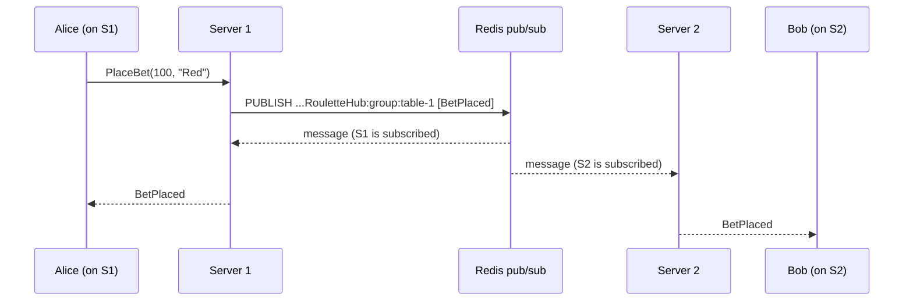
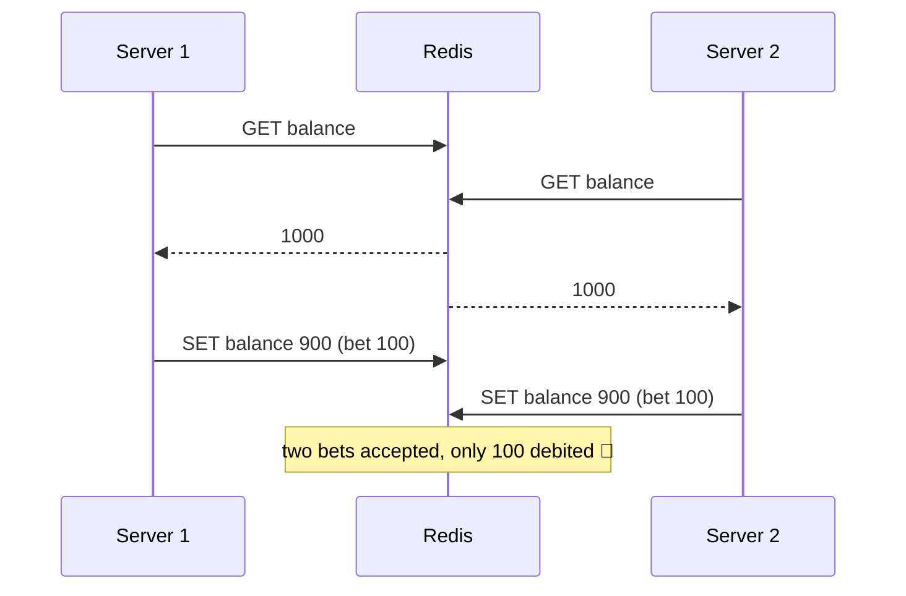
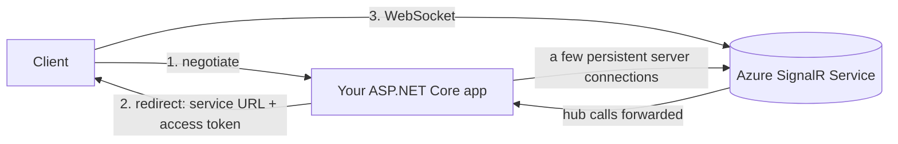

# Scaling and Redis: deep dive

> The detailed version of [04: Scaling](../04-scaling-and-redis.md), for when you want to go deeper. You do NOT need this for an interview. Every result below was **measured**, not imagined: two copies of the Phase 1 server on ports 5001/5002, a real Redis 7.4 in Docker, and Node.js test clients. The Phase 3 code (in its own folder, `src/` stays as Phase 1) will add an "In this project" section.

## 0. The short version

Scaling a real-time app out to several servers creates **two separate problems**:

| # | Problem | Symptom | Fix |
|---|---|---|---|
| 1 | **Messages** don't cross servers | players on different servers don't see each other | a **backplane** (Redis pub/sub) or **Azure SignalR Service** |
| 2 | **State and timers** are per server | two round timers, two results, two balances | **shared state** in Redis + **atomic** operations + **one leader** runs the game loop |

Plus one infrastructure detail: **sticky sessions**, because SignalR's negotiate step (and the non-WebSocket transports) must reach the same server.



---

## 1. Why scaling real-time is hard

A stateless REST API scales by **adding servers behind a load balancer**: any server can answer any request. A real-time server breaks every part of that:

| Thing | Where it lives in Phase 1 | Problem with 2+ servers |
|---|---|---|
| **Connections** | the server's memory (a WebSocket is a live TCP connection to *one* machine) | `Clients.Group("table-1")` only reaches connections **on this server** |
| **Groups** | the server's memory | players on server A and server B at "the same" table are in two different groups |
| **Game state** (`GameStore`) | a DI singleton = **one per process** | two different balances, bet lists, player lists |
| **Round timer** (`GameEngine`) | a `BackgroundService` on **every** server | two independent rounds with two different results |
| **Negotiate token** | the server that issued it | the next request must go to that same server |

### Vertical vs horizontal
- **Vertical** (a bigger machine): simplest. Thanks to async I/O a single .NET server can hold a lot of idle connections ([extra/c10k-problem.md](c10k-problem.md)). But there's a ceiling, and **one server = one point of failure**, and every deploy disconnects everybody.
- **Horizontal** (more machines): needed for availability and for large scale. This is where the problems above appear.

### What limits one server
Not threads (if nothing blocks), but:
- **memory per connection**: connection objects, buffers, groups, TLS state;
- **file descriptors**;
- **CPU for fan-out**: serializing and writing one message to N connections;
- **network bandwidth**.

Measure rather than guess (Phase 4 load test). The real limit is usually **message rate × fan-out**, not the number of idle connections.

---

## 2. Problem #1 demonstrated: two servers, no backplane

Setup: two copies of the Phase 1 server (5001, 5002). Alice connects to 5001, Bob to 5002, both join **table-1**, Alice bets 100 on Red, Bob bets 50 on 17.

Measured result:

```
alice@5001: players=["alice"] | bets seen=["alice:100@Red"]
   results: ["round 1 -> 15", "round 2 -> 25"]
bob@5002:   players=["bob"]   | bets seen=["bob:50@17"]
   results: ["round 1 -> 3",  "round 2 -> 36"]
```

- Each player sees **only themselves** and **only their own bet**.
- "Round 2" produced **25** on one server and **36** on the other.

**Why:** `Clients.Group("table-1").SendAsync(...)` looks up the group **in this process's memory**. Server 5001 has no idea Bob exists, and each server runs its own `GameEngine`.



---

## 3. The backplane (fixes messages)

### Idea
A **backplane** is a shared message bus that **every server** is connected to. When a server wants to send to a group, user or everyone, it **publishes** the message to the bus. **Every server subscribed** to that topic receives it and delivers it to **its own local** connections.



Important: the backplane fans out to **servers**, not clients. Each server still writes to its own connections.

### Turning it on

```csharp
// dotnet add package Microsoft.AspNetCore.SignalR.StackExchangeRedis
builder.Services.AddSignalR()
    .AddStackExchangeRedis("localhost:6379", options =>
    {
        // Lets several apps share one Redis. NOTE: the prefix is joined WITHOUT a separator,
        // so end it with ':' (we used "roulette" and got "rouletteRoulette.Server...").
        options.Configuration.ChannelPrefix = RedisChannel.Literal("roulette:");
    });
```

**No hub code changes.** `Clients.Group(...)`, `Clients.User(...)`, `Clients.All` and `Groups.AddToGroupAsync(...)` now work across servers.

### What it does underneath (captured)

`PUBSUB CHANNELS` while both servers were running:

```
rouletteRoulette.Server.Hubs.RouletteHub:all                        ← Clients.All
rouletteRoulette.Server.Hubs.RouletteHub:group:table-1              ← Clients.Group("table-1")
rouletteRoulette.Server.Hubs.RouletteHub:connection:79mrRhcvPF...   ← Clients.Client(id), one per connection
rouletteRoulette.Server.Hubs.RouletteHub:connection:Sd0XdiiYhk...
rouletteRoulette.Server.Hubs.RouletteHub:internal:groups            ← "add connection X to group Y" across servers
rouletteRoulette.Server.Hubs.RouletteHub:internal:ack:EHSAN_091a... ← acknowledgements for those group operations, one per server
rouletteRoulette.Server.Hubs.RouletteHub:internal:return:EHSAN_...  ← client results (server→client invoke with return value)
```

(A `:user:<id>` channel appears once users are authenticated, in Phase 2.)

- `PUBSUB NUMSUB ...:all` → **2** (one subscription per server instance, not per client).
- During one test: 21 messages on `group:table-1`, 16 on `group:table-2`, 1 on `all`.
- `DBSIZE` → **0**. The backplane **stores nothing**. It's pure pub/sub.

### Measured result with the backplane

```
alice@5001: bets seen=["alice:100@Red"]
bob@5002:   bets seen=["alice:100@Red"]     ← Bob now sees Alice's bet ✅
```

**Messages are fixed.** But see the next section.

### Backplane properties to know
- **Every message goes through Redis** to every subscribed server. Redis throughput becomes the ceiling for the whole system's push rate. A single Redis node handles a lot (often 100k+ simple ops/s), but plan for it.
- **No persistence, no retry**: if Redis is down or a server is disconnected from it, messages published in that window are **lost**. Connections stay open, but they miss messages. That's another reason for Phase 2's sequence numbers and resync.
- Every server receives every `All` message and every message for groups it has members in. With many servers and huge broadcast rates, that duplicated work adds up. That's one reason to consider **Azure SignalR Service**.
- Alternatives: Azure SignalR Service (no backplane needed), SQL Server or Orleans-based backplanes (community packages), or your own using any pub/sub.

---

## 4. Problem #2 demonstrated: state and timers are still per server

Same two servers, now **with** the backplane:

```
alice@5001: players=["bob"]               ← wrong: overwritten by server 5002's local list
   BettingOpen events: ["#1 ends 09:58:52.178", "#2 ends 09:59:05.196", "#2 ends 09:59:09.197"]
   results: ["round 1 -> 19", "round 1 -> 30", "round 2 -> 34"]
bob@5002:   players=["bob"]
   results: ["round 1 -> 19", "round 1 -> 30", "round 2 -> 34"]
bob rejections: ["Betting is closed for this round."]
```

What went wrong (servers started 4 s apart):
- **Two game engines**: every client now receives **both** timelines through the backplane, so there are two "round 1" results (19 **and** 30) and two "round 2" end times, 4 s apart.
- **A bet rejected for a round the player saw as open**: Bob saw `BettingOpen` pushed by **server 5001's** engine, but his bet went to **server 5002**, whose own round was in a different phase.
- **The player list** flips between each server's local view.
- **Balances** live in each server's memory: a reconnect that lands on the other server would show a different balance.

**The backplane moves messages, not state.** We need:
1. **Shared state** in one place (Redis);
2. **Atomic** check-and-update on that state;
3. **Exactly one** server running the round loop (leader election).

---

## 5. Shared state in Redis

### Key design (Phase 3 plan)

| Data | Redis type | Key | Notes |
|---|---|---|---|
| Round state | Hash | `table:{table-1}:round` → `id`, `phase`, `endsAtMs` | written only by the leader |
| Bets of a round | List | `table:{table-1}:round:42:bets` | appended by the bet script; set a TTL after settlement |
| Players at a table | Hash / Set | `table:{table-1}:players` | nickname per player id |
| Balance | String (integer) | `player:{alice}:balance` | `DECRBY`/`INCRBY` |
| Processed bet ids | String with TTL | `bet:{betId}` | `SET ... EX 86400`: the idempotency marker |
| Jackpot | String | `jackpot` | prefer **integer cents** with `INCRBY` over `INCRBYFLOAT` (floating-point drift) |
| Leader lock | String with TTL | `roulette:engine-leader` | `SET NX PX` |

Notes:
- `{table-1}` in braces is a **hash tag**. In a Redis **Cluster** only the part in braces decides the slot, so all keys of one table live on the same node, and a Lua script can touch them together.
- In a real casino the **balance's source of truth is a wallet service / SQL database** with an audit trail. Redis is fast shared state, but don't treat it as your ledger unless persistence (AOF), replication and failover are designed for it. For this learning project Redis is fine.

---

## 6. Atomic operations (preventing double spending)

### The race
"Check the balance, then debit" is **two steps**. Two servers can both check before either debits:



### Measured: 50 concurrent bets of 100 against a balance of 1000, from two connections

| Approach | Accepted | Final balance | Correct? |
|---|---|---|---|
| Naive `GET` then `SET` | **50** (= 5,000 credits spent) | **900** | ❌ massive double spend + lost updates |
| Lua script (below) | **10** (40 rejected "insufficient") | **0** | ✅ |

### Your options in Redis

| Option | How | Good for |
|---|---|---|
| Single atomic command | `INCRBY`, `DECRBY`, `SET NX`, `HINCRBY`… | one-key updates without a condition |
| `WATCH` + `MULTI/EXEC` | optimistic: watch keys, read, then queue writes; `EXEC` fails if a watched key changed → **retry** | simple conditions; retries under contention |
| **Lua script** (`EVAL`/`EVALSHA`) | the whole script runs **atomically** on the Redis server; nothing else runs in between | multi-key check-then-act (**our bet**) |
| Redis Functions (7.0+) | like Lua scripts but stored server-side as a library | same, with better deployment |

### The bet script (tested)

```lua
-- KEYS[1] round hash   KEYS[2] balance   KEYS[3] bets list   KEYS[4] betId marker   KEYS[5] jackpot
-- ARGV[1] roundId      ARGV[2] amount    ARGV[3] bet json
if redis.call('EXISTS', KEYS[4]) == 1 then return {'duplicate'} end           -- idempotency

local round = redis.call('HMGET', KEYS[1], 'id', 'phase', 'endsAtMs')
local t = redis.call('TIME')                                                  -- Redis = the single clock
local nowMs = tonumber(t[1]) * 1000 + math.floor(tonumber(t[2]) / 1000)
if round[1] ~= ARGV[1] or round[2] ~= 'BettingOpen' or nowMs >= tonumber(round[3]) then
  return {'closed'}                                                           -- server-authoritative timing
end

local amount = tonumber(ARGV[2])
if not amount or amount <= 0 then return {'invalid'} end
local balance = tonumber(redis.call('GET', KEYS[2]) or '0')
if balance < amount then return {'insufficient', tostring(balance)} end

local newBalance = redis.call('DECRBY', KEYS[2], amount)                      -- debit
redis.call('RPUSH', KEYS[3], ARGV[3])                                         -- record the bet
redis.call('SET', KEYS[4], '1', 'EX', 86400)                                  -- remember betId for 24 h
redis.call('INCRBYFLOAT', KEYS[5], amount * 0.01)                             -- jackpot (prefer integer cents in real code)
return {'ok', tostring(newBalance)}
```

Measured:
- 50 concurrent bets → **10 ok, 40 insufficient, balance 0, 10 bets stored, jackpot 10**.
- Same `betId` twice → `["ok","950"]` then `["duplicate"]`, balance **950** (debited once).
- Phase set to `BettingClosed` → `["closed"]`.

It's **the same rules as Phase 1's `GameStore.PlaceBet`** (the `lock` becomes "Redis runs one script at a time").

### Lua rules of thumb
- Redis executes scripts **one at a time**. A slow script blocks **everyone**, so keep scripts short (no loops over big collections).
- Pass **every key** in `KEYS[]` (not built inside the script). Redis Cluster needs this to route the call, and all keys must be in the same slot (use hash tags).
- Use `EVALSHA` (send the script hash instead of the text). Client libraries handle the caching; in StackExchange.Redis use `LuaScript.Prepare(...)` / `ScriptEvaluateAsync`.
- Using **`redis.call('TIME')`** makes Redis the single clock for "is betting still open?", so it doesn't matter if the servers' clocks drift apart. The leader should compute `endsAtMs` from Redis time too.

---

## 7. Leader election (only one GameEngine)

### Why
The round loop must run **exactly once per table**, not once per server. Options:
- run the engine in a **separate single service** (simple, but a single point of failure unless it has failover);
- **leader election**: every server *can* run it, but only the one holding a lock *does*.

### The algorithm (Redis lock with expiry)

```
acquire:  SET roulette:engine-leader <myId> NX PX 3000     → "OK" = I'm leader, nil = someone else is
renew:    every ~1 s, only if I still own it:
          if GET == myId then PEXPIRE 3000                  (Lua, atomic compare-and-extend)
release:  on shutdown, only if I still own it:
          if GET == myId then DEL                           (Lua, atomic compare-and-delete)
follower: retry acquire every ~0.5–1 s
```

- **`NX`** = only set if the key doesn't exist, so exactly one server wins.
- **`PX 3000`** = the lock expires by itself after 3 s, so if the leader **crashes**, the lock frees itself.
- **Compare before renew/delete**: never extend or delete a lock that someone else now owns.

### Measured timeline

```
t=0.0s A: SET NX PX -> OK                    (A is leader)
t=0.0s B: SET NX PX -> null                  (B waits, retries every 500 ms)
t=4.5s A still leader after the 3000 ms TTL thanks to renewals (owner = instance-A, ttl = 2524 ms)
t=4.5s A: *** crashes (stops renewing) ***
t=7.1s B: acquired the lock -> B is now leader and starts the GameEngine
t=7.2s A comes back and tries to renew -> 0  (not the owner any more: A must stop acting as leader)
t=7.2s A tries to release B's lock -> 0      (refused)
```

Failover took **~2.6 s** (the lock's remaining TTL plus the retry interval). That's the trade-off: **a shorter TTL means faster failover, but a higher risk of losing leadership during a GC pause or network hiccup.**

### In .NET (Phase 3 shape)

```csharp
// A BackgroundService that loops: try to acquire → while leader: renew + run the engine → on loss: cancel the engine.
while (!stoppingToken.IsCancellationRequested)
{
    if (await db.StringSetAsync(LockKey, _instanceId, TimeSpan.FromSeconds(3), When.NotExists))
    {
        using var leadership = CancellationTokenSource.CreateLinkedTokenSource(stoppingToken);
        var engine = _engine.RunAsync(leadership.Token);              // start the round loop
        while (await RenewAsync())                                    // compare-and-extend Lua
            await Task.Delay(TimeSpan.FromSeconds(1), stoppingToken);
        leadership.Cancel();                                          // lost the lock: stop immediately
        await engine;
    }
    await Task.Delay(TimeSpan.FromMilliseconds(500), stoppingToken);
}
```

Because round state lives **in Redis**, the new leader **continues** the current round (it reads `phase` and `endsAtMs`) instead of starting over.

### The hard part: "two leaders for a moment" (split brain)
If the old leader freezes (a long GC pause or a network partition) longer than the TTL, the lock expires and B becomes leader. **Then A wakes up and still believes it's the leader** for a short moment, until its next renew fails. Defences:
- **Check leadership before every important write**, or better:
- **Fencing tokens**: on acquiring, `INCR roulette:leader-epoch` and remember the number. Every write by the engine includes the epoch, and the Lua script rejects writes with an older epoch. A stale leader can then do no harm.
- Keep critical sections short, and the renew interval well below the TTL (≈ TTL/3).

Alternatives: Kubernetes **Lease** objects, **etcd / ZooKeeper / Consul** (built for consensus), database locks (`sp_getapplock`, `pg_advisory_lock`). *Redlock* (a lock over several Redis nodes) exists but is debated (Martin Kleppmann's critique). For correctness-critical locks, use fencing tokens whatever the lock is.

---

## 8. Redis pub/sub internals

How it works inside Redis:
- Redis keeps a dictionary **channel → list of subscribed client connections** (plus a list of pattern subscriptions).
- `PUBLISH channel msg` walks that list and **copies the message into each subscriber's output buffer**, then returns **how many subscribers got it**. That's it.
- A connection in subscribe mode can only (un)subscribe and ping. That's why StackExchange.Redis uses a **separate** connection for subscriptions.

Measured:

```
PUBLISH table-1 "BettingOpen round 1"    → 0   (nobody listening: message gone)
(subscriber connects)
PUBLISH table-1 "BettingClosed round 1"  → 1   (subscriber received it)
PUBSUB NUMSUB table-1                    → 1
(subscriber disconnects)
PUBLISH table-1 "Result round 1: 17"     → 0   (gone again)
DBSIZE                                   → 0   (nothing was ever stored)
```

So Redis pub/sub is:
- **fire-and-forget, at-most-once**: no acknowledgement, no retry;
- **not persistent**: an offline subscriber **misses** messages, and there is no replay;
- **fast and simple**: perfect for **ephemeral** messages like "push this to these sockets now";
- **unforgiving to slow subscribers**: if a subscriber reads too slowly, its output buffer grows, and Redis **disconnects** it past `client-output-buffer-limit pubsub` (default 32 MB hard / 8 MB for 60 s).
- In **Redis Cluster**, classic `PUBLISH` is broadcast to **all nodes**. Redis 7 adds **sharded pub/sub** (`SPUBLISH`) to avoid that.

That's exactly why the SignalR backplane is fine for **notifications**, but **money must never depend on it**: balances and bets live in state (and in a real system, a database), and clients **resync** after gaps.

---

## 9. Comparison: Redis pub/sub vs Redis Streams vs RabbitMQ vs Kafka

Measured with Redis Streams: with **no consumer running**, `XADD` ×4 → stream length 4. A consumer that starts **later** reads all four (`BettingOpen | BetPlaced | BettingClosed | Result:17`). A **consumer group** read 2 → **pending 2** until `XACK`; after acking one → **pending 1** (an un-acked message can be re-claimed by another worker if this one dies).

| | Redis pub/sub | Redis Streams | RabbitMQ | Kafka |
|---|---|---|---|---|
| Model | broadcast to current subscribers | append-only log in Redis | broker with queues and exchanges | distributed, partitioned append-only log |
| Persistence | ❌ none | ✅ in Redis memory (+ AOF/RDB) | ✅ durable queues | ✅ on disk, replicated |
| Offline consumer | **misses** messages | catches up from an id | messages wait in its queue | catches up from an offset |
| Delivery | at-most-once | at-least-once (groups + `XACK`) | at-least-once (acks); per-queue ordering | at-least-once (exactly-once possible with transactions) |
| Replay history | ❌ | ✅ (until trimmed) | ❌ (once consumed) | ✅ (retention, days or forever) |
| Consumer groups / work sharing | ❌ | ✅ | ✅ (competing consumers) | ✅ (partition per consumer) |
| Routing | channel / pattern | stream key | **rich**: direct, topic, fanout, headers | topic + partition key |
| Latency | sub-ms | sub-ms | ~ms | ms to tens of ms (batching) |
| Throughput | very high | very high (memory-bound) | high | **very high**, horizontally scalable |
| Ops cost | already have Redis | already have Redis | a broker cluster | a cluster (ZooKeeper or KRaft) |
| Typical use | **SignalR backplane**, cache invalidation, live notifications | lightweight event log, job queues, "last N events" for resync | task queues, commands, integration between services | event sourcing, analytics, audit trail, high-volume event pipelines |

**In a casino:**
- **pub/sub** → push fan-out (the backplane).
- **Streams** → recent table events, for resync after reconnect.
- **RabbitMQ** → commands and work queues (e.g. "settle round 42", emails).
- **Kafka** → the durable stream of every bet, payout and wallet change, for audit, analytics and regulators.

Often you'll use several of them together.

---

## 10. Sticky sessions

### Why they're needed (measured)
SignalR's connection starts with `POST /negotiate`, which returns a **connection token held in that server's memory**. The next request must reach **the same server**:

```
POST /hubs/roulette/negotiate               on 5001 → token 1hOBkYyR6zLBPOAX057kSg
GET  /hubs/roulette?id=<token> (WebSocket)  on 5002 → HTTP/1.1 404 Not Found
GET  /hubs/roulette?id=<token> (long poll)  on 5002 → 404 "No Connection with that ID"
GET  /hubs/roulette?id=<token> (WebSocket)  on 5001 → HTTP/1.1 101 Switching Protocols ✅
```

| Transport | Requests per connection | Needs sticky sessions? |
|---|---|---|
| WebSockets | negotiate + 1 upgrade (then a single TCP connection) | **yes**, for negotiate → upgrade |
| WebSockets with `skipNegotiation: true` | just the upgrade | **no** (measured: a direct upgrade to 5002 without an id → `101`) |
| Server-Sent Events | negotiate + 1 stream + a POST per client→server message | **yes** |
| Long polling | negotiate + a GET per poll + a POST per message | **yes** |

**Sticky sessions don't share state.** They only keep one client on one server. You still need the backplane and shared state.

### How to configure them
- **nginx**: `ip_hash` (simple, but uneven behind corporate NAT where many users share one IP) or cookie-based hashing (`hash $cookie_...`). Also forward `Upgrade`/`Connection` headers and raise `proxy_read_timeout` above the keep-alive interval.
- **YARP** (the .NET reverse proxy): `SessionAffinity` enabled on the cluster (cookie-based).
- **Azure App Service**: "ARR affinity" (on by default). **Kubernetes ingress-nginx**: `nginx.ingress.kubernetes.io/affinity: cookie`.

### Downsides
- Uneven load: long-lived connections stay on old servers after you scale out, so new servers start empty.
- When a server dies, its clients reconnect elsewhere. That's fine **only if state is shared** (section 5) and the client **resyncs** (Phase 2).

---

## 11. Azure SignalR Service: let someone else hold the connections



- Clients connect to the **service**, not your servers. Your servers keep only a few connections to the service.
- `negotiate` on your app returns the service URL and a token, so clients are redirected.
- The service handles **connections, groups, users, fan-out, scale**. Your app just calls `Clients.Group(...)` as usual (`builder.Services.AddSignalR().AddAzureSignalR(...)`).
- **No backplane and no sticky sessions to manage.** Your app servers become almost stateless for connections.
- Capacity is sold in **units** (each roughly 1,000 concurrent connections in the Standard tier, plus a message quota). It scales by adding units.
- There's also **serverless mode** (Azure Functions + REST API to push) without a hub server.
- **It does NOT solve problem #2.** Game state, atomic bets and the single round timer are still your job.

Similar managed options elsewhere: AWS API Gateway WebSockets, Ably, Pusher.

---

## 12. Phase 3 target setup

```
docker-compose:
  redis        backplane + shared state + leader lock
  server-1     Roulette.Server (port 5001)
  server-2     Roulette.Server (port 5002)
  nginx        :8080 → server-1/server-2, sticky (ip_hash), WebSocket upgrade headers
```

Demo script for Phase 3:
1. Two servers **without** Redis → players don't see each other (section 2).
2. Add the backplane → messages cross, but two timelines (section 4).
3. Shared state + Lua bet script + leader election → one timeline; kill the leader → the follower takes over (sections 5–7).
4. Put nginx in front with sticky sessions (section 10).
5. `Roulette.PubSubDemo` console app → see raw pub/sub behaviour (section 8).

---

## 13. Checklist: scaling a real-time app

- [ ] Messages cross servers (backplane or managed service)
- [ ] No game or money state in server memory; it's shared and the **source of truth** is durable
- [ ] Every check-then-act on shared state is **atomic** (Lua, transactions, conditional SQL)
- [ ] Every money operation is **idempotent** (betId)
- [ ] Exactly **one** owner for timers/loops (leader election + fencing, or a dedicated service)
- [ ] Sticky sessions (or WebSockets-only + `skipNegotiation`, or Azure SignalR)
- [ ] The load balancer forwards `Upgrade`, and its timeouts are longer than keep-alive
- [ ] Clients **reconnect + resync** (connections *will* move between servers)
- [ ] The backplane (Redis) is monitored and highly available; you know what happens when it's down
- [ ] A load test proves the per-server limits (Phase 4)

Interview questions for this topic are in [06-interview-questions.md](../06-interview-questions.md#scaling-and-redis).
