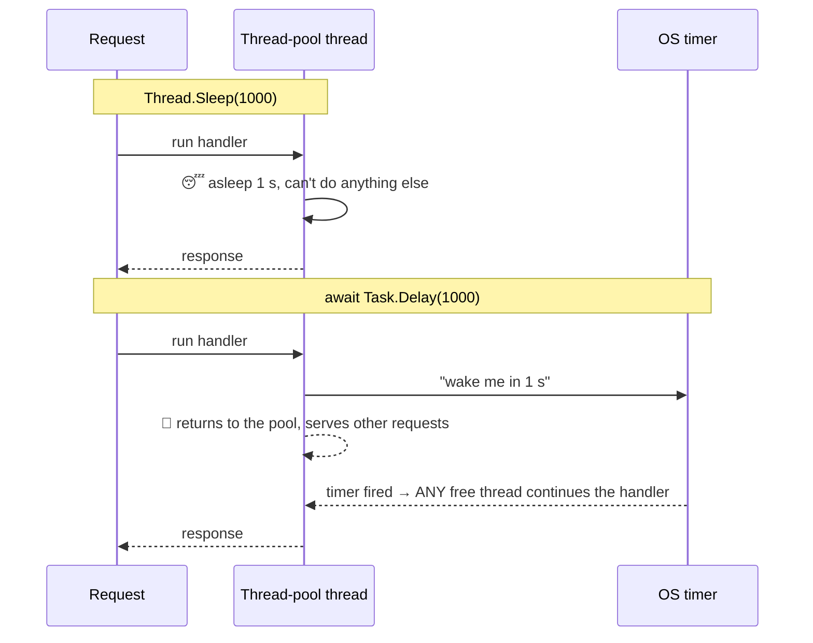

# `Thread.Sleep` vs `await Task.Delay`

Both wait one second. Only one of them keeps a thread hostage while it waits.

## The difference in one picture



- **`Thread.Sleep(1000)`** asks the OS to suspend **this thread**. The thread still exists (with its stack, usually 1 MB+ reserved) and **can't be used for anything else** for that second.
- **`await Task.Delay(1000)`** registers a timer and **returns the thread to the pool**. When the timer fires, the rest of the method continues on whichever pool thread is free. **No thread is used while waiting.**

Analogy: a waiter who stands next to your table for 10 minutes while your food cooks, versus a waiter who serves other tables and comes back when the kitchen bell rings.

## Measured on this machine (22 CPUs, .NET 10, Release)

Two endpoints, hit with **200 requests at the same time**:

```csharp
app.MapGet("/sleep", () => { Thread.Sleep(1000); return "slept"; });
app.MapGet("/delay", async () => { await Task.Delay(1000); return "delayed"; });
app.MapGet("/ping",  () => "pong");
```

| 200 concurrent requests to | All done after | A `/ping` sent during the storm took |
|---|---|---|
| `/delay` (`await Task.Delay`) | **1.20 s** | **9 ms** |
| `/sleep` (`Thread.Sleep`) | **9.07 s** | **7,874 ms** 😱 |

Why: the thread pool starts with about one thread per CPU (22 here). With `Thread.Sleep`, every one of those threads is asleep, so the other requests, **including a trivial `/ping`**, wait in a queue. The pool notices and adds threads, but **only slowly** (deliberately, to avoid creating thousands of threads). That's **thread pool starvation**: the CPU is almost idle, yet the server is unresponsive.

## The same trap in disguise

Anything that **blocks a thread while waiting for something** has the same effect:

| Blocking (holds the thread) | Async (releases the thread) |
|---|---|
| `Thread.Sleep(ms)` | `await Task.Delay(ms)` |
| `task.Result`, `task.Wait()`, `GetAwaiter().GetResult()` ("sync over async") | `await task` |
| `File.ReadAllText`, `stream.Read` | `await File.ReadAllTextAsync`, `await stream.ReadAsync` |
| sync DB calls (`ToList()`, `ExecuteReader()`) | `await ToListAsync()`, `await ExecuteReaderAsync()` |
| `HttpClient.Send` | `await HttpClient.SendAsync` |

Phase 4 of this project adds a deliberate `.Result` in the bet path and diagnoses the starvation with `dotnet-counters` (watch **ThreadPool Queue Length** climb).

## When `Thread.Sleep` is fine
- On a **dedicated thread you own** (a `new Thread(...)` worker, a console app's main thread) where nothing else is waiting for that thread.
- Short **spin-wait backoff** in low-level code.
- **Never** in ASP.NET Core request handlers, SignalR hub methods, or `BackgroundService`s that share the thread pool.

> Note: `Task.Delay` doesn't make *one* request faster. Both wait 1 s. It makes the **server** scale, because waiting costs no threads.

## Interview questions

**1. What does `Thread.Sleep` do?**
It suspends the current OS thread for at least the given time. The thread keeps its resources and can't run other work.

**2. What does `await Task.Delay` do differently?**
It creates a timer-backed task and returns the thread to its caller or pool. The continuation runs on a pool thread when the timer completes. No thread is held during the wait.

**3. Why is `Thread.Sleep` dangerous in ASP.NET Core?**
Requests run on shared thread-pool threads. Sleeping ties them up, so new requests queue up: thread pool starvation, with huge latency at low CPU.

**4. What is thread pool starvation?**
All pool threads are blocked waiting, so queued work can't start. The pool injects new threads only gradually, so latency explodes. Symptoms: rising **ThreadPool Queue Length**, low CPU, timeouts.

**5. Why doesn't the thread pool just create 1,000 threads immediately?**
Threads are expensive (stack memory, scheduling, context switches), and too many threads hurt throughput. The pool grows cautiously, which is exactly what makes blocking code so harmful under bursts.

**6. Is `.Result` / `.Wait()` the same problem?**
Yes ("sync over async"). It blocks a thread until the task finishes. In older ASP.NET or UI apps it could also **deadlock** because of the synchronization context. In ASP.NET Core it "only" starves the pool.

**7. Does `await Task.Delay(1000)` make my request return faster?**
No. It still waits ~1 s. It improves **throughput and scalability**, because the server can handle many more waiting requests at once.

**8. On which thread does the code after `await Task.Delay` run?**
In ASP.NET Core (no synchronization context), on any available thread-pool thread, often not the original one. Don't rely on thread identity or `[ThreadStatic]` across an `await`.

**9. How would you find blocking calls in production?**
`dotnet-counters monitor` (thread pool thread count and queue length), `dotnet-trace` / `dotnet-stack` to see threads parked in `Sleep`, `Wait` or `Monitor.Enter`, and analyzers that flag `.Result` and sync I/O.

**10. When is `Thread.Sleep` acceptable?**
On a thread you own and that nothing else needs (a dedicated worker thread, a simple console tool), or for tiny spin backoffs. Not in request, hub or shared background-service code.

**11. Is `Task.Delay` accurate to the millisecond?**
No. It depends on the OS timer resolution (about 15.6 ms on Windows by default) and on a pool thread being available to continue. Fine for timeouts and pacing, not for precise timing. That's one reason our `GameEngine` waits until an **absolute end time** instead of chaining delays.
