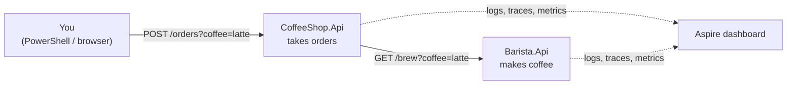

# Training: Observability with Aspire (logs, traces, metrics, correlation ids)

Learn by doing what **logs**, **metrics**, **traces** and **correlation ids** are, and how to use them to find a problem. You build a tiny **Coffee Shop** made of two services and watch everything in the **Aspire dashboard**.

| Part | You do |
|---|---|
| [Part 1: Build and run](part-1-build-and-run.md) | create the Coffee Shop with Aspire, run it, tour the dashboard |
| [Part 2: Logs, traces, metrics](part-2-logs-traces-metrics.md) | write good logs, add your own trace step and metric, follow one order across both services, then solve a "customer complaint" like in a real job |

Time: about 2 hours. No Docker needed.

## The app

| Coffee | Behaviour | Why |
|---|---|---|
| `latte` | fast (100–300 ms) | the normal case |
| `cappuccino` | slow (1.5–2.5 s) | so you can **find a slow request** |
| `mocha` | always fails ("out of chocolate") | so you can **find an error** |

## The four ideas in one page

Imagine **one coffee order**:

| Signal | Question it answers | In the coffee shop | Where in the dashboard |
|---|---|---|---|
| **Logs** | "What happened, in words?" | `Order received for mocha` · `Out of chocolate, can't make mocha` | **Structured logs** |
| **Metrics** | "How many / how fast / how often, **in total**?" | 120 orders in the last minute, 8% failed, p95 = 2.1 s | **Metrics** |
| **Traces** | "Where did the time go for **this one** order?" | order 2,300 ms = loyalty check 50 ms + barista call 2,200 ms | **Traces** |
| **Correlation id** (trace id) | "Which logs and steps belong to **the same** order?" | one id (`4bf92f35…`) on every log line and step of that order, in **both** services | shown on every log and trace |

- **Metrics** tell you **that** something is wrong (cheap numbers, aggregated).
- **Traces** tell you **where** (one request, step by step, across services).
- **Logs** tell you **why** (the details).
- The **trace id** ties them together.

## What is Aspire?

**Aspire** is a .NET toolkit for running apps made of several services. For this training it gives you three things for free:
1. **One click starts all services** (the "AppHost" project).
2. **OpenTelemetry is already set up** (the "ServiceDefaults" project). Every service automatically sends its logs, traces and metrics.
3. **A dashboard** that shows all of it.

> 🧠 **OpenTelemetry** (OTel) is the industry standard for producing logs, traces and metrics. Aspire's dashboard is just one place to view them. In production the same data goes to Application Insights, Grafana, Datadog and so on, **without changing your code**. That's why what you learn here applies everywhere.
