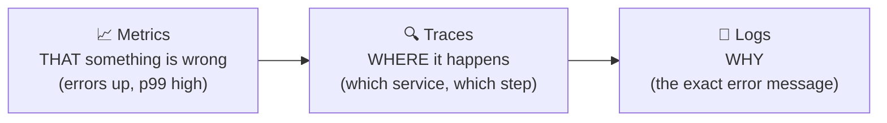

# Part 2: Logs, traces, metrics and correlation ids

Keep the Coffee Shop from Part 1. Each section has: a short explanation 🧠, something to **do**, and something to **find in the dashboard** ✅.

Set your coffeeshop address in a terminal (from the dashboard's **Resources** page):

```powershell
$shop = "http://localhost:5123"   # ← your coffeeshop address
```

---

## A. Logs: "what happened, in words"

### 🧠 Log levels

| Level | Use for | In our code |
|---|---|---|
| `Trace` / `Debug` | very detailed info, while developing | not used |
| `Information` | normal events worth knowing | "Order received", "latte ready" |
| `Warning` | something unexpected, but the app copes | "Order failed: barista returned 500" |
| `Error` | an operation failed | "Out of chocolate" |
| `Critical` | the app itself is in trouble | not used |

In production you usually keep `Information` and above. `appsettings.json` → `Logging:LogLevel` controls it.

### 🧠 Message templates, not string interpolation

```csharp
logger.LogInformation("Order received for {Coffee}", coffee);   // ✅ structured: Coffee becomes a FIELD
logger.LogInformation($"Order received for {coffee}");          // ❌ just text: can't filter by Coffee
```

With the template, the dashboard (and any log tool) stores `Coffee = mocha` as a **field**, so you can search and filter by it.

### Do and find

Place a few orders (`latte`, `mocha`), then open **Structured logs**:

1. Filter by level: show only **Error**. ✅ You see "Out of chocolate, can't make mocha" from `barista`.
2. Click that log line. ✅ The details show fields: **`Coffee: mocha`**, plus **`TraceId`** and **`SpanId`**. Remember those, they're the correlation ids (section C).
3. Use **Filters → Add filter → `Coffee` equals `latte`**. ✅ Only latte logs, from **both** services.

---

## B. Traces and spans: "where did the time go?"

### 🧠 Trace vs span

- A **trace** = the whole journey of **one request**, across all services.
- A **span** = **one step** of that journey: a name, a start time, a duration, a status (OK/error), tags, and a **parent** span. Spans form a tree.

One latte order:

```
POST /orders                          (coffeeshop)     260 ms   ← root span
└── GET /brew   (HTTP call out)       (coffeeshop)     205 ms
    └── GET /brew                     (barista)        200 ms
```

You didn't write any tracing code for this. **ASP.NET Core and HttpClient create these spans automatically** because of `AddServiceDefaults()`.

### Do and find

```powershell
Invoke-RestMethod -Method Post "$shop/orders?coffee=latte"
Invoke-RestMethod -Method Post "$shop/orders?coffee=cappuccino"
try { Invoke-RestMethod -Method Post "$shop/orders?coffee=mocha" } catch { "mocha failed (as expected)" }
```

Open **Traces**:

1. **latte**: click it. ✅ The tree above, with both services in one timeline.
2. **cappuccino**: ✅ the total is ~2 s, and the bar shows **where**: almost all of it is the `barista` span. *That's how you find a slow step.*
3. **mocha**: ✅ red error spans. **Look closely: there are several `GET /brew` calls, not one!**

> 🧠 **Surprise: retries.** `ServiceDefaults` adds a **resilience handler** to every HttpClient. It automatically **retries** failed calls (with growing waits between tries). That's why a mocha order takes much longer and the barista was called several times. Without a trace you'd never notice this. It's a classic real-world finding: *retries can multiply the load on a service that's already failing.*

### Add your own span

Automatic spans cover HTTP calls. For **your own** steps, you create spans yourself. Let's add a "Check loyalty card" step.

**1. In `CoffeeShop.Api/Program.cs`**, add at the very top:

```csharp
using System.Diagnostics;
```

and after `app.MapDefaultEndpoints();`:

```csharp
// Our own source of spans. The name must also be registered in ServiceDefaults (step 2).
var activitySource = new ActivitySource("CoffeeShop.Api");
```

Inside the `/orders` handler, right after the "Order received" log line:

```csharp
using (var activity = activitySource.StartActivity("Check loyalty card"))
{
    activity?.SetTag("coffee", coffee);
    await Task.Delay(50);   // pretend we look up the customer's loyalty card
}
```

**2. In `CoffeeShop.ServiceDefaults/Extensions.cs`**, find `.WithTracing(tracing => ...)` and **add** one line to the chain:

```csharp
tracing.AddSource(builder.Environment.ApplicationName)
    .AddSource("CoffeeShop.Api")          // ← add this line
    .AddAspNetCoreInstrumentation()
    // ... keep the rest as it is
```

> 🧠 In .NET a span is called an **`Activity`**, and an `ActivitySource` creates them. OpenTelemetry only records sources that are **registered** with `AddSource(...)`. Forget that line and your span silently doesn't appear. That's the #1 mistake. (The `?` in `activity?.` is there because `StartActivity` returns `null` when nobody is listening.)

Restart (F5), order a latte. ✅ The trace now has a **`Check loyalty card`** span (~50 ms) with the tag `coffee = latte`.

---

## C. Correlation ids: "which pieces belong together?"

### 🧠 The idea

Every trace has a **trace id** (32 hex characters, e.g. `4bf92f3577b34da6a3ce929d0e0e4736`). Everything that happens for one request carries it:
- every **span**, in every service;
- every **log line** written during that request (that's the `TraceId` field you saw in section A).

**How does the barista know the coffee shop's trace id?** When `CoffeeShop.Api` calls the barista, HttpClient automatically adds an HTTP header:

```
traceparent: 00-4bf92f3577b34da6a3ce929d0e0e4736-00f067aa0ba902b7-01
             │  └──────────── trace id ──────────┘ └─ parent span ─┘ └ flags
             version
```

This is the **W3C Trace Context** standard. The barista reads it and continues the **same** trace. That's how one id flows through all services.

> 🧠 "Correlation id" is the general name for "an id that ties together everything about one request". In modern apps the **trace id** *is* the correlation id.

### Do 1: see the header arrive

In `Barista.Api/Program.cs`, change the start of the handler to also receive the request and log the header:

```csharp
app.MapGet("/brew", async (string coffee, HttpRequest request, ILogger<Program> logger) =>
{
    logger.LogInformation("Brewing {Coffee}. Incoming traceparent: {TraceParent}",
        coffee, request.Headers["traceparent"].ToString());
    // ... rest unchanged
```

Restart, order a latte, open **Structured logs**, click the "Brewing latte" line. ✅ The `TraceParent` value contains **the same trace id** as the log's own `TraceId` field.

### Do 2: give the customer a "support code"

Real apps show the trace id to the user ("Error, reference: 4bf92f35…") so support can find the exact request. In `CoffeeShop.Api`, at the start of the `/orders` handler:

```csharp
var supportCode = Activity.Current?.TraceId.ToString();
```

and change the two `return` lines:

```csharp
return Results.Problem($"Sorry, we couldn't make your {coffee}. Support code: {supportCode}");
// ...
return Results.Ok($"Your {coffee} is ready! Support code: {supportCode}");
```

> 🧠 `Activity.Current` = the span that's running right now (the incoming request). Its `TraceId` is the correlation id for this whole order.

Restart, then:

```powershell
try { Invoke-RestMethod -Method Post "$shop/orders?coffee=mocha" } catch { $_.ErrorDetails.Message }
```

✅ The error message ends with `Support code: <32 characters>`. Copy it, then in **Structured logs → Filters → `TraceId` equals `<your code>`**. ✅ You see **every log line of that one order, from both services, in order**: "Order received", "Brewing mocha" (several times, the retries), "Out of chocolate", "Order failed". Click any of them → **View trace** to jump to its trace.

**This is the core skill: one id → all logs and steps of one request, across services.**

---

## D. Metrics: "how much, how fast, how often, in total?"

### 🧠 Three kinds of metrics

| Kind | Meaning | Example |
|---|---|---|
| **Counter** | a number that only goes **up** | orders placed, errors |
| **Histogram** | a **distribution** of values, from which you get **p50 / p90 / p99** | request duration |
| **Gauge** / up-down counter | a **current** value that goes up and down | connected users, queue length |

Metrics are **cheap**: just numbers, aggregated per time window. They can't show one specific request (that's what traces and logs are for), but they show **trends and totals** and you can **alert** on them.

**Tags** (also called dimensions) split a metric: `orders{coffee=latte, result=ok}`.
> ⚠️ Never use a tag with millions of different values (user id, order id). Every combination becomes a separate time series. That's called **high cardinality**, and it's expensive. Ids belong in **logs and traces**.

### Do 1: look at the built-in metrics

Generate traffic (takes a minute or two; mocha orders are slow because of the retries):

```powershell
$coffees = "latte", "latte", "latte", "cappuccino", "mocha"
1..30 | ForEach-Object {
    $coffee = Get-Random $coffees
    try { Invoke-RestMethod -Method Post "$shop/orders?coffee=$coffee" } catch { "FAILED: $coffee" }
}
```

**Metrics** → `coffeeshop` → **`http.server.request.duration`**. ✅ A histogram chart with **percentile lines** (P50, P90, P99). The P50 is low (lattes) and the P99 is high (cappuccinos, mochas). *That's why you always look at percentiles, not averages.* You can also filter it by `http.response.status_code` to see the 500s.

### Do 2: add your own counter

In `CoffeeShop.Api/Program.cs`, add at the top:

```csharp
using System.Diagnostics.Metrics;
```

next to the `activitySource` line:

```csharp
var meter = new Meter("CoffeeShop.Api");
var ordersCounter = meter.CreateCounter<int>("coffeeshop.orders", description: "Coffee orders");

void CountOrder(string coffee, string result) =>
    ordersCounter.Add(1,
        new KeyValuePair<string, object?>("coffee", coffee),
        new KeyValuePair<string, object?>("result", result));
```

In the handler, call it before each `return`:

```csharp
CountOrder(coffee, "failed");   // before the Problem(...) return
// ...
CountOrder(coffee, "ok");       // before the Ok(...) return
```

And register the meter in **`ServiceDefaults/Extensions.cs`**, in `.WithMetrics(metrics => ...)`:

```csharp
metrics.AddAspNetCoreInstrumentation()
    .AddHttpClientInstrumentation()
    .AddRuntimeInstrumentation()
    .AddMeter("CoffeeShop.Api");          // ← add this line
```

Restart, run the traffic loop again. **Metrics** → `coffeeshop` → **`coffeeshop.orders`**. ✅ The count of orders. Use the tag filters to show only `result = failed`, or only `coffee = mocha`.

> 🧠 Same rule as tracing: a `Meter` must be **registered** (`AddMeter`) or its numbers are never exported.

---

## E. Put it together: two "real job" investigations

The order that real engineers use: **metrics → traces → logs.**



### Investigation 1: "Sometimes orders are slow"
Without looking at the code, answer:
1. **Metrics:** in `http.server.request.duration` for `coffeeshop`, how big is the difference between P50 and P99?
2. **Traces:** sort or filter traces by duration and open the slowest one. Which **service** and which **span** takes the time?
3. **Logs:** open that trace's logs. What's the `BrewTimeMs`, and for which coffee?

<details><summary>Expected answer</summary>

P99 is several seconds while P50 is a few hundred ms. The slowest successful traces are cappuccinos, and almost all the time is in the `barista` `GET /brew` span. The barista's log says `cappuccino ready after ~2000 ms`. Conclusion: the barista is slow at cappuccinos. (Mochas are slow too, but they fail: that's investigation 2.)
</details>

### Investigation 2: "A customer says their order failed, support code `…`"
Place a mocha order and use its support code as if a customer sent it to you.
1. **Logs:** filter `TraceId` = the code. What's the very first **Error** log, and from which service?
2. **Traces:** open the trace. How many times was the barista called? Why?
3. **Metrics:** in `coffeeshop.orders`, how many failed orders were there, and for which coffee?

<details><summary>Expected answer</summary>

The first error is "Out of chocolate, can't make mocha" from `barista`. The trace shows several barista calls: the resilience handler retried the failing call. The metric shows all failed orders are `coffee = mocha`. Conclusion: the barista can't make mochas. Retrying doesn't help (it's not a temporary error) and only adds load and waiting time.
</details>

---

## How this maps to production

| Here | In production |
|---|---|
| Aspire dashboard | Application Insights, Grafana + Prometheus + Tempo/Jaeger + Loki, Datadog, Elastic… |
| `AddServiceDefaults()` | the same OpenTelemetry setup, with an **exporter** pointed at your monitoring tool |
| Every trace is kept | **sampling**: keep only a percentage of traces (always keep the errors and slow ones) to save cost |
| You look at charts | **alerts** on metrics (e.g. "error rate > 2% for 5 min", "p99 > 1 s") |
| Support code = trace id | the same, shown to users on error pages and API error responses |

---

## Self-check questions

<details><summary>1. Logs vs metrics vs traces: one sentence each.</summary>

Logs = individual events in words (why). Metrics = aggregated numbers over time (that something is wrong, how much). Traces = the step-by-step timeline of one request across services (where).
</details>

<details><summary>2. What's the difference between a trace and a span?</summary>

A trace is the whole journey of one request. A span is one step in it (with a duration, status, tags and a parent). A trace is a tree of spans.
</details>

<details><summary>3. How does the barista end up in the same trace as the coffee shop?</summary>

HttpClient adds the W3C `traceparent` header (containing the trace id and the parent span id) to the outgoing call. The barista's ASP.NET Core reads it and continues the same trace.
</details>

<details><summary>4. What is a correlation id, and what's the modern way to do it?</summary>

An id that ties together everything about one request (logs, spans, calls to other services). Today the OpenTelemetry/W3C **trace id** is used for that, and it's added to logs automatically.
</details>

<details><summary>5. Why <code>"Order for {Coffee}"</code> and not <code>$"Order for {coffee}"</code>?</summary>

The template keeps `Coffee` as a separate field (structured logging), so you can filter and search by it. Interpolation produces plain text only. (It also creates the string even when that log level is turned off.)
</details>

<details><summary>6. Your custom span doesn't show up. What's the most likely cause?</summary>

The `ActivitySource` name isn't registered with `AddSource(...)` in the tracing setup. The same goes for a custom `Meter` and `AddMeter(...)`.
</details>

<details><summary>7. Counter vs histogram vs gauge?</summary>

Counter: only goes up (orders). Histogram: a distribution, giving percentiles (durations). Gauge: a current value that goes up and down (active users).
</details>

<details><summary>8. Why shouldn't you add the order id as a metric tag?</summary>

High cardinality: every distinct value creates a new time series, which explodes storage and cost. Ids belong in logs and traces.
</details>

<details><summary>9. A mocha order made several calls to the barista. Why, and is that good?</summary>

The standard resilience handler (from ServiceDefaults) retries failed HTTP calls. Retries help with **temporary** errors, but for a permanent error ("out of chocolate") they only add delay and extra load. Use a circuit breaker, or don't retry errors that won't go away.
</details>

<details><summary>10. In what order do you usually use the three signals when investigating?</summary>

Metrics (notice that something is wrong and how big it is) → traces (find where: which service and step) → logs (understand why). The trace id links traces and logs.
</details>

---

## Final code for reference

Only look at this if you're stuck. `CoffeeShop.Api/Program.cs` after all steps:

<details><summary>Show code</summary>

```csharp
using System.Diagnostics;
using System.Diagnostics.Metrics;

var builder = WebApplication.CreateBuilder(args);
builder.AddServiceDefaults();

builder.Services.AddHttpClient("barista", client =>
    client.BaseAddress = new Uri("https+http://barista"));

var app = builder.Build();
app.MapDefaultEndpoints();

// Our own spans and metrics. Both names are registered in ServiceDefaults (AddSource / AddMeter).
var activitySource = new ActivitySource("CoffeeShop.Api");
var meter = new Meter("CoffeeShop.Api");
var ordersCounter = meter.CreateCounter<int>("coffeeshop.orders", description: "Coffee orders");

void CountOrder(string coffee, string result) =>
    ordersCounter.Add(1,
        new KeyValuePair<string, object?>("coffee", coffee),
        new KeyValuePair<string, object?>("result", result));

app.MapPost("/orders", async (string coffee, IHttpClientFactory httpClientFactory, ILogger<Program> logger) =>
{
    var supportCode = Activity.Current?.TraceId.ToString();
    logger.LogInformation("Order received for {Coffee}", coffee);

    using (var activity = activitySource.StartActivity("Check loyalty card"))
    {
        activity?.SetTag("coffee", coffee);
        await Task.Delay(50);   // pretend we look up the customer's loyalty card
    }

    var barista = httpClientFactory.CreateClient("barista");
    var response = await barista.GetAsync($"/brew?coffee={coffee}");

    if (!response.IsSuccessStatusCode)
    {
        logger.LogWarning("Order for {Coffee} failed: barista returned {StatusCode}", coffee, (int)response.StatusCode);
        CountOrder(coffee, "failed");
        return Results.Problem($"Sorry, we couldn't make your {coffee}. Support code: {supportCode}");
    }

    logger.LogInformation("Order for {Coffee} completed", coffee);
    CountOrder(coffee, "ok");
    return Results.Ok($"Your {coffee} is ready! Support code: {supportCode}");
});

app.Run();
```
</details>

## Troubleshooting

| Problem | Fix |
|---|---|
| The "Check loyalty card" span is missing | add `.AddSource("CoffeeShop.Api")` in ServiceDefaults, and check the name is spelled exactly the same |
| `coffeeshop.orders` doesn't appear in Metrics | add `.AddMeter("CoffeeShop.Api")`, restart, and place at least one order (it appears after the first value) |
| The support code is empty | `Activity.Current` is null: check `builder.AddServiceDefaults()` is called in `CoffeeShop.Api` |
| The mocha request takes very long | that's the automatic retries; expected |
| `Invoke-RestMethod` throws on mocha | expected (HTTP 500). Wrap it in `try { } catch { }` as shown |
