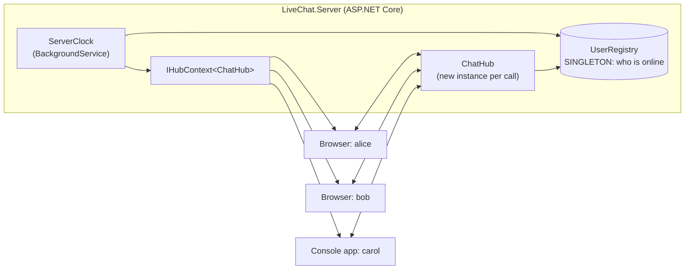

# Part 1: SignalR basics (LiveChat on one server)

## What you'll build



| Feature | Concept it teaches |
|---|---|
| Join with a name | client → server call (`invoke`), `Clients.Caller`, `Clients.Others` |
| Send to all | `Clients.All` |
| Send privately | `Clients.Client(connectionId)`, finding a user's connection |
| Online list | a **singleton** service shared by all hub calls |
| Server time every 5 s | a **BackgroundService** pushing through **`IHubContext`** |
| Console client | SignalR is not only for browsers |

## Before you start

- **Visual Studio 2022 or newer** with the **"ASP.NET and web development"** workload (Visual Studio Installer → Modify).
- **.NET 8 or newer.** Check in a terminal: `dotnet --list-sdks`. You have .NET 10 installed.
- Internet access (the web page loads the SignalR JavaScript library from a CDN).

---

## Step 1: Create the project

1. Open Visual Studio → **Create a new project**.
2. In the search box type **"ASP.NET Core Empty"** → select it (C#) → **Next**.
3. Fill in:
   - **Project name:** `LiveChat.Server`
   - **Location:** a folder outside the roulette repo, e.g. `C:\Repositories\Ehsan\Training`
   - **Solution name:** `LiveChat`
   - → **Next**
4. Additional information:
   - **Framework:** .NET 10 (if it isn't listed, choose .NET 8 or 9; everything works the same)
   - **Configure for HTTPS:** ❌ **uncheck** (keeps things simple, no certificate prompts)
   - **Enable container support:** ❌ unchecked
   - **Do not use top-level statements:** ❌ unchecked
   - → **Create**

> 🧠 **Why "ASP.NET Core Empty" and not "Console App"?**
> A SignalR **server** needs a web server (Kestrel) to accept HTTP and WebSocket connections. That's what ASP.NET Core gives you. The "Empty" template is a console app plus the web SDK: its project file says `Sdk="Microsoft.NET.Sdk.Web"` instead of `Microsoft.NET.Sdk`. You *will* build a real console app in Step 9, as a **client**.
>
> SignalR is **built into ASP.NET Core**, so the server needs **no NuGet package**.

✅ **Checkpoint:** Solution Explorer shows `LiveChat.Server` with `Program.cs`, `appsettings.json` and `Properties/launchSettings.json`.

---

## Step 2: Fix the port and run it once

1. Open **Properties → launchSettings.json**.
2. In the `"http"` profile, change `applicationUrl` to:
   ```json
   "applicationUrl": "http://localhost:5000",
   ```
3. In the toolbar, make sure the run profile is **http**, then press **F5**.

✅ **Checkpoint:** a browser opens at `http://localhost:5000` showing **Hello World!**. Stop debugging (**Shift+F5**).

> 🧠 A fixed port makes life easier: the console client in Step 9 needs to know where the server is.

---

## Step 3: The singleton, `UserRegistry`

This class remembers **who is online** (connection id → name).

Right-click the project → **Add → Class…** → `UserRegistry.cs`, and write:

```csharp
using System.Collections.Concurrent;

namespace LiveChat.Server;

// Remembers who is online: connection id -> user name.
// Registered as a SINGLETON, so every hub instance and the background service share this one object.
public class UserRegistry
{
    private readonly ConcurrentDictionary<string, string> _names = new();

    public void Add(string connectionId, string name) => _names[connectionId] = name;

    public string? Remove(string connectionId) =>
        _names.TryRemove(connectionId, out var name) ? name : null;

    public string? GetName(string connectionId) => _names.GetValueOrDefault(connectionId);

    // Returns the connection id of the first user with this name, or null.
    public string? FindConnectionId(string name) =>
        _names.FirstOrDefault(pair => pair.Value == name).Key;

    public string[] GetAllNames() => _names.Values.Order().ToArray();

    public int Count => _names.Count;
}
```

> 🧠 **Why `ConcurrentDictionary` and not `Dictionary`?**
> Many users call the hub **at the same time**, on different threads, and they all use this **one** object. A normal `Dictionary` can get corrupted when two threads change it at once. `ConcurrentDictionary` is safe for that.
>
> 🧠 Note the class is **plain**: no `static`, no private constructor. It becomes a singleton only because of **how we register it** (Step 5).

---

## Step 4: The hub, `ChatHub`

**Add → Class…** → `ChatHub.cs`:

```csharp
using Microsoft.AspNetCore.SignalR;

namespace LiveChat.Server;

public class ChatHub(UserRegistry users, ILogger<ChatHub> logger) : Hub
{
    public async Task Join(string name)
    {
        logger.LogInformation("Hub instance {Hub} uses registry {Registry}", GetHashCode(), users.GetHashCode());

        users.Add(Context.ConnectionId, name);

        await Clients.Caller.SendAsync("Welcome", $"Hi {name}! Your connection id is {Context.ConnectionId}");
        await Clients.Others.SendAsync("SystemMessage", $"{name} joined the chat");
        await Clients.All.SendAsync("OnlineUsers", users.GetAllNames());
    }

    public async Task SendToAll(string text)
    {
        var from = users.GetName(Context.ConnectionId) ?? "anonymous";
        await Clients.All.SendAsync("ChatMessage", from, text);
    }

    public async Task SendToUser(string toName, string text)
    {
        var from = users.GetName(Context.ConnectionId) ?? "anonymous";
        var toConnectionId = users.FindConnectionId(toName);

        if (toConnectionId is null)
        {
            await Clients.Caller.SendAsync("SystemMessage", $"'{toName}' is not online");
            return;
        }

        await Clients.Client(toConnectionId).SendAsync("PrivateMessage", from, text);
        await Clients.Caller.SendAsync("PrivateMessage", $"you -> {toName}", text);
    }

    public override async Task OnDisconnectedAsync(Exception? exception)
    {
        var name = users.Remove(Context.ConnectionId);
        if (name is not null)
        {
            await Clients.All.SendAsync("SystemMessage", $"{name} left the chat");
            await Clients.All.SendAsync("OnlineUsers", users.GetAllNames());
        }

        await base.OnDisconnectedAsync(exception);
    }
}
```

> 🧠 **What is a hub?**
> A class whose **public methods the clients can call** (`Join`, `SendToAll`, `SendToUser`), and through which the server **sends messages to clients** (`Clients.X.SendAsync("MessageName", data...)`).
>
> 🧠 **Who receives what:**
> | Code | Receives it | Used for |
> |---|---|---|
> | `Clients.Caller` | only the user who called this method | the welcome message, "not online" errors |
> | `Clients.Others` | everyone **except** the caller | "alice joined" (alice doesn't need to be told) |
> | `Clients.All` | everyone | chat messages, the online list |
> | `Clients.Client(id)` | one specific connection | private messages |
>
> 🧠 **The hub is created for every call.** When alice calls `Join`, SignalR creates a **new** `ChatHub`, runs `Join`, and throws it away. That's why the hub keeps **no data in fields**. It asks `UserRegistry` instead, which is passed in through the constructor (dependency injection).
>
> 🧠 `Context.ConnectionId` is the unique id of the connection that's calling. A new browser tab = a new id.
>
> 🧠 `OnDisconnectedAsync` runs automatically when a user closes the tab or loses the connection.

---

## Step 5: Register everything in `Program.cs`

Replace the content of `Program.cs` with:

```csharp
using LiveChat.Server;

var builder = WebApplication.CreateBuilder(args);

builder.Services.AddSignalR();
builder.Services.AddSingleton<UserRegistry>();

var app = builder.Build();

app.UseDefaultFiles();
app.UseStaticFiles();

app.MapHub<ChatHub>("/chat");

app.Run();
```

> 🧠 Line by line:
> - `AddSignalR()`: turns SignalR on.
> - **`AddSingleton<UserRegistry>()`**: "create **one** `UserRegistry` the first time someone needs it, and give that **same object** to everyone, for as long as the app runs." **This line is what makes it a singleton.**
> - `UseDefaultFiles()` + `UseStaticFiles()`: serve `wwwroot/index.html` when you open `http://localhost:5000`.
> - `MapHub<ChatHub>("/chat")`: clients connect to the hub at `http://localhost:5000/chat`.
> - The old `app.MapGet("/", ...)` Hello World line is gone. The web page replaces it.

---

## Step 6: The web page (the browser client)

1. Right-click the project → **Add → New Folder** → name it `wwwroot`.
2. Right-click `wwwroot` → **Add → New Item…** → search "HTML Page" → `index.html`:

```html
<!doctype html>
<html>
<head>
  <meta charset="utf-8">
  <title>LiveChat</title>
  <style>
    body { font-family: sans-serif; max-width: 700px; margin: 20px auto; }
    #log { border: 1px solid #ccc; height: 300px; overflow: auto; padding: 8px; margin-top: 10px; }
    .system { color: gray; }
    .private { color: purple; }
  </style>
</head>
<body>
  <h1>LiveChat</h1>
  <p>Server time: <b id="time">-</b> | Online: <span id="users">-</span></p>

  <div>
    <input id="name" placeholder="Your name">
    <button id="join">Join</button>
  </div>
  <div>
    <input id="text" placeholder="Message">
    <button id="sendAll">Send to all</button>
    <input id="to" placeholder="Recipient name">
    <button id="sendUser">Send privately</button>
  </div>

  <div id="log"></div>

  <script src="https://cdnjs.cloudflare.com/ajax/libs/microsoft-signalr/8.0.7/signalr.min.js"></script>
  <script src="chat.js"></script>
</body>
</html>
```

3. Right-click `wwwroot` → **Add → New Item…** → "JavaScript File" → `chat.js`:

```js
const connection = new signalR.HubConnectionBuilder()
  .withUrl("/chat")
  .build();

function show(text, cssClass) {
  const line = document.createElement("div");
  line.textContent = text;
  if (cssClass) line.className = cssClass;
  document.getElementById("log").prepend(line);
}

// Server -> client: what to do when the server sends each message
connection.on("Welcome", (text) => { show(text, "system"); });
connection.on("SystemMessage", (text) => { show(text, "system"); });
connection.on("ChatMessage", (from, text) => { show(`${from}: ${text}`); });
connection.on("PrivateMessage", (from, text) => { show(`(private) ${from}: ${text}`, "private"); });
connection.on("OnlineUsers", (names) => { document.getElementById("users").textContent = names.join(", "); });
connection.on("ServerTime", (time, count) => { document.getElementById("time").textContent = `${time} (${count} online)`; });

// Client -> server: call hub methods when buttons are clicked
document.getElementById("join").onclick = () =>
  connection.invoke("Join", document.getElementById("name").value);

document.getElementById("sendAll").onclick = () =>
  connection.invoke("SendToAll", document.getElementById("text").value);

document.getElementById("sendUser").onclick = () =>
  connection.invoke("SendToUser", document.getElementById("to").value, document.getElementById("text").value);

connection.start()
  .then(() => show("Connected to the server", "system"))
  .catch((err) => show("Could not connect: " + err, "system"));
```

> 🧠 **The two directions:**
> - `connection.invoke("Join", name)` → **client calls server**: runs `ChatHub.Join(name)` on the server. The name string must match the C# method name.
> - `connection.on("ChatMessage", (from, text) => {...})` → **server calls client**: when the server does `SendAsync("ChatMessage", from, text)`, this function runs. The arguments arrive in the same order.
>
> 🧠 Notice the handlers use `{ ... }` braces. A handler that *returns* a value means something special in SignalR ("client results"), so keep them returning nothing.

**Run it (F5) and test:**
1. Window 1 (`http://localhost:5000`): name **alice** → **Join**.
2. Open a **second window** (another browser, or a private/incognito window) at the same address: name **bob** → **Join**.
3. Bob: type "hello" → **Send to all**.
4. Bob: message "secret", recipient **alice** → **Send privately**.
5. Bob: recipient **nobody** → **Send privately**.
6. Close Bob's window.

✅ **Checkpoint:**
- Alice sees: `bob joined the chat`, `bob: hello`, `(private) bob: secret` in purple, then `bob left the chat`.
- Bob sees: `(private) you -> alice: secret` and `'nobody' is not online` (only Bob sees that, via `Caller`).
- The **Online** list updates for both when someone joins or leaves.
- "Server time" still shows `-`. That's Step 7.

---

## Step 7: A background service that pushes to everyone

**Add → Class…** → `ServerClock.cs`:

```csharp
using Microsoft.AspNetCore.SignalR;

namespace LiveChat.Server;

// Runs in the background for the whole life of the app and pushes the time to everyone every 5 seconds.
public class ServerClock(IHubContext<ChatHub> hub, UserRegistry users) : BackgroundService
{
    protected override async Task ExecuteAsync(CancellationToken stoppingToken)
    {
        using var timer = new PeriodicTimer(TimeSpan.FromSeconds(5));

        while (await timer.WaitForNextTickAsync(stoppingToken))
        {
            var time = DateTime.Now.ToString("HH:mm:ss");
            await hub.Clients.All.SendAsync("ServerTime", time, users.Count, stoppingToken);
        }
    }
}
```

Register it in `Program.cs`, under the singleton line:

```csharp
builder.Services.AddHostedService<ServerClock>();
```

> 🧠 **What's a BackgroundService?**
> Code that starts with the app and runs **in the background** for its whole life. Nobody calls it; it does its own thing (here: a loop every 5 seconds).
>
> 🧠 **Why `IHubContext<ChatHub>` and not `ChatHub`?**
> A hub only exists **during a client's call**, and here there is no client call: the **server** decides to send. `IHubContext<ChatHub>` is a singleton "remote control" for the hub that you can use from anywhere. It has the same `Clients.All` / `Clients.Client(...)` / `Clients.Group(...)`, but no `Caller` (there's no caller).
>
> 🧠 **The singleton again:** `ServerClock` asks for `UserRegistry` too, and gets **the same object** the hubs use. That's how it knows how many people are online.

✅ **Checkpoint:** run (F5), join with two windows. Every 5 seconds both show e.g. `Server time: 13:34:53 (2 online)`. Close one window: the next tick shows `(1 online)`.

---

## Step 8: Prove the singleton (and break it on purpose)

### 8a: See it in the logs
`Join` already logs the hub's and the registry's hash code (a number that identifies an object). Join with two windows, then look at the **console window** where the server runs (or VS **Output → Debug**):

```
Hub instance 21201466 uses registry 49935917
Hub instance 295723 uses registry 49935917
```

✅ **Checkpoint:** the **hub** number is different every time (a new hub per call), and the **registry** number is always the same (one singleton).

### 8b: Break it
In `Program.cs` change `AddSingleton<UserRegistry>()` to **`AddTransient<UserRegistry>()`** ("a new object every time someone asks"). Run and test again with alice and bob.

What happened when this was tested:

```
alice: OnlineUsers ["alice"]          ← each user only sees themselves
bob:   OnlineUsers ["bob"]
both:  ServerTime  (0 online)         ← the clock got its own, empty registry
bob → alice private: 'alice' is not online
```

> 🧠 Each hub call got a **brand-new, empty** registry. Alice was added to one registry, which was thrown away right after her `Join`. This is exactly why shared data must live in a **singleton** (or a database/Redis), never in the hub.

**Change it back to `AddSingleton`** before continuing.

---

## Step 9: A console app client

SignalR isn't only for browsers. Let's add a .NET client.

1. Right-click the **solution** → **Add → New Project…** → **Console App** (C#) → name `LiveChat.ConsoleClient` → same framework → **Create**.
2. Right-click the new project → **Manage NuGet Packages…** → **Browse** → install **`Microsoft.AspNetCore.SignalR.Client`**. (If your project is .NET 8 and the newest version doesn't install, pick the version that starts with 8.)
3. Replace `Program.cs`:

```csharp
using Microsoft.AspNetCore.SignalR.Client;

// Server address: the first command-line argument, or port 5000 by default.
var url = args.Length > 0 ? args[0] : "http://localhost:5000/chat";

var connection = new HubConnectionBuilder()
    .WithUrl(url)
    .Build();

// Server -> client handlers (same message names as in the browser)
connection.On<string>("Welcome", text => Console.WriteLine($"[system] {text}"));
connection.On<string>("SystemMessage", text => Console.WriteLine($"[system] {text}"));
connection.On<string, string>("ChatMessage", (from, text) => Console.WriteLine($"{from}: {text}"));
connection.On<string, string>("PrivateMessage", (from, text) => Console.WriteLine($"(private) {from}: {text}"));
connection.On<string[]>("OnlineUsers", names => Console.WriteLine($"[online] {string.Join(", ", names)}"));
connection.On<string, int>("ServerTime", (time, count) => Console.WriteLine($"[clock] {time} ({count} online)"));

await connection.StartAsync();
Console.WriteLine("Connected.");

Console.Write("Your name: ");
var name = Console.ReadLine() ?? "console";
await connection.InvokeAsync("Join", name);

Console.WriteLine("Type a message and press Enter. Start with @name for a private message. Empty line = quit.");
while (Console.ReadLine() is { Length: > 0 } line)
{
    if (line.StartsWith('@') && line.Contains(' '))
    {
        var space = line.IndexOf(' ');
        await connection.InvokeAsync("SendToUser", line[1..space], line[(space + 1)..]);
    }
    else
    {
        await connection.InvokeAsync("SendToAll", line);
    }
}

await connection.StopAsync();
```

4. Run both projects: right-click the solution → **Configure Startup Projects…** → **Multiple startup projects** → set both to **Start** (server first in the list) → OK → **F5**.

> 🧠 Compare with JavaScript:
> | JavaScript | C# |
> |---|---|
> | `connection.on("ChatMessage", (from, text) => ...)` | `connection.On<string, string>("ChatMessage", (from, text) => ...)` |
> | `connection.invoke("Join", name)` | `connection.InvokeAsync("Join", name)` |
> | `connection.start()` | `connection.StartAsync()` |
>
> In C# you state the **types** of the arguments (`<string, string>`).

✅ **Checkpoint** (real output from a test where the console user "carol" chatted with alice in the browser):

```
Connected.
Your name: carol
[system] Hi carol! Your connection id is 5kV57YnTTrV_mRSti2IDeg
[online] alice, carol
carol: hello all
[clock] 13:34:53 (2 online)
(private) you -> alice: this is private
[system] 'nobody' is not online
```

And alice's browser shows `carol: hello all` and `(private) carol: this is private`.

---

## What you learned

| Concept | Where in your code |
|---|---|
| A **hub** = methods clients call + a way to send to clients | `ChatHub` |
| Client → server | `connection.invoke("Join", ...)` / `InvokeAsync` |
| Server → client | `Clients.X.SendAsync("Name", ...)` + `connection.on("Name", ...)` |
| `Caller` / `Others` / `All` / `Client(id)` | `Join`, `SendToAll`, `SendToUser` |
| Hubs are **new per call** → no data in the hub | `ChatHub` asks `UserRegistry` |
| A **singleton** shares data between all calls | `AddSingleton<UserRegistry>()` (and Step 8b) |
| A **background service** pushes on its own | `ServerClock` |
| **`IHubContext`** = send from outside a hub | `ServerClock` |
| Connect / disconnect events | `OnDisconnectedAsync` |

## Self-check questions

Try to answer out loud first, then open the answer.

<details><summary>1. Why can't <code>ChatHub</code> keep the list of online users in a field like <code>private List&lt;string&gt; _names</code>?</summary>

A new `ChatHub` is created for **every call** and thrown away afterwards. The list would be empty every time. Shared data must live in a singleton (or a database/Redis).
</details>

<details><summary>2. What exactly makes <code>UserRegistry</code> a singleton?</summary>

The registration `builder.Services.AddSingleton<UserRegistry>()`. The DI container creates one instance and hands that same object to every hub and to `ServerClock`. The class itself is a normal class.
</details>

<details><summary>3. Why does <code>UserRegistry</code> use <code>ConcurrentDictionary</code>?</summary>

Many users call the hub at the same time on different threads, all using the one shared registry. `ConcurrentDictionary` is safe for simultaneous changes; `Dictionary` is not.
</details>

<details><summary>4. Why does <code>ServerClock</code> use <code>IHubContext&lt;ChatHub&gt;</code> instead of <code>ChatHub</code>?</summary>

A hub only exists during a client's call. A background service runs on its own, with no client call. `IHubContext` is the singleton way to send to clients from anywhere.
</details>

<details><summary>5. What's the difference between <code>Clients.Caller</code>, <code>Clients.Others</code> and <code>Clients.All</code>?</summary>

Caller = only the user who called the method. Others = everyone except that user. All = everyone.
</details>

<details><summary>6. Why is <code>Clients.Caller</code> not available in <code>ServerClock</code>?</summary>

There is no caller. Nobody called the background service; it acts on its own.
</details>

<details><summary>7. How does the browser's <code>connection.on("ChatMessage", ...)</code> get triggered?</summary>

The server runs `SendAsync("ChatMessage", from, text)`. SignalR sends a small message naming "ChatMessage" with the arguments, and the client runs the function registered under that name.
</details>

<details><summary>8. If you open two tabs as "alice", who gets a private message sent to "alice"? Why?</summary>

Only **one** of them: `FindConnectionId` returns the first connection with that name. Every tab is a separate connection. (One fix: send to a group named after the user, which Part 2 does. In real apps you'd use authentication and `Clients.User(userId)`, which reaches all of a user's connections.)
</details>

## Optional exercises

1. **Add a "Send to others" button** that uses `Clients.Others`. Who doesn't see the message?
2. **Return a value from the hub:** add `public string Ping() => "pong";` to `ChatHub`, and in the browser console (F12) run `await connection.invoke("Ping")`. What do you get back?
3. **Same name twice:** what happens to the online list and to private messages if two people join as "alice"?
4. **Uptime:** make `ServerClock` also send how long the server has been running.

## Troubleshooting

| Problem | Fix |
|---|---|
| Page shows "Could not connect" | Is the server running? Does `withUrl("/chat")` match `MapHub<ChatHub>("/chat")`? |
| Clicking Join does nothing | Press **F12 → Console** in the browser and read the error. Is the method name exactly `Join`? |
| `signalR is not defined` | The CDN script didn't load (no internet or a blocked CDN). Check the `<script src=...>` line. |
| The page shows "Hello World!" | You still have `app.MapGet("/", ...)` in `Program.cs`, or `index.html` isn't inside `wwwroot`. |
| Console client: connection refused | Start the **server** first, and check it's on port 5000 (Step 2). |
| Port 5000 already in use | Another app (e.g. the roulette server) is running. Stop it, or use another port in both `launchSettings.json` and the console client. |

**Next:** [Part 2: Scaling with Redis](part-2-scaling-with-redis.md)
