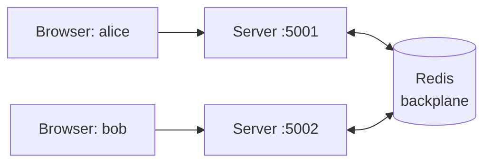

# Part 2: Scaling LiveChat with Redis

## Goal

Run LiveChat on **two servers at once**, see what breaks, then connect the servers with a **Redis backplane** so messages reach everyone.



New terms (**backplane**, **pub/sub**) are explained in [docs/extra/glossary.md](../docs/extra/glossary.md).

## Before you start

- **Part 1 finished and working.**
- **Make a copy** of your `LiveChat` folder (e.g. `LiveChat-part2`) and open the copy, so your Part 1 version stays intact.
- **Docker Desktop** installed and running (`docker --version` in a terminal).

> In real life the servers sit behind a **load balancer** at one address. Here we skip that and open each server directly by its port, so you can **choose** who is on which server.

---

## Step 1: Label the clock with the server's identity

With two servers it's useful to see **which** server sent something. In `ServerClock.cs` change the `time` line to:

```csharp
var time = $"{DateTime.Now:HH:mm:ss} from server {Environment.ProcessId}";
```

`Environment.ProcessId` is a number that's different for each running server.

---

## Step 2: See the problem (two servers, no Redis)

Open a terminal in Visual Studio (**View → Terminal**). Go to the server project folder and start it on port **5001**:

```powershell
cd LiveChat.Server
dotnet run --urls http://localhost:5001
```

Open a **second** terminal (the **+** button in the terminal panel) and start another copy on port **5002**:

```powershell
cd LiveChat.Server
dotnet run --urls http://localhost:5002
```

Now:
1. Browser window 1 → `http://localhost:5001` → join as **alice**.
2. Browser window 2 (private window) → `http://localhost:5002` → join as **bob**.
3. Bob: **Send to all** "hello everyone".
4. Bob: send privately to **alice**.

✅ **Checkpoint**: this is what happened when it was tested:

| | alice (on 5001) | bob (on 5002) |
|---|---|---|
| Online list | `alice` only | `bob` only |
| Bob's "hello everyone" | ❌ **never arrives** | ✅ sees it |
| Bob's private message to alice | ❌ | `'alice' is not online` |
| Clock | `from server 57300` | `from server 128744` |

> 🧠 **Why?** Each server only knows **its own** connections. When server 5002 runs `Clients.All.SendAsync(...)`, "All" means "all connections **on this server**". Alice is connected to the other server, so she's invisible to it. Each server also has its **own** `UserRegistry` (one singleton **per process**).

Stop both servers (**Ctrl+C** in each terminal).

---

## Step 3: Install and start Redis

In a terminal:

```powershell
docker run -d --name livechat-redis -p 6379:6379 redis:7.4-alpine
```

- `-d` = run in the background.
- `--name livechat-redis` = a name, so you can refer to it later.
- `-p 6379:6379` = make Redis reachable at `localhost:6379` (Redis's standard port).

Check it's alive:

```powershell
docker exec -it livechat-redis redis-cli ping
```

✅ **Checkpoint:** it answers `PONG`.

> No Docker? Alternatives on Windows: **Memurai** (a Redis-compatible Windows service) or Redis inside **WSL**. Anything that listens on `localhost:6379` works.

---

## Step 4: Try pub/sub by hand (what the backplane uses)

Before letting SignalR use Redis, feel how **pub/sub** works yourself. Open **two** terminals.

**Terminal A** (the listener):

```powershell
docker exec -it livechat-redis redis-cli
SUBSCRIBE news
```

**Terminal B** (the sender):

```powershell
docker exec -it livechat-redis redis-cli
PUBLISH news "hello from terminal B"
```

✅ **Checkpoint:**
- Terminal B prints **`(integer) 1`**: one subscriber received it.
- Terminal A shows the message:
  ```
  1) "message"
  2) "news"
  3) "hello from terminal B"
  ```

Now stop the listener (**Ctrl+C** in terminal A) and publish again in B:

```
PUBLISH news "anyone there?"
(integer) 0
```

> 🧠 **`0` = nobody received it, and the message is gone forever.** Redis pub/sub doesn't store messages. It only passes them to whoever is listening **right now**. That's fine for live chat updates, but it's why important data (like money) is never sent *only* through pub/sub.

Type `exit` in the redis-cli terminals when done.

---

## Step 5: Add the backplane

1. Right-click `LiveChat.Server` → **Manage NuGet Packages…** → **Browse** → install **`Microsoft.AspNetCore.SignalR.StackExchangeRedis`**. (If your project is .NET 8 or 9, pick the version with the same first number.)
2. In `Program.cs`, change the SignalR line, and add a `using` at the top:

```csharp
using LiveChat.Server;
using StackExchange.Redis;

var builder = WebApplication.CreateBuilder(args);

builder.Services.AddSignalR()
    .AddStackExchangeRedis("localhost:6379", options =>
    {
        options.Configuration.ChannelPrefix = RedisChannel.Literal("livechat:");
    });
builder.Services.AddSingleton<UserRegistry>();
builder.Services.AddHostedService<ServerClock>();
// ... rest unchanged
```

> 🧠 That's the whole backplane: **one call, no changes to the hub.** From now on, when a server sends to `All`, a group or a connection, it publishes the message to Redis. Every server is subscribed, receives it, and delivers it to **its own** users.
>
> 🧠 `ChannelPrefix` puts `livechat:` in front of every Redis channel name, so several apps can share one Redis. End it with `:`, because SignalR glues the prefix directly to the hub name.

---

## Step 6: Test again with the backplane

Start both servers again (Step 2 commands), then repeat: alice on **5001**, bob on **5002**, bob sends to all, bob sends privately to alice.

✅ **Checkpoint**: what happened when it was tested:

```
alice got SystemMessage: "bob joined the chat"                ✅ crosses servers now
alice got ChatMessage:   "bob", "hello everyone, from bob"     ✅ crosses servers now
alice got ServerTime:    "13:37:06 from server 32504"
alice got ServerTime:    "13:37:06 from server 30480"         ⚠️ the clock arrives TWICE
alice got OnlineUsers:   ["bob"]                               ⚠️ wrong: alice is missing
bob   got SystemMessage: "'alice' is not online"               ❌ private still fails
```

> 🧠 **What the backplane fixed:** messages to **All** (and to groups and connections) now reach users on **every** server.
>
> 🧠 **What it did NOT fix:** each server still has **its own memory**.
> - ⚠️ **Clock twice:** each server runs its own `ServerClock`, and both broadcasts now reach everybody.
> - ⚠️ **Online list wrong:** server 5002's registry only knows bob. When it broadcasts its list, it overwrites alice's view.
> - ❌ **Private message fails:** server 5002 looks up "alice" in **its own** registry and doesn't find her. (Sending to a connection id *would* cross servers through the backplane. The problem is that 5002 can't **find** alice's id.)
>
> **The backplane shares messages, not data.** That's the most important sentence of this part.

Keep the servers running for Step 7.

---

## Step 7: Watch the backplane at work

With both servers running and alice and bob joined, open a terminal:

```powershell
docker exec -it livechat-redis redis-cli PUBSUB CHANNELS "livechat:*"
```

✅ **Checkpoint**: something like:

```
livechat:LiveChat.Server.ChatHub:all                         ← Clients.All
livechat:LiveChat.Server.ChatHub:internal:groups              ← SignalR's own bookkeeping
livechat:LiveChat.Server.ChatHub:internal:ack:...             ← (one per server)
livechat:LiveChat.Server.ChatHub:internal:return:...
```

Now watch messages flow live:

```powershell
docker exec -it livechat-redis redis-cli PSUBSCRIBE "livechat:*"
```

Send some chat messages and watch lines appear for `livechat:LiveChat.Server.ChatHub:all`. The message content looks garbled, because SignalR packs it in a compact binary format. That's normal. **Ctrl+C** to stop.

> 🧠 These are exactly the pub/sub channels you used by hand in Step 4. SignalR just picks the channel names for you: one for "all", one per group, one per connection.

Stop both servers.

---

## Step 8: Fix private messages with groups

Idea: instead of looking up alice's connection id (only her own server knows it), put every user in a **group named after them**. Groups go through the backplane, so a message to the group `user:alice` reaches alice **wherever** she is connected.

In `ChatHub.cs`:

**In `Join`**, after `users.Add(...)`, add:

```csharp
await Groups.AddToGroupAsync(Context.ConnectionId, $"user:{name}");
```

**Replace `SendToUser`** with:

```csharp
public async Task SendToUser(string toName, string text)
{
    var from = users.GetName(Context.ConnectionId) ?? "anonymous";

    // The group "user:<name>" lives in the backplane, so this reaches the user on ANY server.
    await Clients.Group($"user:{toName}").SendAsync("PrivateMessage", from, text);
    await Clients.Caller.SendAsync("PrivateMessage", $"you -> {toName}", text);
}
```

> 🧠 We removed the "is not online" check, because one server can't know who's online on the other server. Sending to an empty group is simply ignored. (Knowing who's online across servers needs **shared data**, see "What's still broken" below.)
>
> 🧠 Bonus: if alice has **two tabs** open, both are in the group `user:alice`, so both get the message.

Start both servers again and repeat the private message test.

✅ **Checkpoint**: when it was tested:

```
alice (on 5001) got PrivateMessage: "bob", "hi alice, from bob"     ✅
bob   (on 5002) got PrivateMessage: "you -> alice", "hi alice, from bob"
```

And Redis now has a channel per user group:

```
livechat:LiveChat.Server.ChatHub:group:user:alice
livechat:LiveChat.Server.ChatHub:group:user:bob
```

---

## Step 9: The console client on the other server

The console client accepts the server address as an argument. In a new terminal, from the solution folder:

```powershell
cd LiveChat.ConsoleClient
dotnet run -- http://localhost:5002/chat
```

(The `--` means "everything after this goes to *my* program, not to `dotnet run`".)

✅ **Checkpoint**: when it was tested, "dave" on the console (server 5002) and alice in the browser (server 5001):

```
Your name: dave
[system] Hi dave! Your connection id is Qi7v02cAOOhJRFF3KCWVBA
dave: hi from the console on 5002
(private) you -> alice: psst
```
Alice's browser on 5001 received both `dave: hi from the console on 5002` and `(private) dave: psst`.

---

## What's still broken, and how real systems fix it

You don't need to fix these now. Just understand them. They're exactly the interview story from [docs/04](../docs/04-scaling-and-redis.md).

| Still broken | Why | Real-world fix |
|---|---|---|
| The clock arrives twice | every server runs `ServerClock` | **one leader**: only the server holding a Redis lock runs it |
| The online list is wrong | each server has its own `UserRegistry` | keep the list in **shared storage** (e.g. a Redis set) instead of server memory |
| (not visible here) sticky sessions | we opened each server directly by port | behind a load balancer you'd need **sticky sessions** (or WebSockets-only / Azure SignalR Service) |

## Clean up

```powershell
docker stop livechat-redis
docker rm livechat-redis
```

## What you learned

| Concept | What you saw |
|---|---|
| Each server only knows its own users | Step 2: Bob's message never reached Alice |
| Redis pub/sub = live delivery, no storage | Step 4: `(integer) 1`, then `(integer) 0` and the message was lost |
| The **backplane** = servers talk through Redis pub/sub | Step 5: one line of code |
| The backplane shares **messages**, not **data** | Step 6: the clock twice, the wrong online list |
| Groups work across servers | Step 8: private messages fixed with `user:<name>` groups |

## Self-check questions

<details><summary>1. In one sentence: what is a backplane?</summary>

A shared message channel (here Redis pub/sub) that all servers are connected to, so a message sent by one server reaches users connected to any server.
</details>

<details><summary>2. Without Redis, why didn't Bob's "send to all" reach Alice?</summary>

`Clients.All` on server 5002 means all connections **on server 5002**. Alice was connected to server 5001.
</details>

<details><summary>3. After adding the backplane, why did the clock arrive twice?</summary>

Each server runs its own `ServerClock` background service. Before, each tick only reached that server's users. With the backplane, both servers' ticks reach everyone.
</details>

<details><summary>4. After adding the backplane, why did the private message still fail?</summary>

Server 5002 looked up "alice" in its own `UserRegistry`, which only knows its own users. The message never got sent. (Sending to a connection id would have crossed servers, but 5002 couldn't find the id.)
</details>

<details><summary>5. Why does sending to the group <code>user:alice</code> work across servers?</summary>

Group messages go through the backplane. Every server receives them and delivers them to its own connections that are in that group, wherever alice is connected.
</details>

<details><summary>6. What happens to a Redis pub/sub message if no server is subscribed at that moment?</summary>

It's lost. Redis returns 0 and stores nothing. That's why pub/sub is fine for live updates but not for data you can't lose.
</details>

<details><summary>7. How would you fix the "clock twice" problem in a real system?</summary>

Make sure only **one** server runs it: leader election with a Redis lock that expires (`SET key value NX PX`). The server holding the lock runs the clock; if it dies, the lock expires and another server takes over.
</details>

## Optional stretch goals (ask me for help when you get there)

1. **A shared online list:** store users in a Redis set (`SADD` / `SREM` / `SMEMBERS`) instead of `UserRegistry`, using the `StackExchange.Redis` library directly.
2. **One clock only:** let `ServerClock` send only if it holds a Redis lock (`SET livechat:clock-leader <id> NX PX 10000`).

## Troubleshooting

| Problem | Fix |
|---|---|
| `docker: error during connect` | Docker Desktop isn't running. Start it and wait until it's ready. |
| `port is already allocated` when starting Redis | Something already uses 6379. Use `-p 6380:6379` and `localhost:6380` in `Program.cs`. |
| Server crashes at start with a Redis connection error | Redis isn't running: `docker ps` should list `livechat-redis`. |
| Messages still don't cross servers | Did you restart **both** servers after adding the backplane? Do both use the same Redis address? |
| `dotnet run --urls ...` still uses port 5000 | Run the command from inside the `LiveChat.Server` folder, and type `--urls` exactly. |
